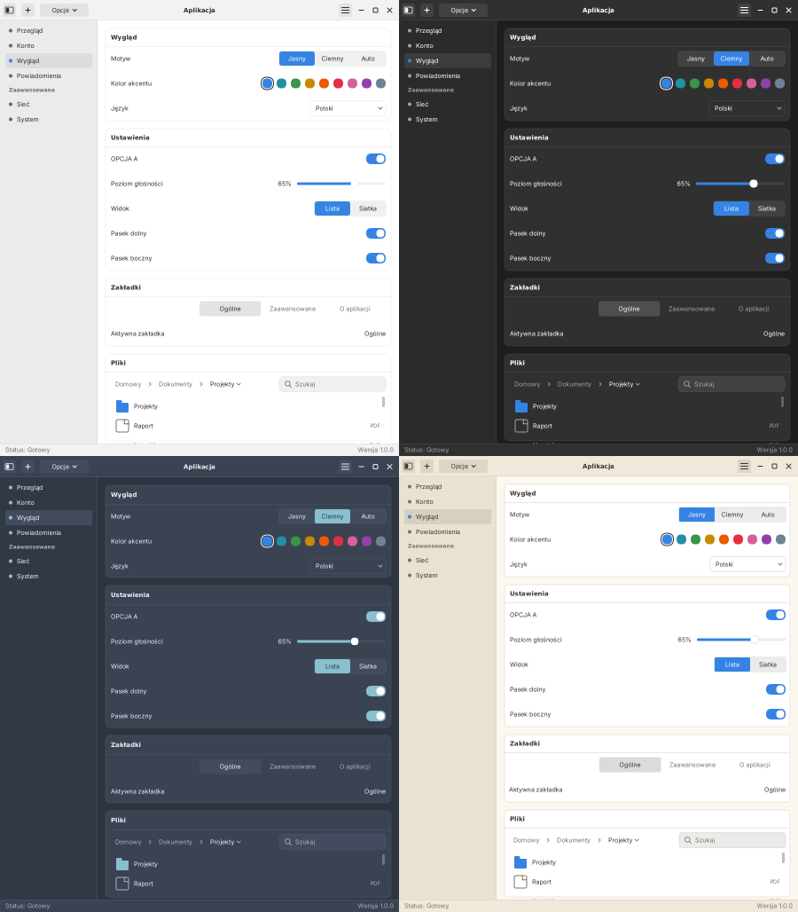
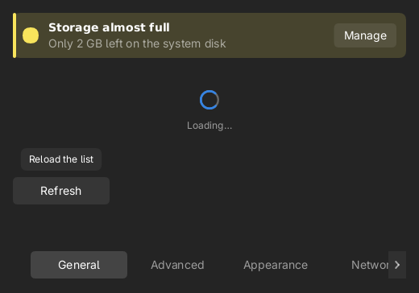
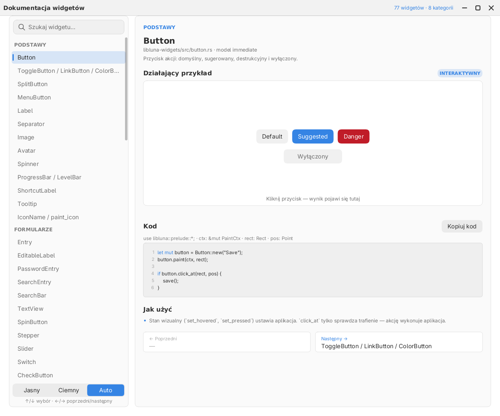
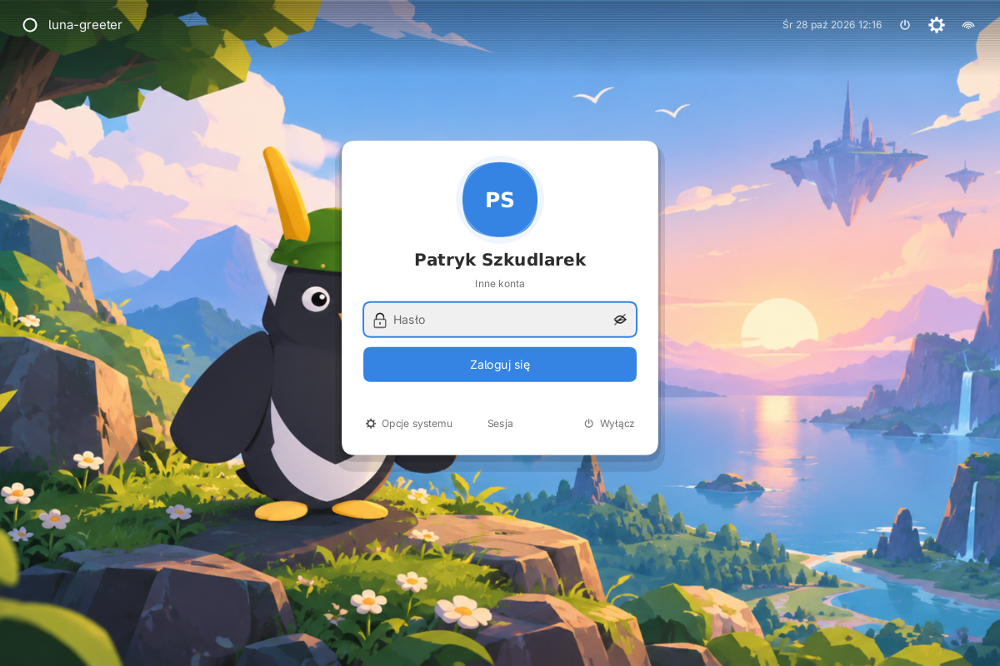
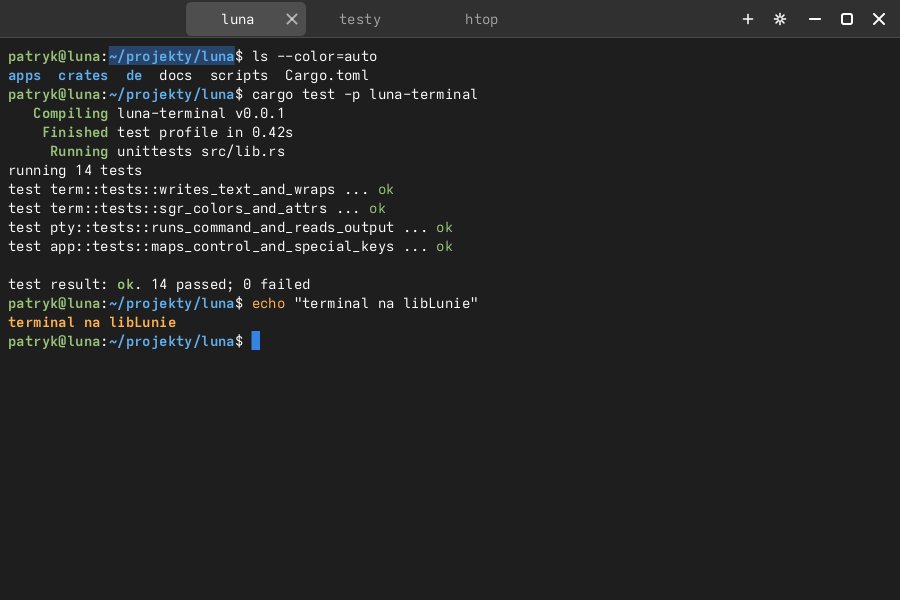
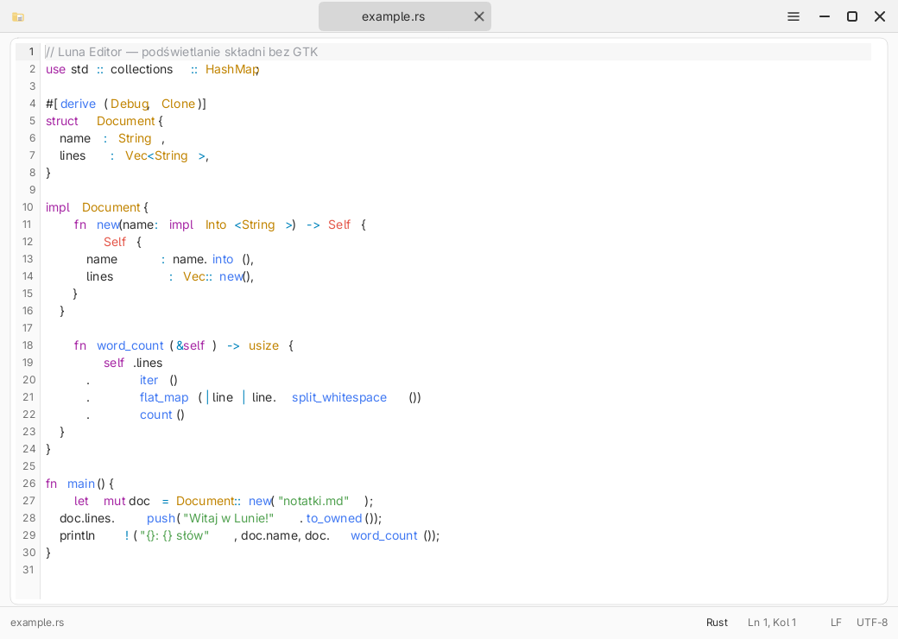
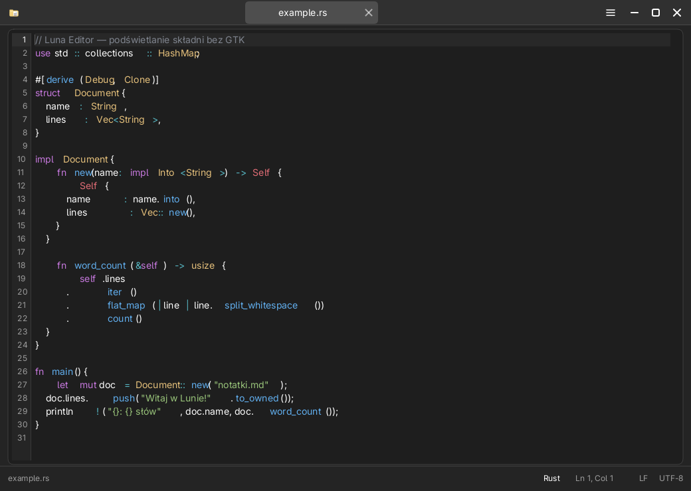
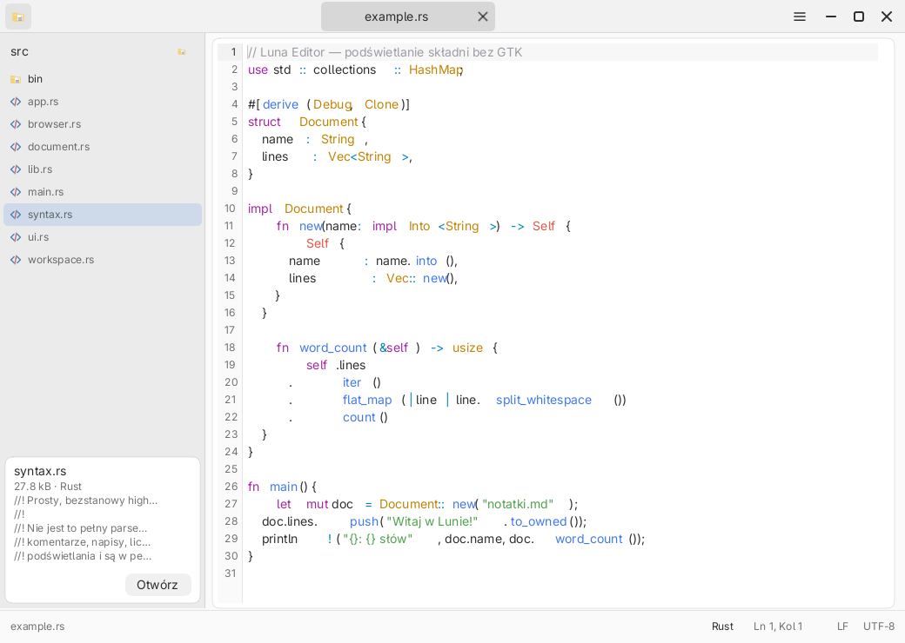
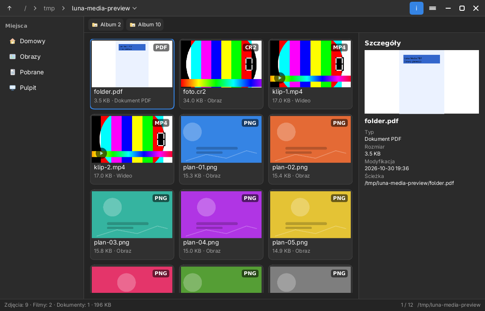
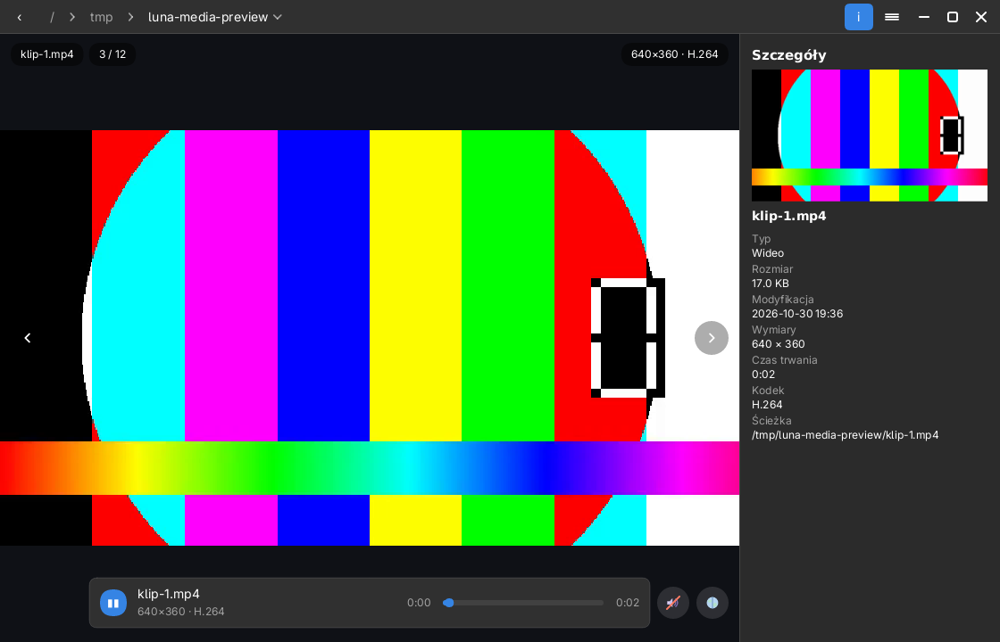

# libLuna

**English** — A lightweight, pure-Rust GUI toolkit: a from-scratch alternative to **GTK4 + libadwaita**, built for the **Luna** desktop.

**Polski** — Lekki zestaw narzędzi GUI w czystym **Rust**: alternatywa od zera dla **GTK4 + libadwaita**, tworzona dla środowiska **Luna**.


> Status: **M0 działające** — fundament, rysowanie, okno Wayland oraz **wielojęzyczność
> i przełączanie wyglądu** (tryb jasny/ciemny/auto, kolory akcentu, metryki kontrolek).
> Repozytorium: <https://github.com/mijsys/libLuna>.

## Why libLuna exists

libLuna exists because building a desktop the way we want it — small, fast, memory-safe and
coherent — is awkward with the options that already exist.

- **GTK4 + libadwaita is capable but heavy.** It drags in the GObject/glib runtime, a large C
dependency tree and manual reference counting. For a lightweight desktop that is more
machinery than the job needs.
- **The alternatives are no better fit.** Qt bindings are enormous; most Rust-native toolkits
(egui, iced, …) are render- or immediate-mode oriented and do not model desktop-shell chrome —
client-side-decorated header bars, sidebars, path bars, tabs, popovers — the way libadwaita does.
- **We want one stack, in pure Rust.** No GObject, no glib, no GTK: just Rust, a scene graph and
a CPU/Wayland backend, with predictable performance and a small binary.
- **We want the looks to be swappable.** Appearance is defined by design tokens — colors *and*
control geometry — so a theme (or a future installed style file) can reshape the UI without
touching widget code.
- **We are building a desktop, not just a widget demo.** libLuna is the UI foundation for the
**Luna** environment (Wayland compositor **Selene**), recreating the GTK4/libadwaita *look and
idioms* without the GTK/Qt bloat.

In short: libLuna is a deliberately small toolkit that gives Luna a fast, memory-safe, cohesive
UI layer it fully controls — written in the language we already build the rest of the system in.

## Dlaczego powstała libLuna

libLuna powstała, bo zbudowanie pulpitu tak, jak chcemy — małego, szybkiego, bezpiecznego
pamięciowo i spójnego — jest niewygodne przy dostępnych obecnie opcjach.

- **GTK4 + libadwaita jest możne, ale ciężkie.** Wciąga runtime GObject/glib, duże drzewo
zależności w C i ręczne liczenie referencji. Dla lekkiego pulpitu to więcej maszynerii, niż trzeba.
- **Alternatywy nie pasują lepiej.** Wiązania do Qt są ogromne; większość natywnych dla Rusta
toolkitów (egui, iced, …) jest nastawiona na render/immediate-mode i nie odwzorowuje „chrome”
pulpitu — pasków tytułu z CSD, pasków bocznych, okruszków ścieżki, zakładek, popoverów — tak jak
robi to libadwaita.
- **Chcemy jeden stos, w czystym Rust.** Bez GObject, bez glib, bez GTK: sam Rust, graf sceny
i backend CPU/Wayland, z przewidywalną wydajnością i małym rozmiarem binarki.
- **Chcemy wymienny wygląd.** Wygląd opisują tokeny — kolory *oraz* geometria kontrolek — więc
motyw (a w przyszłości instalowany plik stylu) może zmienić UI bez dotykania kodu widgetów.
- **Budujemy pulpit, nie tylko demo widgetów.** libLuna to fundament UI środowiska **Luna**
(kompozytor Wayland **Selene**), odtwarzający *wygląd i idiomy* GTK4/libadwaita — bez balastu GTK/Qt.

Krótko: libLuna to celowo mały toolkit, który daje Lunie szybką, bezpieczną pamięciowo i spójną
warstwę UI, w pełni przez nas kontrolowaną — napisaną w języku, w którym budujemy resztę systemu.

## Nazewnictwo

Wzorem GTK / GNOME / Mutter (i Qt / KDE / KWin) rozdzielamy trzy warstwy:

| Warstwa | Odpowiednik GNOME | Odpowiednik KDE | Nasza nazwa |
|---|---|---|---|
| Toolkit (biblioteka) | GTK | Qt | **libLuna** |
| Środowisko / powłoka | GNOME | KDE Plasma | **Luna** |
| Kompozytor Wayland | Mutter | KWin | **Selene** |

To repozytorium to **libLuna** (toolkit). Środowisko **Luna** (powłoka, panele, aplikacje)
i kompozytor **Selene** buduje się na nim.

## Decyzje projektowe

- **Język: czysty Rust** — bez GObject/glib i bez GTK/Qt. Stąd lekkość i bezpieczeństwo
  pamięci; integracja z powłoką odbywa się przez standardowy Wayland (`xdg-shell`,
  a dla paneli `wlr-layer-shell`).
- **Rysowanie: własny stos** — graf sceny + backend CPU (tiny-skia + fontdue). Bez Cairo/Pango.
- **Wielojęzyczność: własna, bez gettext** — kluczem jest angielski napis, więc brak
  tłumaczenia degraduje się łagodnie do angielskiego. **Każdy język to osobny plik**
  `i18n/<kod>.lang`; wbudowane: **pl, en, de**, a kolejne można dołożyć w runtime bez
  rekompilacji (katalogi `~/.config/luna/i18n`, `~/.local/share/luna/i18n`, `/usr/share/luna/i18n`).
- **Kompozytor docelowy: Selene** (Wayland) — jako zwykły klient `xdg-shell`/`wlr-layer-shell`.

## Struktura repozytorium

To **meta-repozytorium**: każdy pakiet jest osobnym workspace'em Cargo (własny
`Cargo.lock`), więc można go wydać i aktualizować niezależnie (GitHub / pakiet OS).

```
luna/                        # meta-repozytorium (dev + integracja)
  libluna/                   # TOOLKIT — [workspace], osobny pakiet/repo
    crates/
      libluna/               # fasada: jedno wejście (core + render + platform + widgets + i18n) + prelude
      libluna-core/          # geometria, kolor, skala, zdarzenia, tokeny motywu, ustawienia wyglądu
      libluna-i18n/          # wielojęzyczność: każdy język w pliku i18n/<kod>.lang + przełączanie w runtime
      libluna-render/        # graf sceny + backend software (tiny-skia + fontdue)
      libluna-platform/      # Wayland: xdg-shell (CSD), wl_shm, wejście, pętla zdarzeń, motyw w Frame
      libluna-widgets/       # widgety: ViewSwitcher, NavList, Menu, Button, Switch, Slider, DropDown, HeaderBar, TabBar/TabView, BottomSheet, Pager, PathBar, SearchEntry, ItemView, ScrollView, Stepper, CheckButton, RadioGroup, Card, ActionRow
    templates/minimal-app/   # szablon startowy aplikacji
    tools/libluna-new.sh     # scaffolder: generuje gotowy projekt aplikacji
  luna/                      # POWŁOKA — [workspace]: panel, launcher, OSD, powiadomienia, keyring/polkit
  selene/                    # KOMPOZYTOR — [workspace]: Wayland (bez smithay: wayland-server + własna pętla)
  luna-greeter/              # LOGOWANIE — [workspace]: ekran logowania (frontend greetd)
  apps/                      # APLIKACJE — każda osobny [workspace]
    luna-demo/               # dokumentacja widgetów (żywe przykłady, kod, warianty HeaderBar)
    luna-files/              # menedżer plików Luna Files
    luna-media/              # przeglądarka obrazów i filmów (ffmpeg)
    luna-editor/             # edytor tekstu i kodu z podświetlaniem składni
    luna-clock/              # zegar, minutnik, stoper, strefy i prywatny kalendarz
    luna-settings/          # centrum ustawień środowiska i systemu
    luna-store/              # sklep: pacman/pag/apt/dnf/emerge/Flatpak + aktualizacje
    luna-terminal/           # terminal: PTY + VT100/xterm, font monospace, kolory ANSI
  de/                        # integracja sesji (wspólna dla pakietów)
    README.md                # opis środowiska, Selene i nazewnictwo
    greetd/                  # przykładowa konfiguracja greetd dla Luny
    session/                 # launcher sesji, wpisy .desktop, portale XDG
  docs/                      # architektura, roadmap, zrzuty ekranu
  web/luna.paganlinux.eu/    # strona projektu + dokumentacja deweloperska (PL)
  examples/                  # przykładowe motywy i tłumaczenia
  packaging/                 # receptury PaganOS
  scripts/install.sh         # instalator całego środowiska / pojedynczego pakietu
  Makefile                   # wspólne build/test/install
```

Mapowanie pojęć GTK/GDK/Gsk/libadwaita → libLuna: [`docs/architecture.md`](docs/architecture.md).
Plan dalszej pracy: [`docs/roadmap.md`](docs/roadmap.md).
Zegar i kalendarz: [`docs/clock.md`](docs/clock.md).
Centrum ustawień: [`docs/settings.md`](docs/settings.md).
Sklep z oprogramowaniem: [`docs/store.md`](docs/store.md).
Zestaw ikon: [`docs/icons.md`](docs/icons.md).
Menedżer logowania: [`docs/greeter.md`](docs/greeter.md).
Osobne repozytoria i aktualizacja pojedynczych pakietów: [`docs/repositories.md`](docs/repositories.md).

Dokumentacja dla deweloperów: <https://luna.paganlinux.eu/docs/> — szybki start,
[koncepcje](https://luna.paganlinux.eu/docs/concepts.html),
[biblioteka 77 widgetów](https://luna.paganlinux.eu/docs/widgets.html),
[motywy](https://luna.paganlinux.eu/docs/theming.html) i
[indeks API](https://luna.paganlinux.eu/docs/api.html).
Wersja angielska: <https://luna.paganlinux.eu/en/docs/>.
Podglądy widgetów i indeks API generują się z kodu: `make web-assets`; pełne
rustdoc: `make web-api`.

## Budowanie i uruchamianie

Wymagany stabilny toolchain Rust. Jeśli go brak:

```bash
curl --proto '=https' --tlsv1.2 -sSf https://sh.rustup.rs | sh
```

```bash
# bez zależności od make (działa wszędzie):
./scripts/workspaces.sh build    # wszystkie pakiety
./scripts/workspaces.sh test     # testy (bez doctestów)
./scripts/workspaces.sh check    # szybka weryfikacja typów
./scripts/workspaces.sh test-doc # doctesty (wymaga rustdoc w PATH)
./scripts/workspaces.sh smoke    # test dymny sesji (zagnieżdżony Selene)
./scripts/workspaces.sh lock     # odśwież Cargo.lock po zmianie wersji

# albo, jeśli masz sprawne make:
make build
make test
make smoke      # test dymny sesji (zagnieżdżony Selene)
make check

# pojedynczy pakiet — tak samo jak w osobnym repozytorium:
cd libluna && cargo build
cd apps/luna-terminal && cargo build
```

`test` celowo pomija doctesty: część toolchainów (np. systemowy `rustc` na PaganOS)
nie zawiera `rustdoc`. Doctesty uruchomisz przez `test-doc` — najlepiej z toolchainem
rustup, który ma `rustdoc` w `~/.cargo/bin`.

`smoke` uruchamia **pełny przepływ sesji** na zagnieżdżonym Selene (panel, okna,
klawiatura, schowek między klientami, ekran blokady) — szczegóły i wymagania:
[`docs/testing.md`](docs/testing.md).

Pomiar rasteryzacji (baseline CPU pod decyzję o backendzie GPU):

```bash
cargo run --release --manifest-path libluna/Cargo.toml \
    -p libluna-render --example render_bench
```

Wyniki, kryteria GPU i zasady stabilności API: [`docs/rendering.md`](docs/rendering.md),
[`docs/api-stability.md`](docs/api-stability.md).

Jeśli `make` w ogóle nie startuje (`libguile-3.0.so.1: cannot open shared object file`),
to problem systemowego pakietu `make`, nie projektu: użyj `./scripts/workspaces.sh`
albo doinstaluj zależność: `sudo pag install guile`.

Oba warianty używają wspólnego `target/` (dzięki temu `scripts/install.sh` widzi
wszystkie binarki). Bezpośrednie `cargo` uruchomione w podkatalogu pakietu tworzy
własny `<pakiet>/target/` — to normalne i nie wpływa na inne pakiety.

Okno dokumentacji widgetów (wymaga kompozytora Wayland, np. Selene):

```bash
cargo run --manifest-path apps/luna-demo/Cargo.toml
```

To okno pokazuje wyłącznie stronę „Widgety”: listę komponentów, działające przykłady,
gotowy kod i noty „jak użyć”. Demo Ustawień pozostało jedynie jako narzędzia
developerskie (`render`, `simulate`, `layout`) — nie jest już interfejsem aplikacji.

Podgląd bez kompozytora — render do PNG (język, motyw i akcent do wyboru):

```bash
cargo run --manifest-path apps/luna-demo/Cargo.toml --bin render -- --lang pl docs/images/settings-light.png
cargo run --manifest-path apps/luna-demo/Cargo.toml --bin render -- --no-sidebar --sidebar-width 340 /tmp/out.png
cargo run --manifest-path apps/luna-demo/Cargo.toml --bin render -- --dark --accent purple --lang de docs/images/settings-de-dark.png
```

### Demo interaktywne bez kompozytora (headless)

Logika interakcji jest niezależna od Waylanda (bierze zdarzenia + ustawienia), więc da się
ją uruchomić bez okna. „Driver” przepuszcza **prawdziwe zdarzenia** (klik w segment motywu,
w kropkę akcentu, w pozycję nawigacji, w przełącznik widoku, w ikonę `◧`, przeciąganie
krawędzi) przez tę samą funkcję `handle_events` i renderuje klatki:

```bash
cargo run --manifest-path apps/luna-demo/Cargo.toml --bin simulate            # → docs/images/demo-step-*.png + demo-montage.png
cargo test --manifest-path apps/luna-demo/Cargo.toml --test interaction       # te same interakcje jako asercje
```


## Instalacja środowiska na PC (testowo / na stałe)

`scripts/install.sh` buduje binarki w trybie release i instaluje **środowisko Luna**
(kompozytor `selene`, powłoka `luna-shell`, sesja `luna-session`, demo, tłumaczenia, motywy,
wpis sesji Wayland, **ikonę sesji** oraz ekran logowania `luna-greeter`):

```bash
# instalacja bez roota — np. sam sklep w ~/.local
./scripts/install.sh --user --only store

# instalacja testowa do katalogu (bez ruszania systemu) — nic nie wymaga uprawnień
./scripts/install.sh --destdir /tmp/luna-test --prefix /usr

# podgląd planu bez zmian
./scripts/install.sh --dry-run

# instalacja systemowa
sudo ./scripts/install.sh --prefix /usr

# usunięcie
sudo ./scripts/install.sh --prefix /usr --uninstall

# aktualizacja TYLKO jednego komponentu (np. terminala) — bez całego środowiska
sudo ./scripts/install.sh --prefix /usr --only terminal
```

Komponenty dla `--only`: `base`, `selene`, `luna`, `greeter`, `demo`, `settings`,
`files`, `media`, `clock`, `store`, `editor`, `terminal`, `icons`. `base` instaluje tylko wspólne zasoby (sesja, tłumaczenia, motywy,
ikona, licencja), a `icons` sam pastelowy pakiet ikon (`share/icons/Luna-Icons`:
PNG 16–512 px + skalowalne SVG).

Po instalacji sesja „Luna” pojawia się w menedżerze logowania (`share/wayland-sessions/selene.desktop`),
z ikoną Luna (`share/icons/hicolor/.../apps/luna.svg` + PNG w kilku rozmiarach oraz `pixmaps/luna.png`,
rysowanymi z `assets/branding/luna.svg`). Instalator kładzie też `luna-greeter`
i `luna-greeter-session` — ekran logowania dla greetd (konfiguracja i wymagania:
[`docs/greeter.md`](docs/greeter.md)).
Na sprzęcie Selene przejmuje ekran przez DRM/KMS — trzeba **wylogować bieżący pulpit** (wolny
master DRM) i mieć dostęp do `/dev/input` (grupa `input`) dla wejścia. Testowo, obok działającej
sesji, można uruchomić `SELENE_BACKEND=nested selene` (okno na obecnym pulpicie) i podłączyć
`luna-shell`. Gdy sesja od razu wraca do menedżera logowania, sprawdź `XDG_RUNTIME_DIR` —
Selene i `luna-session` wybierają go awaryjnie same. Szczegóły: `de/README.md`.

## Budowanie własnej aplikacji na libLunie

Najszybsza droga to **fasada `libluna`** — jedna zależność zamiast czterech. Trzy sposoby:

```toml
[dependencies]
libluna = { path = "../libluna/crates/libluna" }     # monorepo / sąsiedni katalog
# libluna = { git = "https://github.com/mijsys/libLuna.git" }  # z repozytorium
# libluna = "0.0.1"                                      # z rejestru (docelowo)
```

W kodzie wystarczy `prelude`:

```rust
use libluna::prelude::*;

fn main() -> Result<(), Box<dyn std::error::Error>> {
    set_locale(Locale::from_env());
    let config = AppConfig::new("Moja apka").initial_size(800, 600);
    run(config, |frame: &mut Frame| {
        // frame.events — zdarzenia; frame.scene — graf sceny;
        // frame.theme  — motyw;    frame.measure_text(...) — pomiar tekstu
    })
}
```

### Scaffolder (najszybciej)

```bash
./libluna/tools/libluna-new.sh ~/projekty/moja-apka
cd ~/projekty/moja-apka && cargo run
```

Skrypt tworzy projekt z poprawną ścieżką do libLuny. Szablon: [`libluna/templates/minimal-app`](libluna/templates/minimal-app).

### Działający przykład

```bash
cargo run --manifest-path libluna/Cargo.toml -p libluna --example minimal
```

> Uwaga: na tym etapie (przed M2) aplikacja wypełnia **graf sceny** ręcznie. Gdy wejdą
> layout i drzewo widgetów, ten sam `run(...)` przyjmie deklaratywne drzewo — kod aplikacji
> stanie się jeszcze krótszy.

## Sterowanie w dokumentacji widgetów

- **Pasek tytułu (CSD)** — przeciągnij za tytuł, aby przesunąć okno; kontrolki
  `[—][□][✕]` minimalizują, maksymalizują i zamykają okno.
- **Lista widgetów** — wyszukiwarka filtruje po nazwie, opisie, źródle i kategorii;
  klik wybiera widget, a `↑/↓`, `Home/End` i `←/→` przechodzą po liście.
- **Działający przykład** — klikaj, przeciągaj i pisz w podglądzie. Widgety ze stanem
  są oznaczone `INTERAKTYWNY`; pozostałe mają podgląd `PODGLĄD`.
- **Kod** — jest zawsze widoczny; „Kopiuj kod” wysyła go do systemowego schowka.
- **Jak użyć** — nota o stanie i metodach `*_at` dla wybranego widgetu.
- **Motywy** — przełącznik `Jasny | Ciemny | Auto` w stopce listy; wybór jest zapisywany
  do `~/.config/luna/theme.conf`. Tryb `Auto` czyta `LUNA_SYSTEM_DARK=1`.
- **Pola tekstowe** — `Ctrl+C/X/V` działa w wyszukiwarce i polach przykładów;
  `Esc` zdejmuje fokus.
- **HeaderBar** — wpis w kategorii „Okna” pokazuje cztery warianty paska tytułu
  (klasyczny, tytuł z lewej, kontrolki z lewej, z akcjami) i pozwala klikać kontrolki okna.

## Własny wygląd (motywy)

Wygląd libLuny to **tokeny**, nie kod widgetów — dlatego „odejście od Adwaty” to głównie
podmiana zestawu tokenów, a nie przepisywanie komponentów. Wygląd opisują trzy warstwy:

1. **Wariant** — `Ciemny / Jasny / Auto` (`ThemePreference`).
2. **Kolor akcentu** (`Accent`, 9 kolorów).
3. **Geometria kontrolek** (`Metrics`) — rozmiary i paddingi widgetów.

Wszystkie tokeny (odstępy, promienie, typografia, **metryki kontrolek**, paleta) żyją
w `Theme` w `libluna-core`. Zmiana wariantu i akcentu jest natychmiastowa, a wybór zapisuje się
w `~/.config/luna/theme.conf`.

### Component metrics

Rozmiary i paddingi kontrolek nie są już stałymi w widgetach, lecz **tokenami**
(`Theme::metrics`) podzielonymi na sekcje per widget: `headerbar`, `button`, `switch`,
`slider`, `dropdown`, `menu`, `nav`, `segmented`, `tabs`, `sheet`, `pager`, `pathbar`, `entry`,
`itemview`, `scrollview`, `stepper`, `check`, `radio`, `card`, `row`, `toast`, `status`. Dzięki temu wygląd steruje **także
geometrią**, nie tylko kolorami — np. `theme.metrics.switch.width` albo
`theme.metrics.headerbar.height`. Widgety czytają te wartości w `paint`/`layout`, więc
przyszły, instalowany styl może zmienić np. wysokość paska tytułu czy rozmiar przełącznika
bez dotykania kodu.

### Style instalowane z plików (jak w GNOME/KDE)

Wygląd można wybrać nie tylko enumatorem w kodzie, lecz **stylem zainstalowanym jako plik**.
Style to pliki `*.theme` w katalogach (kolejność = priorytet):
`~/.config/luna/themes`, `~/.local/share/luna/themes`, `/usr/share/luna/themes`.

Format jest liniowy (`klucz = wartość`, `#` = komentarz), z **kropkowymi kluczami**:

```ini
__name__ = Nord          # nazwa w UI
appearance = dark        # light | dark (wybiera bazową paletę)
colors.card_bg = #3b4252
colors.text = #eceff4
accent = teal
radius.small = 5
metrics.button.height = 36
metrics.headerbar.height = 48
```

Klucze pokrywają `colors.*`, `spacing.*`, `radius.*`, `typography.*.size` i `metrics.*`
(np. `metrics.switch.width`) — **styl steruje więc nie tylko kolorami, ale i geometrią**.
Nieznane klucze są ignorowane (zgodność wprzód). Wczytuje/nakłada to
`libluna_core::theme_file` (`ThemePatch`), a wybrany styl zapisuje się w `theme.conf`
(`style = <nazwa>`). Przykłady: `examples/luna/themes/nord.theme`, `paper.theme`.

Podgląd (headless) tego samego okna w stylach:

```sh
cargo run --manifest-path apps/luna-demo/Cargo.toml --bin render -- --theme examples/luna/themes/nord.theme docs/images/settings-nord.png
cargo run --manifest-path apps/luna-demo/Cargo.toml --bin layout -- --theme examples/luna/themes/nord.theme --out docs/images/layout-nord.png
```

Do zrobienia pozostaje **okno podglądu na żywo** wewnątrz aplikacji (miniatura aktualizowana przy
przewijaniu listy). Sam wybór stylu działa już w demo: **menu `☰` → „Styl”** otwiera listę
(„Domyślny” + style z plików), a wybór jest natychmiast stosowany i zapisywany w `theme.conf`.
Headlessowy podgląd (montaż motywów) to `cargo run --manifest-path apps/luna-demo/Cargo.toml --bin styles` →
`docs/images/styles.png`. W headless demo/testach katalog ze stylami wskazuje `LUNA_THEMES_DIR`.

### Co jeszcze decyduje o „looku GTK4”

Tokeny zmieniają kolory i geometrię kontrolek, ale o tym, czy okno „wygląda jak z GTK4”,
decyduje też **chrome okna**: umiejscowienie kontrolek (`[—][□][✕]`), wyrównanie tytułu,
zaokrąglone narożniki, cień. To warstwa widgetu `HeaderBar` (opcje `ControlsSide`,
`TitleAlign`, `ControlsLayout`) — dzięki temu stronę kontrolek czy wyrównanie tytułu można
zmienić bez przepisywania aplikacji. Rozmiar samych kontrolek okna jest już tokenem
(`theme.metrics.headerbar.control`).

## Dodawanie i edycja języków

Każdy język to **jeden plik** `libluna/crates/libluna-i18n/i18n/<kod>.lang`. Format:

```
__name__ = Français          # natywna nazwa języka w UI (opcjonalne)
Appearance = Apparence       # klucz (angielski) = tłumaczenie
# linie zaczynające się od # to komentarze
```

- Wbudowane pliki (`pl`, `en`, `de`) są wkompilowane przez `include_str!`.
- Kolejne języki wystarczy wrzucić jako `<kod>.lang` do `~/.config/luna/i18n`,
  `~/.local/share/luna/i18n` lub `/usr/share/luna/i18n` — zostaną **doładowane przy starcie**
  (nadpisują wbudowane; brakujące klucze spadają do angielskiego).
- Demo przełącza się między wszystkimi wykrytymi językami (klawisz `g` lub klik w „Język”).

Przykładowy, kompletny plik francuski jest w `examples/luna/i18n/fr.lang`:

```bash
XDG_CONFIG_HOME="$PWD/examples" cargo run --manifest-path apps/luna-demo/Cargo.toml --bin render -- --lang fr /tmp/fr.png
```

## Co już działa (M0 + i18n/wygląd)

- `libluna-core`: `Point/Size/Rect/Insets`, `Color` (sRGB, hex), `Scale`, zdarzenia, tokeny
  motywu (`Spacing`, `Radius`, `Typography`), **metryki kontrolek** (`Metrics`) oraz
  **ustawienia wyglądu** (`ThemePreference`, `Accent`, `ThemeSettings` z trwałością
  i rozwiązywaniem `light/dark`), a także **style instalowane z plików** (`theme_file`:
  `ThemePatch`, skanowanie katalogów `available_themes()`). Animacje: `motion` (`Easing`,
  `lerp`, `Animation`) — matematyka ruchu i animowany skalar, bez stanu w widgetach.
- `libluna-i18n`: `Locale` (z `LANG`/`LC_*`), `Catalog`, `Translations`, globalne `tr`/`set_locale`,
  makro `t!` z podstawianiem argumentów, **języki z osobnych plików** `i18n/<kod>.lang`
  (wbudowane) oraz **doładowywane w runtime** z katalogów; `languages()` i `language_name()`.
  **Zmiana języka w Ustawieniach działa od razu** we wszystkich procesach na libLunie
  (`libluna-platform` obserwuje `locale.conf` i przeładowuje katalogi).
- `libluna-render`: graf sceny (prostokąty, zaokrąglenia, obramowania, linie, clip, tekst,
  **obrazy** `Scene::image`/`ImageData`) i rasteryzator CPU z antyaliasingiem; tekst przez
  `fontdue` (font Adwaita Sans).
- `libluna-platform`: okno `xdg-shell` z CSD, bufor `wl_shm`, pętla `calloop`, **zdarzenia
  wejścia** (wskaźnik, klawiatura, scroll) w `Frame`, odświeżanie na żądanie, zarządzanie
  motywem przez `Frame::set_preference` / `set_accent` (zapis + natychmiastowe przerysowanie).
  `Frame::close/minimize/toggle_maximize` to **realne akcje okna** (`xdg_toplevel`),
  a `Frame::set_title` pozwala zmienić tytuł okna bez restartu (np. po zmianie języka).
  **Klatki animacji**: aplikacja czyta `Frame::delta_time()` i woła `Frame::request_frame()`,
  dopóki trwa animacja — okno odświeża się wtedy płynnie (~60 Hz), a bez tego tylko na zdarzenia.
- `libluna-widgets`: **widgety wielokrotnego użycia** w modelu immediate — `ViewSwitcher`
  (segmentowy), `NavList` (menu nawigacji z sekcjami), `Menu` (popover `☰`), `Button`
  (z wariantami i chevronem), `Switch`, `Slider`, `DropDown` (z rozwinięciem przez `Menu`),
  `HeaderBar` (pasek tytułu: tytuł, kontrolki okna, obszar na treść), `TabBar`/`TabView`
  (pasek zakładek i model stron: wybór, dodawanie, zamykanie; przy przepełnieniu przewijany
  z przyciskami na krawędziach), `BottomSheet` (dolny panel
  modalny z „grabberem”, przeciąganiem i zamykaniem), `Pager` (karuzela stron z kropkami),
  `PathBar` (okruszki z separatorem `›`, wskaźnikiem `▾` i zwijaniem do `…`), `Entry`
  (pole tekstowe: kursor, edycja, **zaznaczanie** i schowek — `select_all`/`copy`/`cut`/`paste`,
  Shift+strzałki/Ctrl+A, opcjonalna ikona wiodąca i czyszczenie; to samo w `TextView`)
  — z `SearchEntry`
  jako jego wyszukiwarkową nakładką (lupka + czyszczenie), `ItemView` (pliki/katalogi w siatce lub
  liście, z zaznaczaniem i przewijaniem) i `ScrollView` (pionowe przewijanie: rolka + „kciuk”)
  oraz `Stepper`, `CheckButton` i `RadioGroup` (krokowiec, pole wyboru, wybór jednokrotny),
  a także `Card` (karta z nagłówkiem), `ActionRow` (wiersz ustawień), `Toast` (powiadomienie
  nakładkowe z akcją, np. „Cofnij”), `StatusPage` (ekran stanu: ikona, tytuł, opis, akcja —
  używany jako „pusty stan” listy), `Spinner` (wskaźnik zajętości — obracający się łuk),
  `Tooltip` (dymek podpowiedzi) i `Banner` (pasek komunikatu info/ostrzeżenie/błąd z akcjami)
  oraz wspólny `PaintCtx`.
- `libluna-widgets` — **galeria w duchu libadwaita** (dalszy zestaw): `Avatar`, `ShortcutLabel`,
  `ToggleGroup`, `SplitButton`, `Bin`; rodzina wierszy `Row` (`switch`/`combo`/`expander`/`entry`/
  `password`/`spin`/`slider`/`button`/`nav`) oraz `PreferencesGroup`/`PreferencesPage`;
  `Dialog`, `AlertDialog`, `AboutDialog`, `ShortcutsDialog`, `PreferencesDialog`; nawigacja
  `NavigationView`, `NavigationSplitView`, `OverlaySplitView`, `Sidebar` (`Carousel` = alias
  `Pager`); pomocniki `ToolbarView`, `WindowTitle`, `Clamp`, `WrapBox`, `BreakpointBin`,
  `ButtonContent`.
- `libluna-widgets` — **galeria GTK4** (kolejny zestaw): prezentacja `Label`, `Separator`,
  `ProgressBar`, `LevelBar`, `Frame`, `Revealer`, `Overlay`, `AspectFrame`; przyciski
  `ToggleButton`, `LinkButton`, `ColorButton`; pola specjalne `PasswordEntry` (maskowanie +
  podgląd „oko”) i `EditableLabel`; kontenery `CenterBox`, `Grid`, `Fixed`, `Paned`
  (przeciągany separator), `Stack`, `ActionBar`, `PopoverMenuBar`; oraz `MenuButton`,
  `SearchBar`, `Expander`, `Statusbar`, `Calendar`, `Image` (ikony wektorowe),
  `TextView` (pole wielolinijkowe), `Popover` (generyczny), `ColumnView` (tabela),
  `Assistant` (kreator kroków), `Scrollbar`/`Adjustment` (przewijanie w obu osiach),
  `ColorChooser` (paleta), `FlowBox` (zawijająca siatka z wyborem), `SpinButton` (pole liczbowe),
  `EmojiChooser` (siatka emoji), `NavigationRail` (kompaktowa szyna nawigacji),
  `Viewport`, `WindowHandle` (obszar chwytu okna);
  aliasy `ScrolledWindow` = `ScrollView`,
  `StackSwitcher` = `ViewSwitcher`, `Notebook` = `TabView`, `ListBox` = `NavList`.
  **Animacje wcielone w widgety**: przejścia `Stack` (slide/fade przez `StackTransition`),
  płynny `Revealer`, `Toast` (wjazd + fade), `BottomSheet` (wysuwanie), `Pager` (animowane
  przyciąganie do strony) — sterowane z aplikacji przez `advance(dt, …)`.
- `libluna-widgets::layout`: **dwuprzebiegowy układ** (retencyjne drzewo `measure`/`allocate`) —
  [`Node`] (`VBox`/`HBox`, `Padding`, `Expanded`, `Center`, `Spacer`, `Label`, `Fixed`),
  [`Constraints`](min/max) i [`Layout`](`desired_size`/`fit`). Liście pochłaniają nadmiar
  (`Expanded`/`Spacer`), `Label` mierzy się realną czcionką.
- `luna-demo`: `HeaderBar` jako widget (tytuł + `[—][□][✕]` po prawej + treść: `◧`, `+`,
  „Opcje ▾”, `☰`); karty i wiersze ustawień rysowane widgetami (`Card`, `ActionRow`);
  **popover `☰`**, chowany i rozciągany (drag) panel boczny (`NavList`),
  chowany **pasek dolny**, wybór motywu/widoku (`ViewSwitcher`), `Switch`, `Slider`, `DropDown`,
  **zakładki** (`TabBar` + `TabView`) oraz **dolny panel** (`BottomSheet` z karuzelą `Pager`,
  otwierany z menu `☰` → „O aplikacji”), a także kartę **Pliki** (`PathBar` + `SearchEntry` +
  `ItemView` — przełącznik **Widok: Lista | Siatka** zmienia tryb widoku elementów; wyszukiwanie
  **filtruje** elementy, a brak wyników pokazuje `StatusPage` „Brak wyników” z akcją „Wyczyść”).
  Zmiana **koloru akcentu** wyświetla `Toast` z akcją **„Cofnij”**.
- Rozmiary i paddingi kontrolek są **tokenami** (`Theme::metrics`), więc geometria jest tak samo
  „stylowalna” jak kolory — nie ma już stałych typów w widgetach (`HeaderBar::HEIGHT`,
  `Switch::WIDTH`, `Button::HEIGHT`…).

## Układ (measure/allocate)

Prostokąty można liczyć ręcznie, ale `libluna-widgets::layout`
daje **retencyjne drzewo**: aplikacja składa [`Node`], silnik robi **pomiar** (`measure`, względem
`Constraints` min/max) i **rozmieszczenie** (`allocate`) — dwuprzebiegowo, jak w klasycznych
toolkitach. Kontenery: `VBox`/`HBox` (odstęp `gap`), `Padding`, `Expanded`/`Spacer` (pochłaniają
nadmiar wzdłuż osi), `Center` (naturalny rozmiar wyśrodkowany). Liściami są `Fixed`, `Label`
(mierzy się czcionką) i `Spacer`; `Node::visit` pozwala obejść drzewo z prostokątami, a
`Layout::fit` zwraca prostokąty liści w kolejności DFS. **Demo Ustawień** używa już tego silnika
(karty i ich wiersze w `ui::layout`).

Minimalny przykład (`apps/luna-demo/src/bin/layout.rs`) buduje kartę ustawień **wyłącznie**
z drzewa i renderuje ją headless:

```sh
cargo run --manifest-path apps/luna-demo/Cargo.toml --bin layout     # → docs/images/layout.png
```

## Zrzuty ekranu

Jasny i ciemny motyw (Luna) oraz wersja niemiecka z fioletowym akcentem i francuska
z pliku doładowanego w runtime:


Style instalowane z plików (`examples/luna/themes/nord.theme`, `paper.theme`) — kolor **i geometria**:


Podgląd kilku motywów (headless, `cargo run --manifest-path apps/luna-demo/Cargo.toml --bin styles`) — ten sam realny
interfejs w każdym stylu:



Nowe widgety — `Banner`, `Spinner`, `Tooltip` (`cargo run --manifest-path apps/luna-demo/Cargo.toml --bin widgets`):



Galeria deweloperska — **wszystkie widgety** libLuny w formie dokumentacji. Lista z
wyszukiwarką po lewej, po prawej działający przykład (kliknięcia i klawiatura),
zawsze widoczny kod użycia z przyciskiem „Kopiuj kod” oraz nota „Jak użyć”
(`cargo run --manifest-path apps/luna-demo/Cargo.toml --bin gallery` albo pozycja
„Widgety” w demo; wybrany widget: `-- Slider /tmp/slider.png`):



Ekran logowania Luna (`luna-greeter`) — frontend greetd na tapecie: górny pasek
(data, zasilanie, ustawienia, sieć), wąska karta z awatarem, polem hasła i stopką
(`Opcje systemu` · `Sesja` · `Wyłącz`) oraz osobny ekran akcji systemowych
(wyłączenie, restart, tryb awaryjny, konsola). Obsługuje PAM przez daemon i wybór
sesji/kompozytora (Wayland/X11). Tapetę, motyw i zegar zmienia się w
**Ustawienia → Ekran logowania** (`/etc/luna/greeter.conf`; szczegóły:
[`docs/greeter.md`](docs/greeter.md)):



Terminal Luny (`luna-terminal`) — emulator VT100/xterm na libLunie, bez GTK/VTE:
`posix_openpt` + `fork`/`exec`, scrollback, 16/256/truecolor, kursory aplikacji,
tryb alternatywny (`vim`, `less`, `htop`), zakładki, zaznaczanie i schowek
(`Ctrl+Shift+C`/`V`) oraz Ustawienia kolorystyki i pisma (`Ctrl+,`).
Szczegóły: [`docs/terminal.md`](docs/terminal.md).



Edytor tekstu i kodu (`luna-editor`) — lekki edytor na `CodeView` z libLuny:
zakładki w headerbarze, numery linii, podświetlanie składni (Rust, TOML, JSON,
Markdown, Shell, C/C++, Python, HTML/XML, CSS, JavaScript/TypeScript, PHP, YAML),
zaznaczanie i schowek, undo/redo, wyszukiwanie (`Ctrl+F`), „Idź do linii” (`Ctrl+G`),
wbudowany manager plików oraz panel projektu z podglądem plików (`Ctrl+B`), menu
kontekstowym i tworzeniem/zmianą nazwy/usuwaniem plików. Ustawienia (`Ctrl+,`)
zapisują szerokość tabulatora, auto-wcięcie i opcje drzewa w
`~/.config/luna/editor.conf`. Zachowuje końce linii (LF/CRLF) i zapisuje atomowo.
Otwieranie działa też z Plików („Otwórz za pomocą”) oraz z linii poleceń:
`luna-editor plik.rs`. Szczegóły: [`docs/editor.md`](docs/editor.md).







Przeglądarka multimediów (`luna-media`) — galeria obrazów, RAW-ów, filmów i PDF-ów,
podgląd z zoomem, pokaz slajdów, odtwarzacz wideo z dźwiękiem oraz czytnik PDF
ze zmianą stron i zaznaczaniem tekstu. Obrazy PNG/JPEG/SVG dekodujemy natywnie,
RAW-y przez osadzony podgląd JPEG lub pełną demozajkę `dcraw_emu`, pozostałe
formaty i filmy — przez `ffmpeg`; strony PDF renderuje poppler, a dźwięk idzie do
PipeWire/PulseAudio (`pw-play`/`paplay`).
Szczegóły: [`docs/media.md`](docs/media.md).





Przebieg interakcji (headless `simulate`) — m.in. menu `☰`, dolny panel, powiadomienie (`Toast`)
karta 12 i ekran stanu („Brak wyników”) klatka 14:


Karta ustawień złożona z drzewa układu (`measure`/`allocate`):


## Motywacja i kontekst

Środowisko **Luna** (kompozytor **Selene**) ma docelowo zastąpić GTK4/libadwaita w aplikacjach
i ujednolicić warstwę UI w czystym Rust. Bazą jest tu **libLuna**; dotychczasowy świat KartONDE
(powłoka `karton-shell`, aplikacje `karton-settings`/`karton-files`) migruje na libLunę.

## Licencja

**libLuna** jest dostępna na licencji **Mozilla Public License 2.0** (`MPL-2.0`).
Pozostałe komponenty projektu (Luna, Selene i aplikacje) są objęte licencją
**GNU General Public License v3.0 lub nowszą** (`GPL-3.0-or-later`), chyba że
dany pakiet stanowi inaczej. Pełny tekst MPL-2.0: [`LICENSE`](LICENSE);
każdy komponent ma też własny plik `LICENSE`
(np. [`libluna/LICENSE`](libluna/LICENSE), [`apps/luna-files/LICENSE`](apps/luna-files/LICENSE)).

Demo i dokumentacja widgetów libLuny (`apps/luna-demo`) oraz strona projektu są
objęte MPL-2.0 razem z biblioteką. Pełny tekst GPLv3:
<https://www.gnu.org/licenses/gpl-3.0.html>.

© 2026 Mijagi Kutasamoto / Luna Project.
