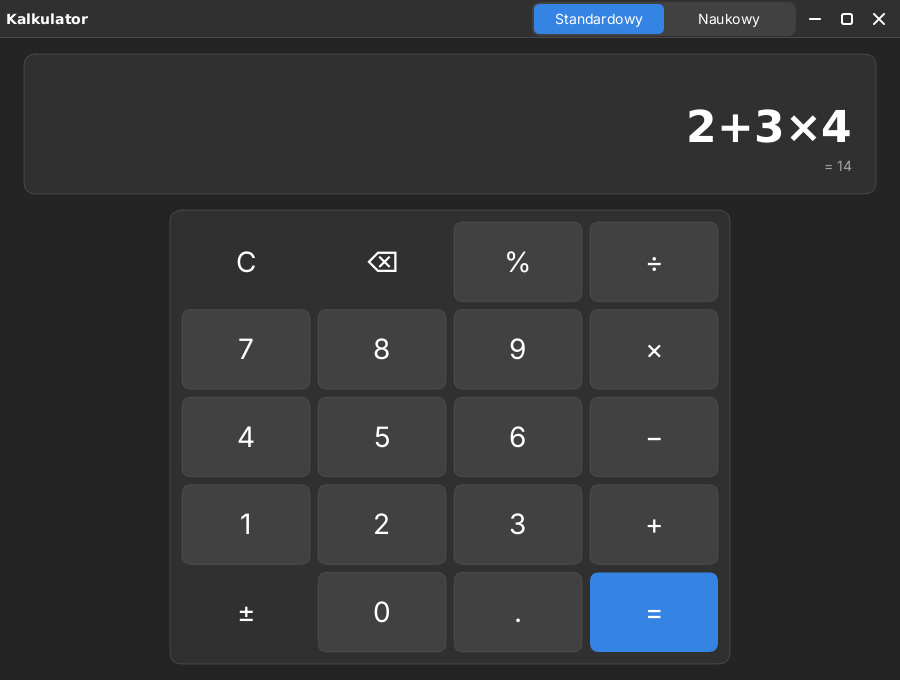
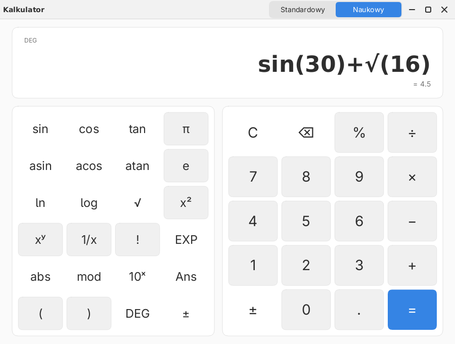

# Luna Calculator (`luna-calculator`)

Kalkulator standardowy i naukowy środowiska Luna na libLunie. Cała arytmetyka
wykonuje się lokalnie w aplikacji — bez GTK, bez bazy danych i bez sieci.





## Funkcje

- **Standard** — cztery działania, procenty, zmiana znaku, nawiasy i pamięć
  ostatniego wyniku (`Ans`).
- **Naukowy** — trygonometria (`sin`, `cos`, `tan` oraz funkcje odwrotne),
  logarytmy (`ln`, `log`), pierwiastki, potęgi, silnia, odwrotność, `π`, `e`,
  notacja naukowa (`EXP`, `10ˣ`) i przełącznik `DEG`/`RAD`.
- **Podgląd na żywo** — wynik pojawia się pod wyrażeniem jeszcze przed `=`.
- **Klawiatura** — cyfry, operatory, `Enter` (=), `Backspace`, `Esc` (czyść),
  `Ctrl+C` (kopiuj wynik), `Ctrl+V` (wklej wyrażenie).
- **Niejawne mnożenie** — `2π`, `3(4+5)` i `2sin(30)` działają bez dodatkowego `×`.
- **Procent i modulo** — `%` jest postfiksowe (`50%` = `0.5`), a `mod` liczy resztę
  z dzielenia (`7 mod 3` = `1`).

## Uruchamianie

```sh
cargo run --manifest-path apps/luna-calculator/Cargo.toml
cargo run --manifest-path apps/luna-calculator/Cargo.toml -- --scientific
cargo test --manifest-path apps/luna-calculator/Cargo.toml --lib
cargo run --manifest-path apps/luna-calculator/Cargo.toml --bin preview
```

## Skróty

| Klawisz | Działanie |
|---|---|
| `0`–`9`, `.` | wpisywanie liczby |
| `+`, `-`, `*`, `/`, `^`, `%`, `!` | operatory |
| `(` `)` | nawiasy |
| `Enter` | oblicz (`=`) |
| `Backspace` | usuń ostatni znak lub całą funkcję (`sin(`) |
| `Esc`, `Delete` | wyczyść wyrażenie |
| `Ctrl+C` | skopiuj wynik |
| `Ctrl+V` | wklej wyrażenie |

## Prywatność

Aplikacja nie zapisuje historii, nie zna konta użytkownika i nie wykonuje
żadnych zapytań sieciowych. Stan (tryb, kąt, ostatni wynik) żyje tylko w pamięci
procesu i znika po zamknięciu okna.

## Licencja

GNU GPL v3.0 lub nowsza (`GPL-3.0-or-later`) — pełny tekst w [`LICENSE`](LICENSE).
© 2026 Luna Project.
