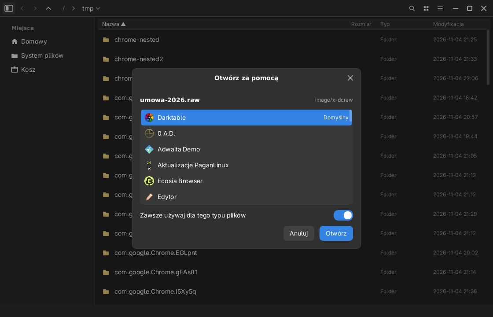

# Luna Files (`luna-files`)

Pierwsza „duża” aplikacja uniwersum Luna: menedżer plików zbudowany **wyłącznie na
libLunie** (`libluna-platform` + `libluna-widgets`), bez GTK, uruchamiany na
kompozytorze Selene.

Dostępne binarki:

| Binarka | Opis |
|---|---|
| `luna-files` | podstawowa nazwa aplikacji (okno „Pliki”) |
| `gaminedes` | alias — ta sama aplikacja, inna nazwa okna i App ID |

## Co już działa

**Nawigacja i widok**
- breadcrumb z klikalnymi segmentami, `Ctrl+L` — edycja ścieżki, `Backspace` — w górę,
  `Alt+←/→` — historia, przyciski myszy Back/Forward;
- **lista z kolumnami** (Nazwa / Rozmiar / Typ / Modyfikacja) i klikalnymi nagłówkami
  sortowania (strzałka pokazuje kierunek), **siatka** kafelków z ikonami typów plików;
- sortowanie (nazwa/rozmiar/data/typ, rosnąco/malejąco), ukrywanie plików (`Ctrl+H`),
  filtr na żywo (`Ctrl+F`), panel boczny chowany `F9`;
- zakładki (`Ctrl+T`, `Ctrl+W`, `Tab`), widok dzielony (`F3`), podgląd pliku
  (`Space` lub menu → „Podgląd”: tekst/kod, PNG i **JPEG**; dla reszty metadane);
- **kafelki z uciętymi nazwami** (wielokropek, bez nachodzenia na sąsiednie kafelki)
  i **dymek z informacjami** po chwili najechania (nazwa, typ, rozmiar, data, ścieżka);
- **przeciąganie plików** myszą: upuszczenie na folder (w tym na drugi panel),
  miejsce w panelu bocznym, zamontowany nośnik albo Kosz przenosi zaznaczenie;
  `Ctrl` podczas przeciągania kopiuje, a cel jest podświetlany (Kosz na czerwono);
- **przeciąganie poza okno** (Wayland DnD): gdy przeciąganie opuści okno, pliki
  idą do kompozytora jako `text/uri-list` + `text/plain` (`file://…`), więc można
  je upuścić w przeglądarce (pole uploadu), innym menedżerze plików, edytorze
  albo kliencie poczty. Odbiorca decyduje, czy kopiuje, czy przenosi;
- wielokrotne zaznaczanie: `Ctrl+klik`, `Shift+klik` (zakres), `Shift+↑/↓`, `Ctrl+A`;
  belka statusu pokazuje liczbę **i łączny rozmiar** zaznaczonych;
- menu kontekstowe (prawy przycisk) i menu główne (☰) — wszystkie napisy przez i18n.

**Pliki**
- kopiowanie/wycinanie/wklejanie (`Ctrl+C/X/V`) z **dialogiem konfliktów**
  (Zastąp / Pomiń / Zmień nazwę / Zastąp wszystkie);
- przenoszenie do kosza zgodnego z **XDG Trash Spec** (`Delete`) i trwałe usuwanie
  (`Shift+Delete`), **przywracanie z kosza** na pierwotną ścieżkę oraz opróżnianie
  kosza z potwierdzeniem;
- zmiana nazwy (`F2`), nowy folder (`Ctrl+N`), odświeżanie (`F5`/`Ctrl+R`),
  otwieranie plików domyślną aplikacją (`xdg-open`), terminal w katalogu (`F4`);
- **„Otwórz za pomocą…”** (menu kontekstowe pliku) — lista aplikacji z wpisów
  `.desktop`, ikony, podpowiedź typu MIME i znacznik aplikacji domyślnej;
  dwuklik na nieznanym typie (albo brak domyślnej aplikacji) otwiera to okno samo,
  a wybór jest zapamiętywany przez `xdg-mime default` w `mimeapps.list`
  (przełącznik „Zawsze używaj dla tego typu plików” jest domyślnie włączony
  dla rozpoznanych typów MIME — można go wyłączyć, by otworzyć plik jednorazowo);
- **Właściwości** pokazują rozmiar katalogu liczony rekurencyjnie w tle
  (liczba plików i podkatalogów), bez blokowania UI.

**Archiwa**
- pakowanie zaznaczenia do **ZIP** (menu kontekstowe → „Skompresuj do ZIP”),
  z unikalną nazwą (`Paczka.zip`, `Paczka (2).zip`), w tle z postępem i anulowaniem;
- rozpakowywanie **ZIP / TAR / TAR.GZ / TAR.XZ / TAR.BZ2 / 7z / RAR** —
  „Wypakuj tutaj” i „Wypakuj do folderu” (podkatalog o nazwie archiwum);
- korzysta z `bsdtar`/`tar`/`zip`/`7z`/`unrar` (libarchive), więc nie ciągniemy
  ciężkich bibliotek, a RAR działa mimo zamkniętego formatu.

**Ustawienia i informacje**
- okno **Ustawień** (`Ctrl+,` lub menu ☰): motyw (jasny/ciemny/auto), widok
  (lista/siatka), język (polski/angielski/niemiecki), pokazywanie plików ukrytych;
- wybory są trwałe (`$XDG_CONFIG_HOME/luna/files.conf`), a zmiana języka działa
  natychmiast (także w panelu bocznym i menu);
- **O aplikacji** — nazwa, wersja, licencja.

**Urządzenia**
- panel boczny: miejsca XDG (z `~/.config/user-dirs.dirs`), kosz, **wymienne nośniki
  także przed zamontowaniem** (np. świeżo podpięty pendrive — `lsblk`, UDisks2)
  oraz zamontowane dyski z wolnym miejscem (`statvfs`);
- kliknięcie niezamontowanego nośnika montuje go przez UDisks2 (`udisksctl` → D-Bus,
  hasło pyta `luna-polkit`), a menu kontekstowe daje „Zamontuj”/„Odmontuj”;
- lista odświeża się co 2 s (i po akcji montowania), więc podłączenie USB pojawia się
  „samo”, bez ruchu myszy.

**Operacje w tle**
- kolejka zadań w osobnym wątku (`ops.rs`): postęp w belce statusu z **prędkością
  i szacowanym czasem**, anulowanie (`✕` lub `Escape`), wynik zbiorczy w powiadomieniu;
  UI nigdy nie blokuje się na dużym kopiowaniu.

## Architektura

| Plik | Rola |
|---|---|
| `model.rs` | wpisy katalogu, sortowanie, filtr, rozmiary i daty (testy bez UI) |
| `list.rs` | lista z kolumnami, nagłówki sortowania, wirtualizacja wierszy |
| `open_with.rs` | skaner wpisów `.desktop`, MIME (`xdg-mime`), rozwijanie `Exec=`, okno wyboru aplikacji |
| `trash.rs` | kosz XDG: `files/` + `info/*.trashinfo`, kolizje nazw, `EXDEV` |
| `places.rs` | miejsca XDG, montowania (`/proc/self/mountinfo`), `statvfs`, UDisks2 |
| `ops.rs` | wielowątkowa kolejka kopiuj/przenieś/usuń/zmień nazwę/pakuj/wypakuj |
| `archive.rs` | wykrywanie formatów, plany poleceń `zip`/`tar`/`bsdtar`/`7z`, anulowanie |
| `prefs.rs` | trwałe preferencje (`language`, `view`, `show_hidden`) w XDG |
| `app.rs` | stan aplikacji, historia, zakładki, powiadomienia, pętla klatki |
| `ui.rs` | layout, rysowanie, obsługa myszy/klawiatury, menu |

## Skróty

| Skrót | Akcja |
|---|---|
| `Ctrl+L` | wpisz ścieżkę |
| `Ctrl+F` | szukaj w katalogu |
| `Ctrl+T` / `Ctrl+W` | nowa karta / zamknij kartę |
| `Ctrl+C` / `Ctrl+X` / `Ctrl+V` | kopiuj / wytnij / wklej |
| `Ctrl+A` | zaznacz wszystko |
| `Ctrl+H` | ukryj/pokaż pliki ukryte |
| `F9` | pokaż/ukryj panel boczny |
| `Ctrl+N` | nowy folder |
| `Ctrl+,` | Ustawienia |
| `F2` / `F3` / `F4` / `F5` | zmiana nazwy / dwa panele / terminal / odśwież |
| `Space` | podgląd |
| `Delete` / `Shift+Delete` | do kosza / trwale usuń |
| `Escape` | zamknij podgląd/menu, wyczyść zaznaczenie |

## Następne kroki

- MTP/PTP (telefony) przez GVFS/libmtp, LUKS i montowanie partycji systemowych;
- miniatury obrazów i wideo, podgląd PDF, kolumny (Miller), masowa zmiana nazw;
- bezpośrednie sygnały UDisks2 (`InterfacesAdded/Removed`) zamiast odpytywania;
- systemowy schowek dla „Kopiuj ścieżkę” (wymaga API schowka w `libluna-platform`).

## Licencja

GNU GPL v3.0 lub nowsza (`GPL-3.0-or-later`) — pełny tekst w [`LICENSE`](LICENSE).
© 2026 Luna Project.
