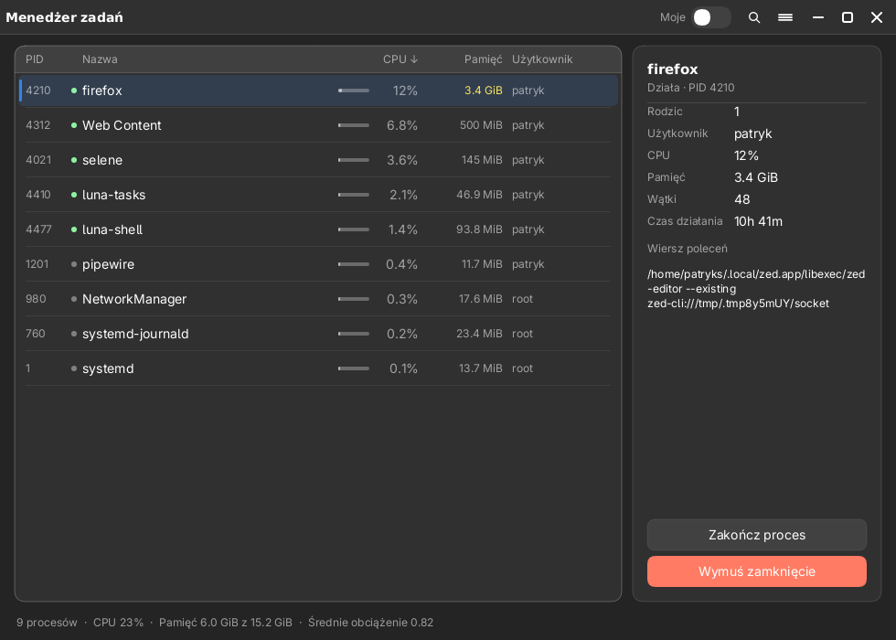
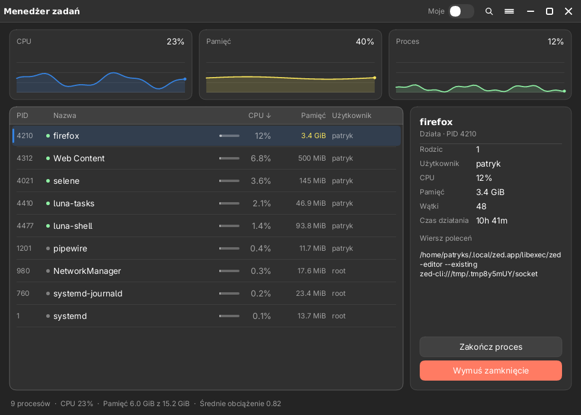
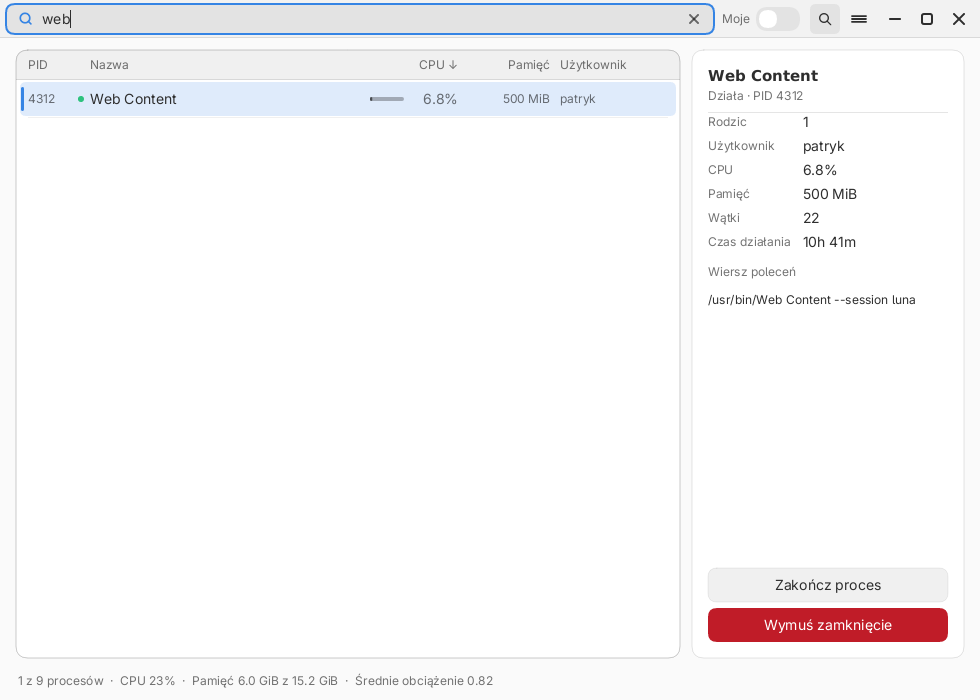
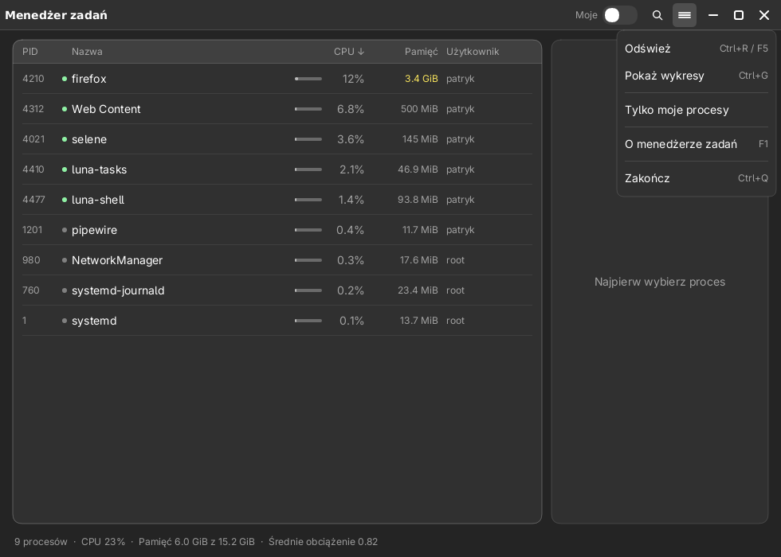
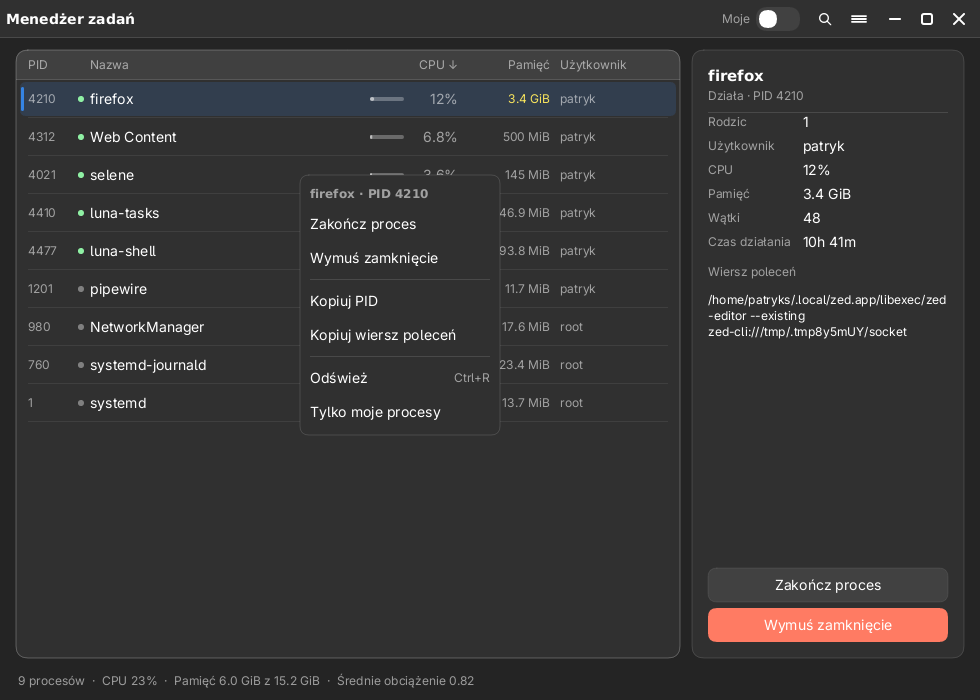
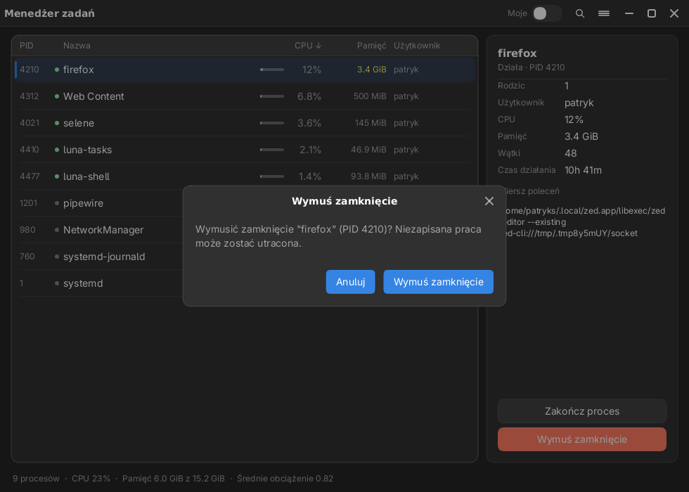
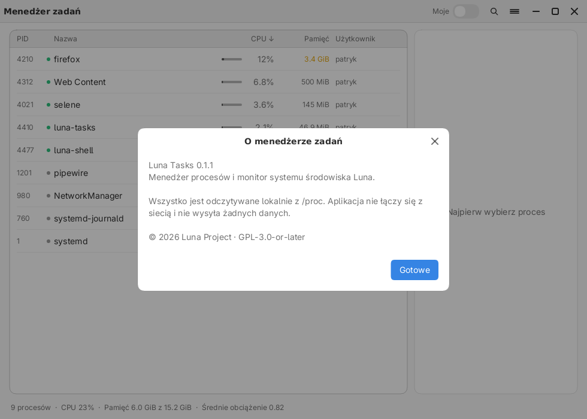

# Luna Tasks (`luna-tasks`)

Menedżer procesów i monitor systemu środowiska Luna na libLunie. Czyta wyłącznie
`/proc` i `/etc/passwd` — bez GTK, bez sieci i bez przechowywania historii.















## Funkcje

- **Lista procesów** — PID, nazwa, CPU, pamięć, użytkownik; kliknięcie nagłówka
  sortuje rosnąco/malejąco, a strzałka pokazuje aktualny kierunek.
- **CPU i pamięć** — procent CPU liczony z dwóch próbek `/proc` (takty jiffies
  między odświeżeniami), pamięć rezydentna z `VmRSS`, podsumowanie systemu
  (CPU, RAM, średnie obciążenie) na dolnym pasku.
- **Wyszukiwanie** — lupka w pasku tytułu (obok `—`/`□`/`×`) pokazuje pole
  filtra; filtr działa po PID, nazwie, linii poleceń i użytkowniku, a wpisanie
  tekstu bez fokusu od razu włącza wyszukiwanie. `Ctrl+F` pokazuje pole,
  `Esc` je chowa i czyści filtr.
- **Zakres** — kompaktowy przełącznik **Moje** w pasku tytułu (obok lupki),
  pełna pozycja **Tylko moje procesy** także w menu. Dzięki temu nad listą nie
  ma osobnego paska filtrów, a licznik procesów jest na dole.
- **Wykresy** — opcja **Pokaż wykresy** (`Ctrl+G`) dodaje nad listą trzy
  mini-wykresy: CPU systemu, pamięć i CPU zaznaczonego procesu, z historią
  ostatnich 60 próbek (minuta). Wybór jest zapisywany w `tasks.conf`.
- **Kolorowanie** — kropka stanu (działa/śpi/czeka/zombie), kolor CPU od 20%
  i 50% oraz pamięci od 10% i 25% całego RAM-u; zombie i zatrzymane procesy
  mają delikatne tło. Kolory są tylko wskazówką — nie zmieniają żadnych akcji.
- **Menu kontekstowe** — PPM na procesie otwiera **Zakończ proces**, **Wymuś
  zamknięcie**, **Kopiuj PID**, **Kopiuj wiersz poleceń**, **Odśwież** i
  przełącznik zakresu. `Shift+F10` otwiera to samo menu z klawiatury.
- **Szczegóły** — rodzic, użytkownik, CPU, pamięć, wątki, czas działania
  i pełna linia poleceń; przy szerokim oknie panel jest widoczny cały czas.
- **Zakończenie** — `SIGTERM` (**Zakończ proces**) lub `SIGKILL`
  (**Wymuś zamknięcie**) po potwierdzeniu. PID 1 jest chroniony, a `EPERM`/
  `ESRCH` dają czytelny komunikat zamiast cichego błędu.
- **Klawiatura** — strzałki, `PageUp`/`PageDown`, `Home`/`End`,
  `Enter`/`Delete` (zakończ), `Shift+Delete` (wymuś), `Shift+F10` (menu
  kontekstowe), `Ctrl+F` (szukaj), `Ctrl+G` (wykresy), `Ctrl+R`/`F5`
  (odśwież), `Ctrl+Q` (zamknij), `F1` (o aplikacji).
- **Bezpieczeństwo** — `starttime` chroni przed wysłaniem sygnału do procesu po
  recyklingu PID; bez fokusu okno nie odpytuje `/proc`.

## Uruchamianie

```sh
cargo run --manifest-path apps/luna-tasks/Cargo.toml
cargo test --manifest-path apps/luna-tasks/Cargo.toml --lib
cargo run --manifest-path apps/luna-tasks/Cargo.toml --bin preview
```

Podglądy (`--bin preview`) zapisują `docs/images/tasks-*.png` i używają
sztucznych procesów wyłącznie po to, by zrzuty były deterministyczne.

## Ustawienia

`~/.config/luna/tasks.conf`:

```ini
sort=cpu      # cpu | memory | pid | name | user
order=desc    # asc | desc
scope=all     # all | mine
charts=off    # on | off
```

Plik zawiera wyłącznie ustawienia widoku — żadnych nazw procesów ani poleceń.

Szczegóły i prywatność: [`docs/tasks.md`](../../docs/tasks.md).
