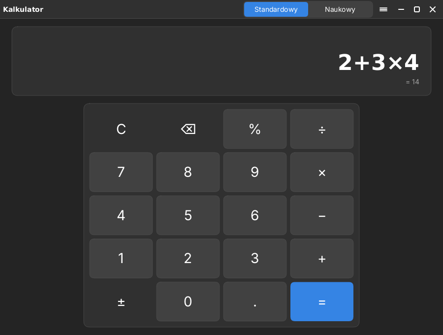
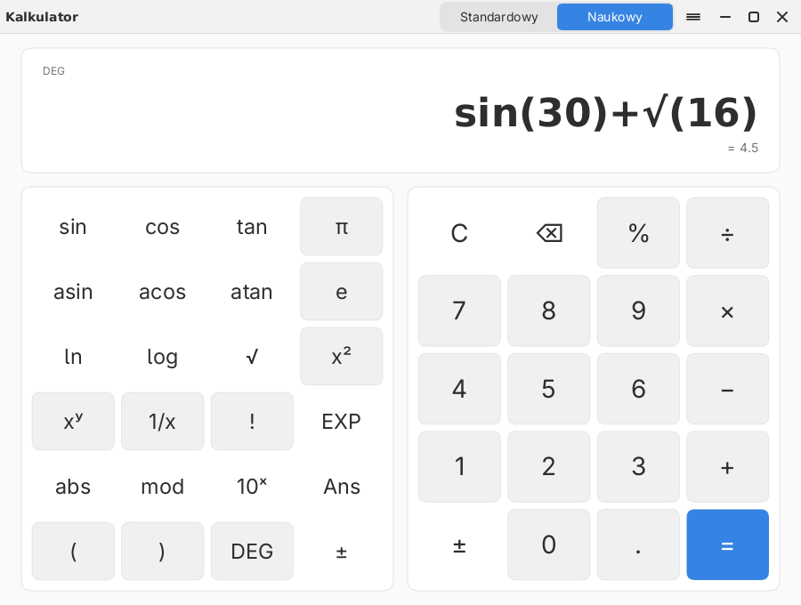
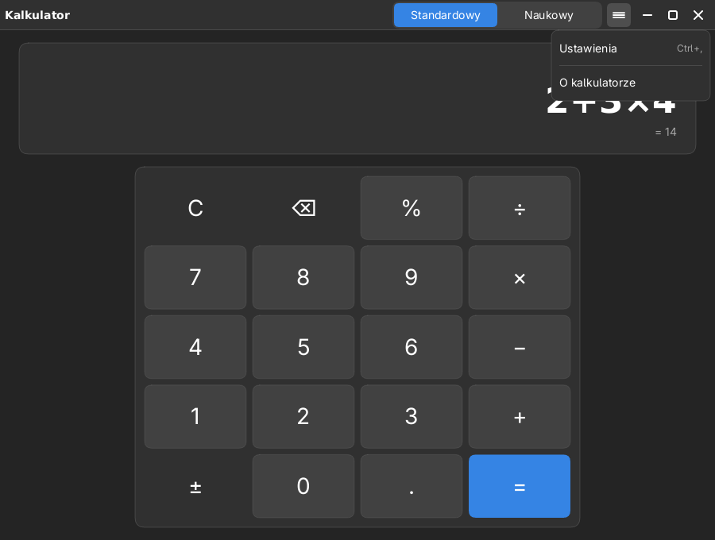
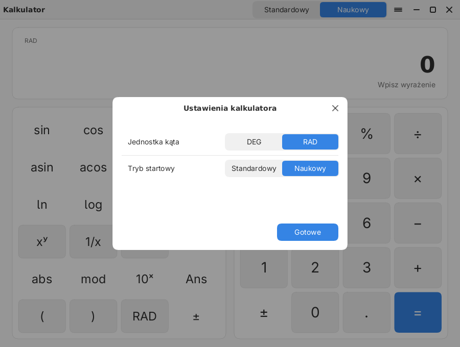
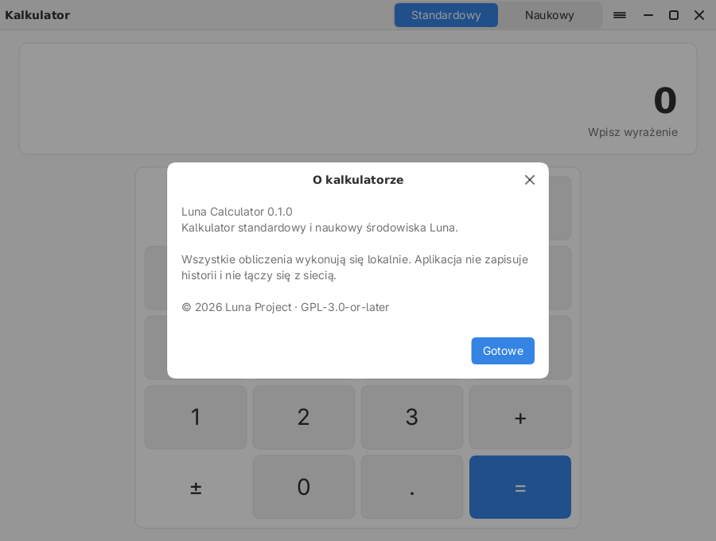

# Luna Calculator — kalkulator standardowy i naukowy











`luna-calculator` to lekka aplikacja środowiska Luna na libLunie: dwa tryby
pracy (**Standard** i **Naukowy**) w jednym oknie. Nie wymaga GTK, nie uruchamia
usług w tle i nie wysyła żadnych danych.

## Co jest w środku

| Obszar | Możliwości |
|---|---|
| **Standard** | `+ − × ÷`, procenty, nawiasy, zmiana znaku, `Ans`, kopiowanie wyniku |
| **Naukowy** | `sin`, `cos`, `tan`, `asin`, `acos`, `atan`, `ln`, `log`, `√`, `x²`, `xʸ`, `1/x`, `x!`, `π`, `e`, `EXP`, `10ˣ`, `DEG`/`RAD` |
| **Podgląd** | wynik obliczany na bieżąco pod wyrażeniem, jeszcze przed `=` |
| **Klawiatura** | cyfry i operatory, `Enter`, `Backspace`, `Esc`, `Ctrl+C`/`Ctrl+V`, `Ctrl+,` (ustawienia) |
| **Menu** | hamburger w pasku tytułu: **Ustawienia**, **O kalkulatorze** |
| **Ustawienia** | jednostka kąta (`DEG`/`RAD`) i tryb startowy (`Standard`/`Naukowy`), zapisywane lokalnie |
| **Parser** | liczby dziesiętne i naukowe, niejawne mnożenie (`2π`, `3(4+5)`), prawostronne `^`, silnia i procenty |

## Jak to działa

- Wyrażenie jest zwykłym napisem edytowanym klawiszami i przyciskami.
- `=` uruchamia wbudowany parser (`src/eval.rs`), który zwraca wynik albo
  czytelny błąd (dzielenie przez zero, brak nawiasu, nieznana funkcja).
- `%` jest operatorem postfiksowym (`50%` = `0.5`), a modulo to `mod`
  (`7 mod 3` = `1`).
- Tryb `DEG`/`RAD` dotyczy wyłącznie funkcji trygonometrycznych; przełącznik
  jest dostępny w panelu naukowym i w **Ustawieniach**.
- Menu **O kalkulatorze** pokazuje wersję, krótki opis i licencję; nie otwiera
  żadnych stron ani nie wysyła danych.
- **Tryb startowy** z Ustawień jest używany przy następnym uruchomieniu;
  bieżący tryb zmieniasz przełącznikiem w pasku tytułu.
- Po `=` kolejna cyfra zaczyna nowe wyrażenie, a operator kontynuuje obliczenia
  na ostatnim wyniku.

## Prywatność

Aplikacja nie zapisuje historii obliczeń, nie zna konta użytkownika i nie
wykonuje żadnych zapytań sieciowych. Lokalnie zapisuje tylko dwie preferencje
(jednostkę kąta i tryb startowy); reszta stanu żyje w pamięci procesu.

## Pliki

| Ścieżka | Znaczenie |
|---|---|
| `src/eval.rs` | tokenizer, parser i formatowanie wyniku |
| `src/app.rs` | stan kalkulatora, klawisze, tryby i pętla aplikacji |
| `src/prefs.rs` | zapis/odczyt `~/.config/luna/calculator.conf` |
| `src/ui.rs` | układ okna, rysowanie klawiatury, menu i obsługa zdarzeń |

## Uruchamianie

```sh
cargo run --manifest-path apps/luna-calculator/Cargo.toml
cargo run --manifest-path apps/luna-calculator/Cargo.toml -- --scientific
cargo test --manifest-path apps/luna-calculator/Cargo.toml --lib
cargo run --manifest-path apps/luna-calculator/Cargo.toml --bin preview
```

Wejście z wpisu `eu.luna.Calculator.desktop`; podglądy headless trafiają do
`docs/images/calculator-{standard,scientific,menu,settings,about}.png`.
