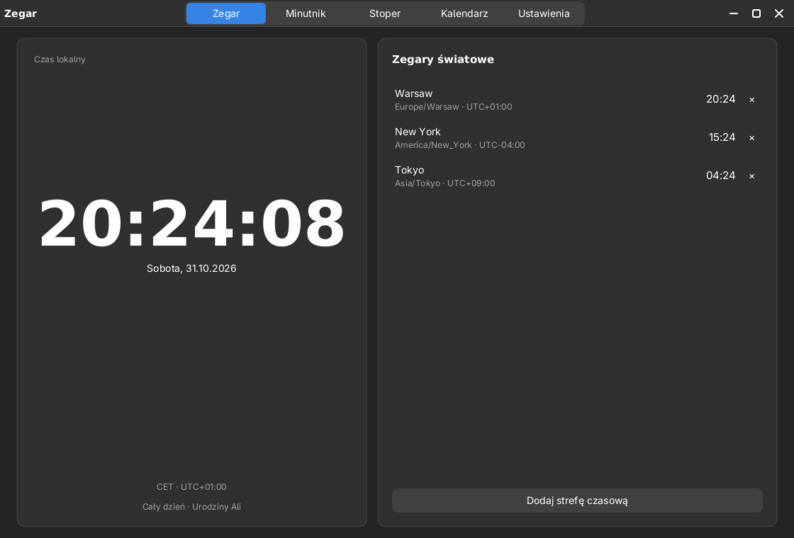
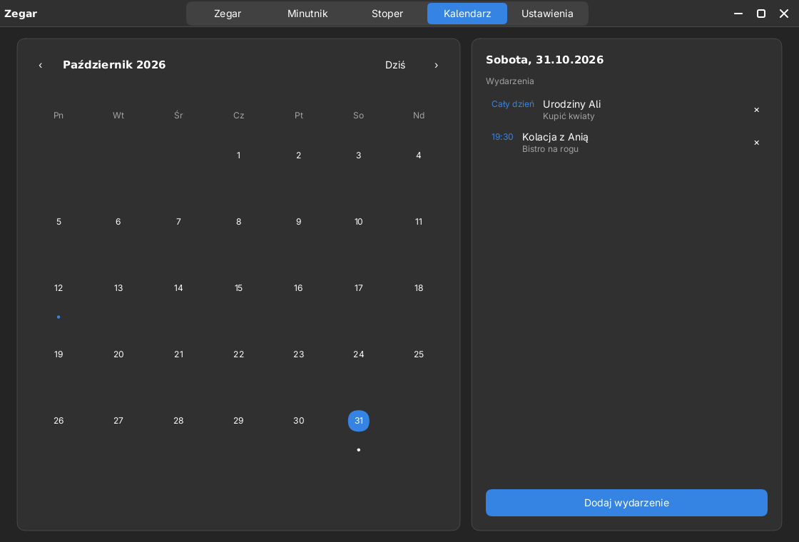
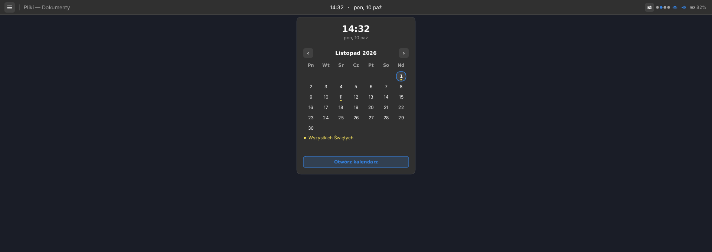
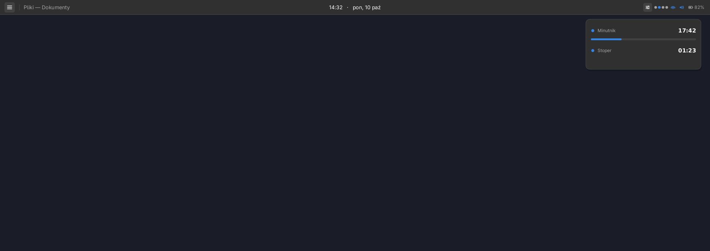

# Luna Clock — zegar, minutnik, stoper i kalendarz





`luna-clock` to lekka aplikacja środowiska Luna na libLunie: cztery strony
robocze (Zegar, Minutnik, Stoper, Kalendarz) oraz Ustawienia. Nie wymaga
GTK, nie uruchamia usług w tle i nie wysyła żadnych danych.

## Co jest w środku

| Obszar | Możliwości |
|---|---|
| **Zegar** | duży zegar lokalny (12/24 h, sekundy), data, skrót strefy (`CET`, `UTC+02:00`), najbliższe wydarzenie dnia oraz **kilka zegarów światowych** z dodawaniem/usuwaniem stref IANA |
| **Minutnik** | dowolny czas (godziny/minuty/sekundy), szybkie nastawy 1–60 min, start/pauza/reset, pasek postępu i powiadomienie o końcu |
| **Stoper** | start/pauza, okrążenia z czasem łącznym i różnicą, reset; odświeżanie co 20 ms |
| **Kalendarz** | miesiąc z kropkami wydarzeń i świąt, wybór dnia, dodawanie/edycja/usuwanie własnych wydarzeń, wydarzenia całodniowe i minutowe, import/eksport `.ics` |
| **Ustawienia** | automatyczny motyw o wybranych godzinach, kraj i święta, format zegara, eksport/import kalendarza, informacje o prywatności |
| **Widget pod paskiem** | po zamknięciu aplikacji działający minutnik/stoper pokazuje się jako kompaktowa karta pod panelem; kliknięcie wraca do właściwej strony `luna-clock` |

## Prywatność

- Wydarzenia są zapisywane **wyłącznie lokalnie** w
  `$XDG_DATA_HOME/luna/clock/events.tsv` (domyślnie
  `~/.local/share/luna/clock/events.tsv`), w prostym, czytelnym formacie
  i z prawami `0600` (dostęp tylko dla właściciela).
- Święta publiczne są **wyliczane w pamięci** z wbudowanych reguł (daty stałe,
  Wielkanoc i święta ruchome). Aplikacja nie wykonuje żadnych zapytań sieciowych
  i nie zna konta użytkownika.
- Import `.ics` czyta wskazany plik lokalny. Eksport zapisuje
  `calendar.ics` w katalogu danych — bez chmury i bez telemetrii.
- Kraj jest wykrywany z locale/strefy czasowej albo wybierany ręcznie; wybór
  również zostaje na urządzeniu.

## Automatyczny motyw

W Ustawieniach włącz **Automatic theme** i ustaw godziny, np. ciemno od `19`,
jasno od `7`. Standardowy stan systemowy (`~/.config/luna/system-dark`) zapisuje
powłoka Luny na podstawie `clock.conf`, więc harmonogram działa także po
zamknięciu aplikacji — wystarczy działająca sesja. Ten sam plik czytają wszystkie
aplikacje Luny. Działa to najlepiej, gdy wygląd Luny jest ustawiony na **Auto**
(albo aplikacja używa trybu systemowego). Harmonogram jest sprawdzany co
sekundę; nie wymaga uprawnień roota.

## Współpraca z panelem

Panel czyta **ten sam** plik wydarzeń (bez zapisu) oraz kraj świąt z `clock.conf`
(przy braku wyboru — wykryty z systemu):

- kropki pod dniami oznaczają wydarzenia (akcent) i święta (kolor ostrzegawczy),
- pod siatką widać plan wybranego dnia razem z nazwą święta,
- przycisk **Open calendar** uruchamia `luna-clock --date RRRR-MM-DD`
  z wybranym dniem.



Panel odświeża listę po zmianie znacznika czasu pliku, więc nowe wydarzenie
pojawia się bez wylogowania.

## Widget minutnika/stopera

Gdy zamkniesz aplikację, a minutnik lub stoper dalej działają, `luna-shell`
rysuje pod paskiem kompaktowy widget (prawy górny róg):



Minutnik i stoper kontynuują odliczanie na podstawie `active.conf`; kliknięcie
widgetu otwiera `luna-clock --tab timer` albo `--tab stopwatch` (a otwarta
aplikacja chowa widget). Po zakończeniu odliczania widget znika, a informacja
trafia do **centrum powiadomień** (toast pojawia się, gdy nie włączono trybu
„nie przeszkadzać”). Stan jest lokalny i zapisany z prawami `0600`. Panel nie
pokazuje widgetu, gdy aplikacja jest otwarta.

## Pliki

| Ścieżka | Znaczenie |
|---|---|
| `~/.config/luna/clock.conf` | preferencje (motyw automatyczny, kraj, strefy, format) |
| `~/.local/share/luna/clock/events.tsv` | wydarzenia użytkownika |
| `~/.local/share/luna/clock/active.conf` | stan aktywnego minutnika/stopera dla widgetu (`0600`) |
| `~/.local/share/luna/clock/calendar.ics` | wynik eksportu `.ics` |

## Uruchamianie

```sh
cargo run --manifest-path apps/luna-clock/Cargo.toml
cargo run --manifest-path apps/luna-clock/Cargo.toml -- --date 2026-12-24
cargo run --manifest-path apps/luna-clock/Cargo.toml -- --tab stopwatch
```

Testy:

```sh
cargo test --manifest-path apps/luna-clock/Cargo.toml --lib
cargo test --manifest-path luna/Cargo.toml --lib
```
