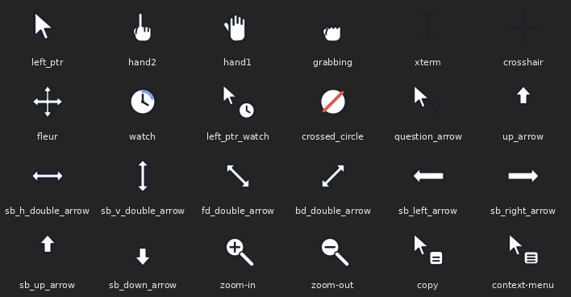

# Luna-Cursors — motyw kursorów pulpitu



`Luna-Cursors` to kompletny motyw XCursor środowiska Luna: **białe kształty
z cienkim grafitowym obrysem** (`#1b202b`, 1,3 px), czytelne na jasnym i ciemnym
tle. Jest generowany z wektorów w `assets/cursors/generate.py`, więc każdy
kształt, hotspot i alias mają jedno źródło prawdy.

## Jak wyglądają

- **Strzałka** jest smukła i wysoka — szeroka sylwetka z grubym czarnym obrysem
  wyglądała topornie („kursory z 1998”).
- **Dłonie** to **jeden kontur** (palce jako fale górnej krawędzi), a nie
  pływające prostokąty: przy 24 px osobne kształty zlewały się w plamę.
  Kciuk jest wybrzuszeniem sylwetki, a cienka kreska tylko go oddziela.
- **Pięść** (`grabbing`) ma kłykcie na górnej krawędzi i kciuk po lewej.
- **Lupa** ma grubszy pierścień i kapsułkową rączkę, **zegar** — akcentowy łuk
  postępu w kolorze `#7aa2f7`.
- Elementy drugoplanowe (`copy`, `context-menu`, `link`) dostają **kartę
  z zaokrąglonymi rogami** w prawym dolnym rogu zamiast kilkupikselowej ikonki.
- Obrysy są o 20–30% cieńsze niż w pierwszej wersji, a strzałki zmiany rozmiaru
  mają cieńszy trzon — dzięki temu zestaw wygląda lekko, a nie jak z Windows 95.

## Co jest w zestawie

Motyw zawiera **26 kształtów fizycznych** w trzech rozmiarach: **24, 32 i 48 px**
(dla HiDPI). Selene wybiera obraz najbliższy 24 px, a płaszczyzna sprzętowa DRM
obsługuje do 64×64.

| Grupa | Kształty |
|---|---|
| **Podstawowe** | `left_ptr` (strzałka), `hand2` (łapka/link), `hand1` (otwarta dłoń/grab), `grabbing` (pięść), `xterm` (I-beam), `crosshair`, `fleur` (przesuwanie), `up_arrow` |
| **Systemowe** | `watch` (ładowanie), `left_ptr_watch` (praca w tle), `crossed_circle` (zakaz), `question_arrow` (pomoc) |
| **Zmiana rozmiaru** | `sb_h_double_arrow`, `sb_v_double_arrow`, `fd_double_arrow`, `bd_double_arrow`, `sb_left_arrow`, `sb_right_arrow`, `sb_up_arrow`, `sb_down_arrow` |
| **Dodatkowe** | `zoom-in`, `zoom-out`, `copy`, `context-menu`, `link` |

Do tego aliasy nazw X11, CSS (`cursor-shape-v1`) i freedesktop, m.in.:
`default`, `arrow`, `pointer`, `text`, `vertical-text`, `move`, `all-scroll`,
`grab`, `openhand`, `closedhand`, `progress`, `wait`, `help`, `not-allowed`,
`no-drop`, `forbidden`, `ew-resize`, `ns-resize`, `nesw-resize`, `nwse-resize`,
`col-resize`, `row-resize`, `e-resize`, `w-resize`, `n-resize`, `s-resize`,
`top_left_corner`, `top_right_corner`, `bottom_left_corner`,
`bottom_right_corner`, `dnd-copy`, `dnd-move`, `dnd-link`, `dnd-no-drop`.

## Jak to działa

- Generator rysuje każdy kształt jako SVG w siatce **24×24**, rasteryzuje go
  przez `cairosvg` i zapisuje binarny plik XCursor (nagłówek `Xcur`, TOC,
  obrazy ARGB + hotspot).
- Hotspot jest skalowany razem z obrazem, więc strzałka trafia ostrzem,
  I-beam środkiem, a uchwyty krawędzi środkiem krawędzi.
- Pliki w `cursors/` to prawdziwe pliki tylko dla kształtów fizycznych.
  Wszystkie aliasy są **dowiązaniami symbolicznymi**, więc motyw nie powiela
  tych samych danych.
- `index.theme` i `cursor.theme` deklarują `Inherits=Adwaita` — gdyby jakiegoś
  kształtu brakowało w przyszłości, system użyje zapasowego motywu zamiast
  ukrywać kursor.
- Selene ma `Luna-Cursors` **pierwsze** na liście motywów (przed
  `Pagan-Cursors`, `Adwaita`, `DMZ-*`), a `luna-session` ustawia
  `XCURSOR_THEME=Luna-Cursors` (o ile użytkownik nie wybrał innego) i
  `XCURSOR_SIZE=24`. Dzięki temu ten sam motyw widzą aplikacje Wayland, X11/
  Xwayland i toolkitty GTK/Qt.
- Motyw jest instalowany do `<prefix>/share/icons/Luna-Cursors` razem z
  `Luna-Icons` — także przy `--only terminal/files/settings`.

## Regeneracja i testy

```sh
make cursors          # python3 assets/cursors/generate.py
cargo test --manifest-path selene/Cargo.toml --bin selene cursor::
```

`make cursors` wymaga `python3`, `cairosvg` i `Pillow`. Test w Selene sprawdza,
że **każdy** wymagany kształt i alias istnieje w repo, parsuje się jako XCursor,
ma niepusty obraz i hotspot w granicach obrazu.

## Prywatność

Motyw jest w całości lokalny: to pliki graficzne w repozytorium. Nic nie jest
pobierane, wysyłane ani zapisywane poza drzewem instalacji.
