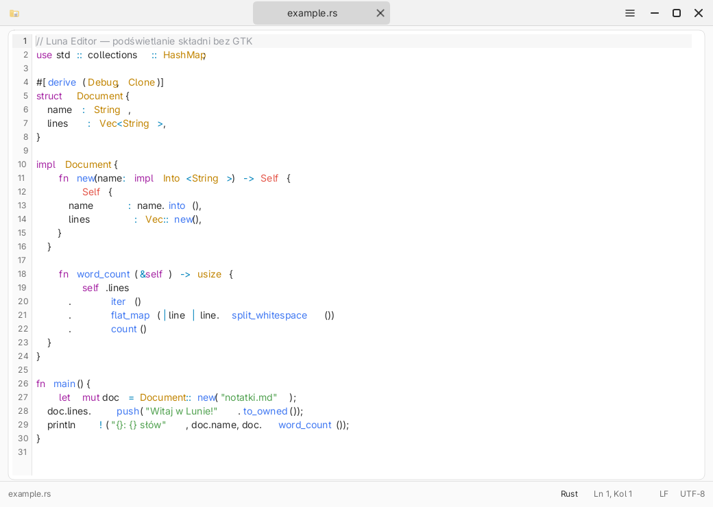
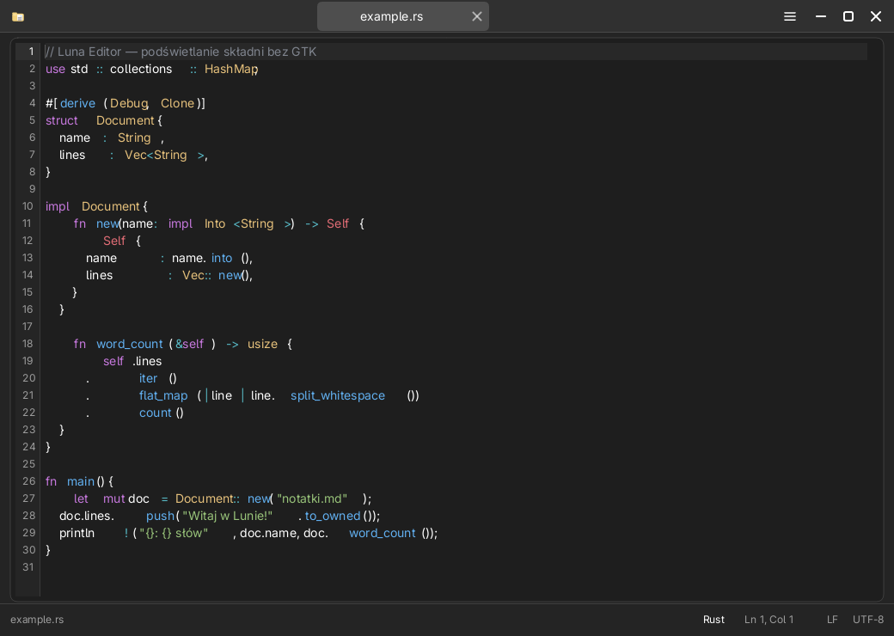
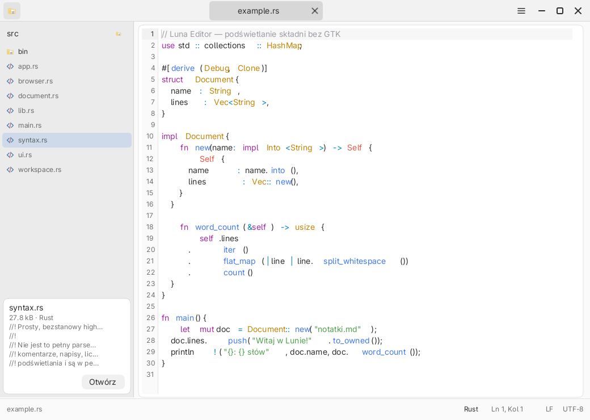
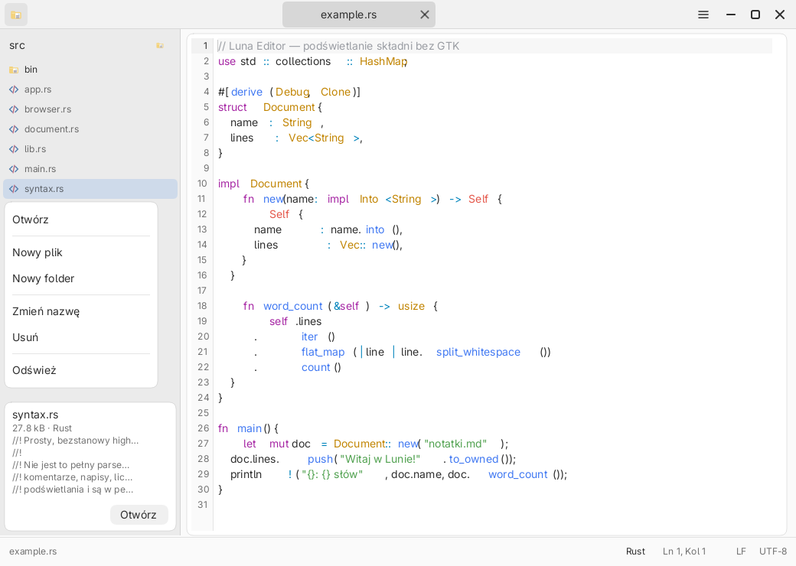
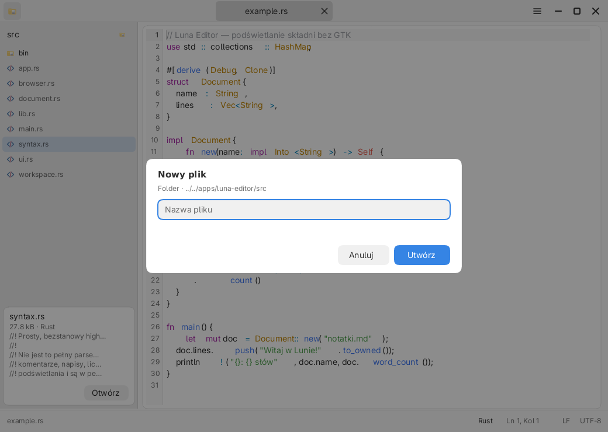
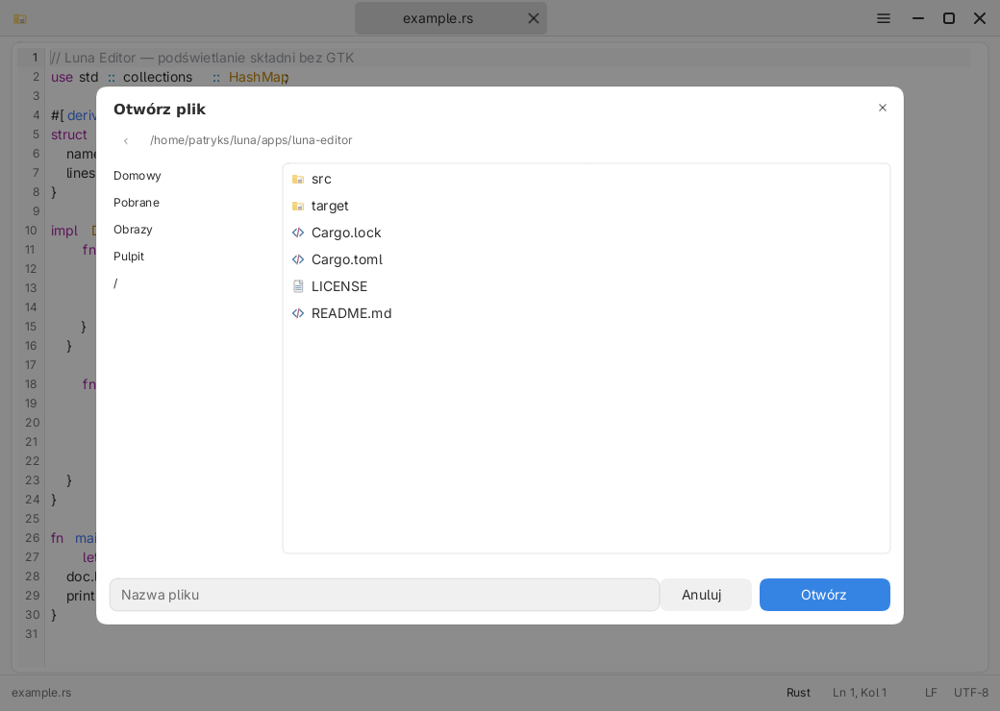
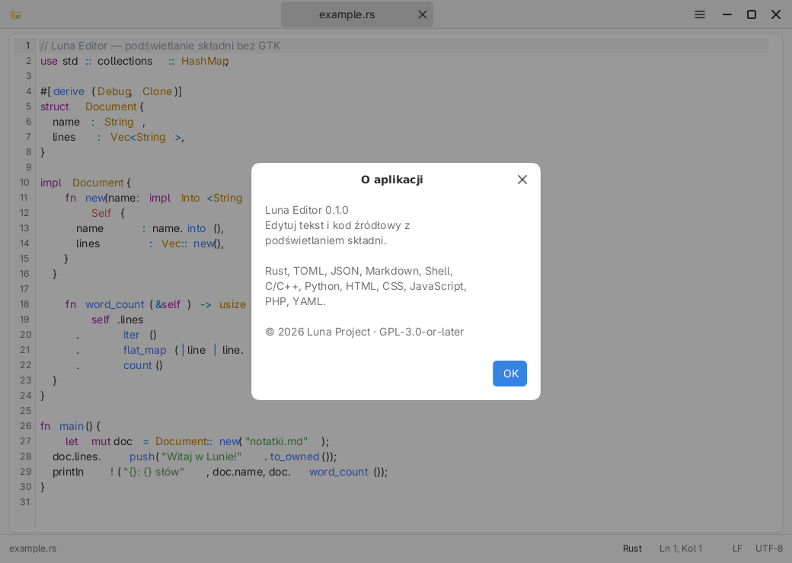
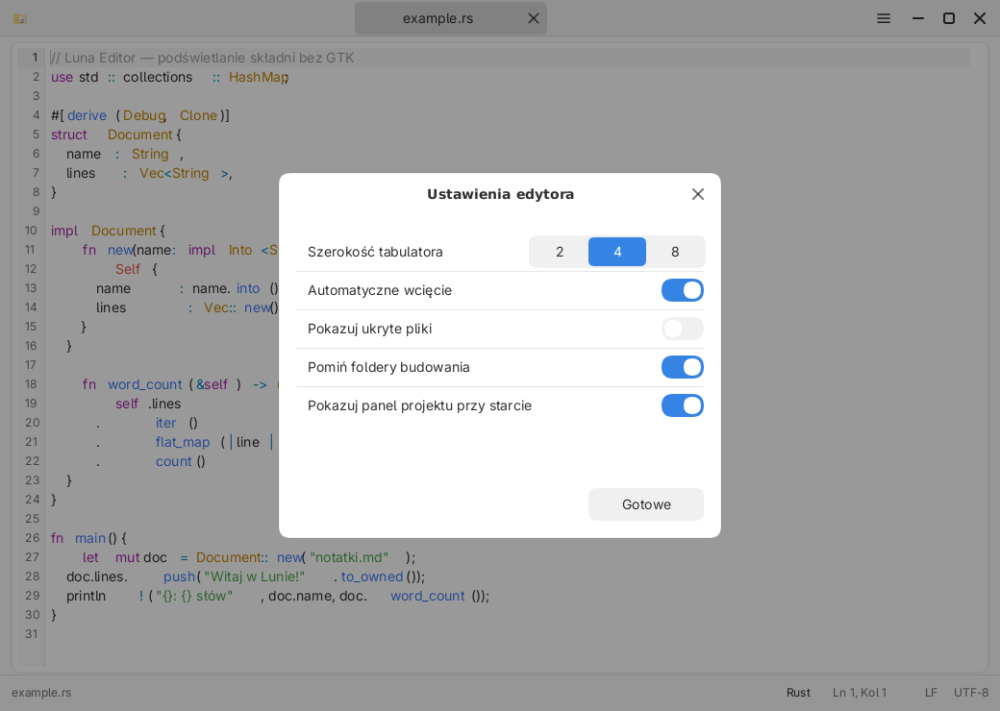

# Luna Editor

Lekki edytor tekstu i kodu środowiska Luna — bez GTK, bez Electrona. Rysuje
własnym rendererem libLuny i korzysta z nowego widgetu **`CodeView`**, dodanego
do `libluna-widgets` razem z tą aplikacją.

















## Funkcje

- **Podświetlanie składni**: Rust, TOML, JSON, Markdown, Shell, C, C++, Python,
  HTML/XML, CSS, JavaScript/TypeScript, PHP i YAML (język wybierany po rozszerzeniu
  pliku). Kolory pochodzą z motywu (`Theme::syntax`) i można je nadpisać w plikach
  `.theme` kluczami `syntax.*`.
- **Numery linii**, podświetlenie bieżącej linii i **przewijanie w obu osiach**
  (kciuki pasków można przeciągać; rolka przewija pion, `dx` w poziomie).
- **Edycja**: wstawianie/usuwanie, zaznaczanie myszą i klawiaturą, schowek,
  `Tab`/`Shift+Tab` (miękkie tabulatory 2/4/8 kolumn), auto-wcięcie po `{`, `(`,
  `[` i `:` (oba zachowania konfigurowane w Ustawieniach).
- **Undo/redo** (`Ctrl+Z`, `Ctrl+Shift+Z`/`Ctrl+Y`) z limitem 500 kroków.
- **Wyszukiwanie** (`Ctrl+F`): podświetla pierwsze trafienie, `Enter`/`Shift+Enter`
  przechodzi dalej/wstecz, `Esc` zamyka pasek.
- **Idź do linii** (`Ctrl+G`) i pasek statusu: język, `Ln`/`Col`, LF/CRLF, UTF-8,
  znacznik niezapisanych zmian.
- **Zakładki**: wiele otwartych plików, etykiety w headerbarze, `●` przy
  niezapisanych zmianach, `✕` zamyka kartę (z potwierdzeniem zapisu),
  `Ctrl+Tab`/`Ctrl+Shift+Tab` przełącza, `Ctrl+W` zamyka.
- **Wbudowany manager plików** dla „Otwórz”, „Zapisz jako…” i „Otwórz folder”:
  lista katalogów (katalogi pierwsze), miejsca XDG (Domowy, Pobrane, Obrazy,
  Pulpit, `/`) i pole nazwy pliku — bez przepisywania ścieżki z pamięci.
- **Panel projektu (workspace)**: drzewo katalogów z rozwijaniem, podgląd pliku
  (9 linii, wykrywanie plików binarnych), dwuklik otwiera plik w zakładce,
  przycisk „Otwórz” w karcie podglądu. Prawy przycisk myszy otwiera menu
  kontekstowe (otwórz, nowy plik/folder, zmień nazwę, usuń, odśwież),
  a klawiatura obsługuje strzałki, `Enter`, `F2` i `Delete`.
  Nowe pliki powstają w zaznaczonym katalogu (albo obok zaznaczonego pliku);
  zmiana nazwy i usuwanie działają też dla otwartych kart.
- **Pliki**: otwieranie (`Ctrl+O`), zapis (`Ctrl+S`), „Zapisz jako…”
  (`Ctrl+Shift+S`), nowy plik (`Ctrl+N`), potwierdzenie zapisu przy zamykaniu
  karty i okna. Zapis jest **atomowy** (plik tymczasowy + `rename`),
  zachowuje uprawnienia i końce linii (LF/CRLF) oraz BOM.
- **Ustawienia programu** (`Ctrl+,` lub menu): szerokość tabulatora (2/4/8),
  automatyczne wcięcie, pokazywanie plików ukrytych, pomijanie `target`
  i `node_modules` oraz panel projektu przy starcie. Preferencje zapisują się
  w `~/.config/luna/editor.conf`.
- **Bezpieczeństwo**: pliki binarne, niepoprawne UTF-8 i pliki większe niż
  32 MiB są odrzucane z czytelnym komunikatem.

## Skróty

| Skrót | Działanie |
|---|---|
| `Ctrl+N` / `Ctrl+O` / `Ctrl+S` | nowy plik / otwórz / zapisz |
| `Ctrl+Shift+S` | zapisz jako |
| `Ctrl+W` / `Ctrl+Tab` / `Ctrl+Shift+Tab` | zamknij kartę / następna / poprzednia |
| `Ctrl+B` | pokaż/ukryj panel projektu |
| `Ctrl+,` | ustawienia programu |
| `F2` / `Delete` | zmień nazwę / usuń zaznaczony element panelu projektu |
| strzałki, `Home`/`End`, `Enter`, `Esc` | nawigacja po drzewie projektu (gdy ma fokus) |
| `Ctrl+Z` / `Ctrl+Shift+Z` / `Ctrl+Y` | undo / redo |
| `Ctrl+F` / `Ctrl+G` | znajdź / idź do linii |
| `Ctrl+A` / `Ctrl+C` / `Ctrl+X` / `Ctrl+V` | zaznacz wszystko / schowek |
| `Tab` / `Shift+Tab` | wcięcie / cofnięcie wcięcia |
| `Enter` | nowa linia z zachowaniem wcięcia |
| `Home`/`End`, `Ctrl+Home`/`Ctrl+End` | początek/koniec linii lub pliku |
| `PageUp`/`PageDown`, strzałki + `Shift` | przewijanie i zaznaczanie |

## Architektura

```
apps/luna-editor/
  src/syntax.rs    # płaskie leksery → Vec<Span>
  src/document.rs  # dokument, ładowanie/zapis, undo/redo, końce linii
  src/workspace.rs # drzewo projektu i podgląd plików
  src/browser.rs   # wbudowany manager plików (otwórz/zapisz/folder)
  src/prefs.rs     # preferencje programu (~/.config/luna/editor.conf)
  src/app.rs       # zakładki, pliki, wyszukiwanie, dialogi
  src/ui.rs        # układ, rysowanie, klawiatura i mysz
  src/bin/editor-render.rs  # zrzuty PNG bez kompozytora
libluna/
  crates/libluna-widgets/src/code_view.rs  # CodeView, Span, TokenKind
  crates/libluna-widgets/src/tab_bar.rs    # zakładki w headerbarze
  crates/libluna-widgets/src/dialogs.rs    # AlertDialog z zawijaniem tekstu
  crates/libluna-core/src/style.rs         # Theme::syntax
```

`CodeView` jest widgetem wielokrotnego użytku (logi, diffy, podgląd konfiguracji),
a nie prywatnym widokiem edytora. Aplikacja dostarcza tylko spany z lekserów,
resztę — kursor, zaznaczenie, gutter, przewijanie i trafianie myszą — robi libLuna.

### Ograniczenia

- Brak podziału widoku i przeciągania zakładek.
- Brak LSP i autouzupełniania; leksery są celowo płaskie (bez gramatyki).
- Brak drag & drop (platforma nie przekazuje jeszcze zdarzeń DnD) — pliki
  otwieramy przez `Ctrl+O`, „Otwórz za pomocą” albo argument wiersza poleceń.
- Wyszukiwanie jest tekstowe (bez wyrażeń regularnych i zamiany).

## Budowanie i instalacja

```sh
cd apps/luna-editor
cargo build --release

# instalacja użytkownika (bez roota)
./scripts/install.sh --user --only editor --no-build
```

Zrzuty do dokumentacji generuje `editor-render`:

```sh
cargo run --bin editor-render -- --no-workspace ../../docs/images/luna-editor.png
cargo run --bin editor-render -- --no-workspace --dark --lang en ../../docs/images/luna-editor-dark.png
cargo run --bin editor-render -- --folder ../../apps/luna-editor/src --preview syntax.rs ../../docs/images/luna-editor-workspace.png
cargo run --bin editor-render -- --folder ../../apps/luna-editor/src --preview syntax.rs --tree-menu ../../docs/images/luna-editor-tree-menu.png
cargo run --bin editor-render -- --folder ../../apps/luna-editor/src --preview syntax.rs --prompt new-file ../../docs/images/luna-editor-prompt.png
cargo run --bin editor-render -- --no-workspace --browser open ../../docs/images/luna-editor-browser.png
cargo run --bin editor-render -- --no-workspace --about ../../docs/images/luna-editor-about.png
cargo run --bin editor-render -- --no-workspace --settings ../../docs/images/luna-editor-settings.png
```

## Licencja

GNU GPL v3.0 lub nowsza (`GPL-3.0-or-later`) — pełny tekst w [`LICENSE`](LICENSE).
Nowy kod libLuny (`CodeView`, paleta składni) jest objęty MPL-2.0.
© 2026 Luna Project.
