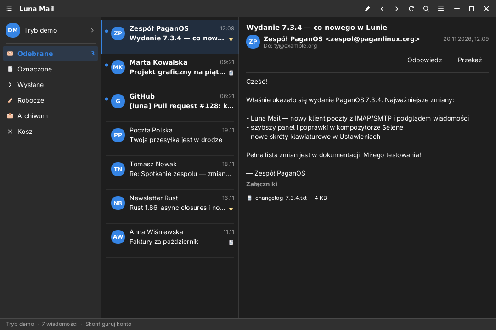
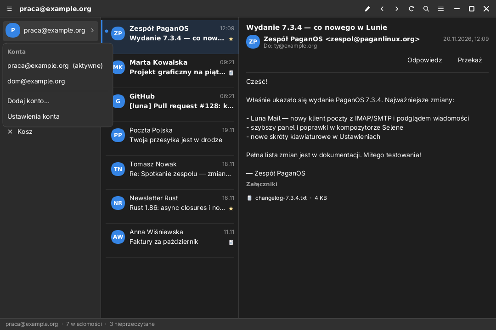
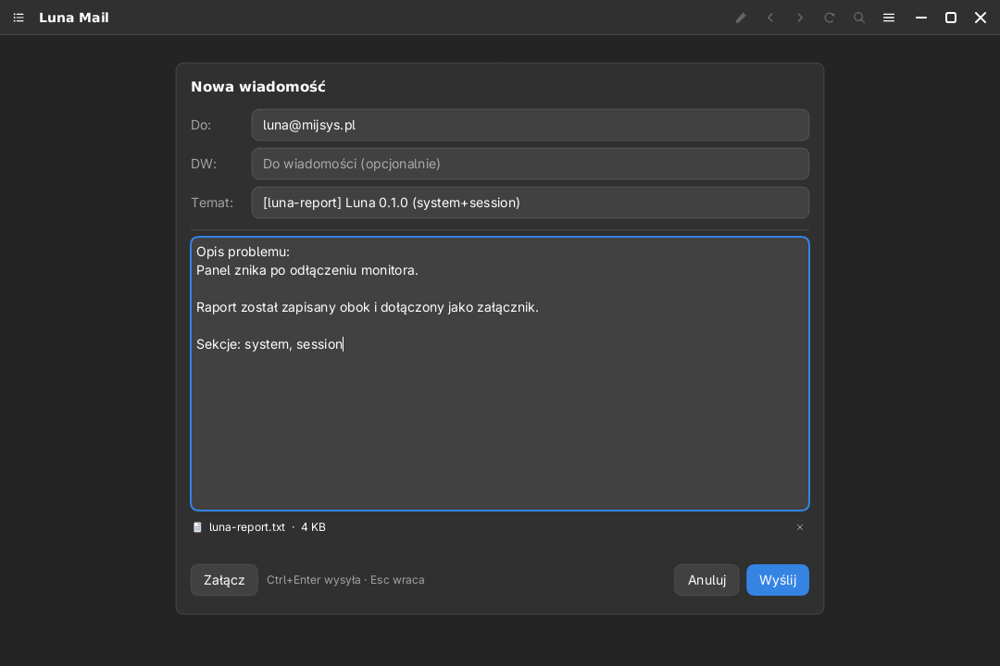

# Luna Mail — klient poczty

`luna-email` to klasyczny klient poczty dla środowiska Luna: pasek folderów,
lista wiadomości i podgląd treści. Działa na `libLuna` (bez GTK) i nie zawiera
telemetrii — łączy się wyłącznie z serwerami IMAP/SMTP wskazanymi w konfiguracji.




## Co robi

- **Foldery** — pobierane z serwera (`LIST`), z rozpoznaniem skrzynki odbiorczej,
  wysłanych, roboczych, kosza i archiwum. Kolejne wiadomości: strony po 50.
- **Lista wiadomości** — nadawca, temat, czas i początek treści; nieprzeczytane
  mają kropkę i pogrubienie, gwiazdka oznacza flagę, ikona dokumentu — załącznik.
- **Podgląd** — treść `text/plain`; gdy jej nie ma, HTML jest zamieniany na tekst
  bez pobierania zdalnych obrazów i bez wykonywania skryptów.
- **Odpowiedź i przekazanie** — cytat w treści, `Re:`/`Fwd:` bez podwajania.
- **Wysyłka SMTP** — z załącznikami i kopią w folderze „Wysłane”, jeśli serwer go ma.
- **Załączniki** — zapis kliknięciem do `~/Downloads` (nazwa nigdy nie nadpisuje
  istniejącego pliku), dodawanie przez przeciągnięcie plików na okno.
- **Wyszukiwanie** — po nadawcy, temacie i początku treści w pobranej stronie.
- **Tryb demo** — bez skonfigurowanego konta aplikacja pokazuje przykładową
  skrzynkę, więc da się ją obejrzeć i przetestować bez serwera.

## Konfiguracja konta

Ustawienia otwiera menu (☰) → **Ustawienia konta**, klik w wiersz konta
w pasku bocznym albo przycisk na pustym podglądzie. Formularz pozwala wpisać
adres, nazwę, login, hasło i serwery. **Wykryj ustawienia** rozpoznaje
popularnych dostawców po domenie:

### Wiele kont

Można dodać dowolną liczbę kont — każde ma własne foldery, cache i kopię
w „Wysłanych”. Klik w wiersz konta u góry paska bocznego otwiera listę:
przełączenie konta, **Dodaj konto…** i **Ustawienia konta**. To samo jest
w menu (☰). Aktywne konto jest zapamiętywane w `email.conf`, a jego nazwa
pojawia się także w stopce. W ustawieniach jest **Usuń konto** (wymaga
drugiego kliknięcia — „Potwierdź usunięcie”).



| Domena | IMAP | SMTP |
|---|---|---|
| gmail.com | `imap.gmail.com:993` (TLS) | `smtp.gmail.com:465` (TLS) |
| outlook.com / hotmail.com | `outlook.office365.com:993` | `smtp.office365.com:587` (STARTTLS) |
| yahoo.com | `imap.mail.yahoo.com:993` | `smtp.mail.yahoo.com:465` |
| icloud.com / me.com | `imap.mail.me.com:993` | `smtp.mail.me.com:587` (STARTTLS) |
| wp.pl / o2.pl / interia.pl / onet.pl / gazeta.pl | `imap.<domena>:993` | `smtp.<domena>:465` |
| proton.me | `127.0.0.1:1143` (Bridge) | `127.0.0.1:1025` |
| inna domena | `imap.<domena>:993` | `smtp.<domena>:465` |

Port `143`/`587`/`25` automatycznie oznacza STARTTLS.

### Hasła

Plik `~/.config/luna/email.conf` ma prawa `0600` i zawiera hasło (heksadecymalnie,
żeby tabulatory i nowe linie nie rozsypały rekordu). Zamiast zapisywać hasło
w pliku, można zostawić pole puste i ustawić zmienną środowiskową:

```sh
export LUNA_EMAIL_PASSWORD='hasło-aplikacji'
```

Dla Gmaila, Outlooka i większości dostawców **należy użyć hasła aplikacji** —
zwykłe hasło może być odrzucone przy włączonym uwierzytelnianiu dwuskładnikowym.
OAuth2 („Zaloguj przez Google/Microsoft”) nie jest jeszcze obsługiwany, bo wymaga
własnego Client ID i procesu zgody; to osobna decyzja produktowa.

## Klawiatura

| Skrót | Działanie |
|---|---|
| `Ctrl+N` | nowa wiadomość |
| `Ctrl+R` | odpowiedź |
| `Ctrl+Shift+F` | przekazanie |
| `Ctrl+F` | wyszukiwanie |
| `F5` | odświeżenie folderu |
| `Ctrl+Shift+R` / `Ctrl+Shift+U` | oznacz jako przeczytane / nieprzeczytane |
| `S` | przełącz gwiazdkę |
| `Delete` | przenieś do kosza (w koszu: usuń) |
| `↑` `↓` `PgUp` `PgDn` `Home` `End` | nawigacja po liście |
| `Enter` | oznacz jako przeczytane (podgląd jest zawsze widoczny) |
| `Ctrl+Enter` | wyślij (w edytorze) |
| `Esc` | zamknij edytor / wyszukiwanie / menu |
| `Ctrl+Q` | zakończ |
| `F1` | o aplikacji |

W polach tekstowych działają `Ctrl+A/C/X/V`, `Home`/`End`, `Shift`+strzałki
(zaznaczanie) oraz `Tab`/`Shift+Tab` (przejście do kolejnego pola). Kliknięcie
w pole ustawia kursor **dokładnie w miejscu kliknięcia** (z `Shift` rozciąga
zaznaczenie), długie wiersze treści zawijają się do szerokości edytora,
a pola jednowierszowe przewijają tekst poziomo, żeby kursor nie znikał za
krawędzią. Środkowy przycisk myszy wkleja zaznaczenie PRIMARY.

## Wygląd i wąskie okna

Okno jest trójdzielne. Poniżej 860 px pasek folderów staje się szufladą nad
treścią (przycisk ☰/lista w lewym górnym rogu), a lista i podgląd dzielą
pozostałą szerokość. Długie tematy, adresy i początek treści są skracane
wielokropkiem **w granicach swojej kolumny** — także w powiadomieniach i menu.

## `mailto:` i „Wyślij raport”

Luna Mail przyjmuje URI `mailto:` (RFC 6068) oraz jawne argumenty:

```sh
luna-email 'mailto:luna@mijsys.pl?subject=Raport&body=Opis'
luna-email --to ala@example.org --subject "Temat" --body "Treść"
luna-email --to ala@example.org --body-file /tmp/raport.txt --attach /tmp/raport.txt
```

Ustawienia → **Pomoc i zgłaszanie problemów** → **Wyślij raport** zapisuje raport,
a następnie uruchamia `luna-email --attach <raport> 'mailto:…'`. Dzięki temu
formularz jest od razu wypełniony (adres, temat, opis problemu), a raport jest
**już załączony** — wystarczy kliknąć „Wyślij”. Jeżeli Luna Mail nie jest
zainstalowana, Ustawienia wracają do `xdg-email`/`gio` (bez załącznika).

Wpis `.desktop` deklaruje `MimeType=x-scheme-handler/mailto` i `Exec=luna-email %u`,
więc `xdg-open mailto:…` i `gio open mailto:…` też trafiają do kompozytora.



## Powiadomienia o nowej poczcie

Gdy okno Luna Mail jest otwarte, aplikacja sprawdza początek skrzynki
odbiorczej **co minutę** i porównuje identyfikatory wiadomości z poprzednim
sprawdzeniem. Nowe wiadomości dają:

- toast systemowy przez `org.freedesktop.Notifications` (serwerem w Lunie jest
  `luna-shell`), z nadawcą i tematem najnowszej wiadomości,
- krótkie potwierdzenie w stopce aplikacji,
- odświeżenie listy bez resetowania zaznaczenia i podglądu.

Kliknięcie powiadomienia aktywuje Luna Mail (hint `desktop-entry`).
Powiadomienia dotyczą **aktywnego konta** — przełączenie konta przenosi też
sprawdzanie skrzynki. Działają **tylko przy otwartej aplikacji**: nie ma jeszcze
osobnego demona w tle; to świadome ograniczenie pierwszej wersji.

## Prywatność i bezpieczeństwo

- Aplikacja łączy się tylko z hostami z konfiguracji; brak analityki i „domyślnych”
  serwerów.
- Treść HTML nigdy nie trafia do UI: jest zamieniana na tekst, a `<script>`,
  `<style>` i `<head>` są pomijane, więc zdalne trackery 1×1 nie mają jak się
  wykonać.
- Załączniki są zapisywane pod `~/Downloads` z unikalną nazwą; aplikacja nie
  uruchamia pobranych plików.
- Tylko tekst jest wysyłany jako `text/plain` — bez HTML i bez zdalnych zasobów.

## Ograniczenia

- Brak OAuth2, PGP/S/MIME, wątków (threading) i filtrów serwerowych — na razie
  wyszukiwanie działa po pobranej stronie.
- Powiadomienia o nowej poczcie działają tylko przy otwartym oknie (sprawdzanie
  co minutę); nie ma demona w tle.
- Brak trwałego cache offline: po restarcie lista jest pobierana ponownie.
- Wysyłka HTML nie jest jeszcze dostępna (edytor jest tekstowy).
- Brak okna wyboru plików (portal) — załączniki dodaje się przez przeciągnięcie.

## Podglądy

```sh
cargo run --manifest-path apps/luna-email/Cargo.toml --bin preview
```

Tworzy `docs/images/email-inbox.png`, `email-compose.png`, `email-account.png`,
`email-accounts.png`, `email-report.png`, `email-about.png` i `email-narrow.png`
bez kompozytora.

## Testy

```sh
cargo test --manifest-path apps/luna-email/Cargo.toml --lib
```

Testy obejmują model (adresy, walidacja szkicu, daty, skracanie), konwersję
HTML→tekst, budowę wiadomości RFC 822, układ okna i zachowanie trybu demo.
