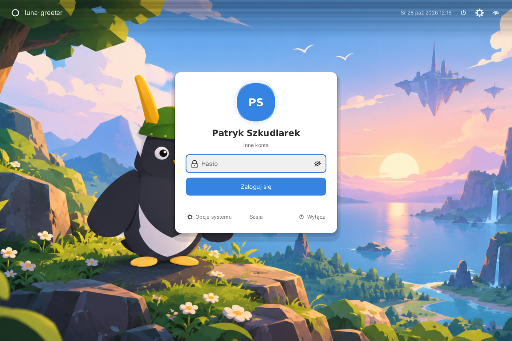
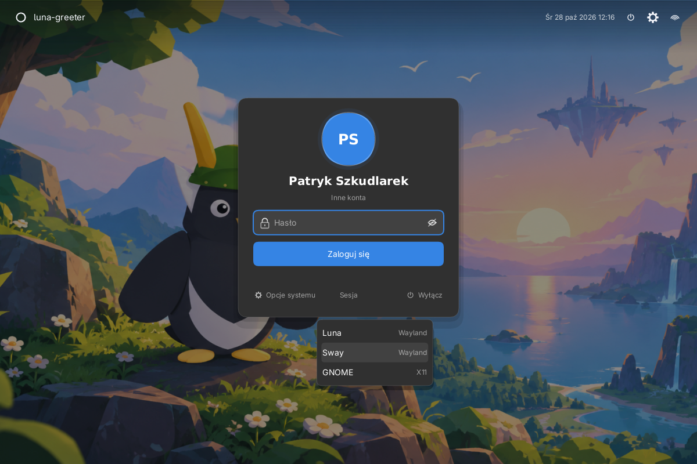
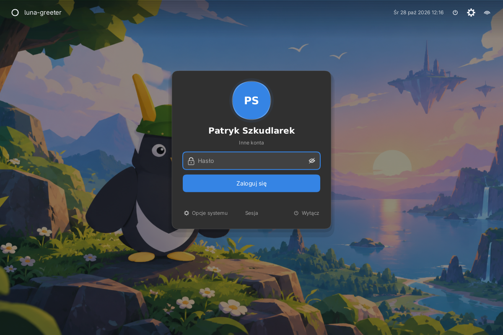
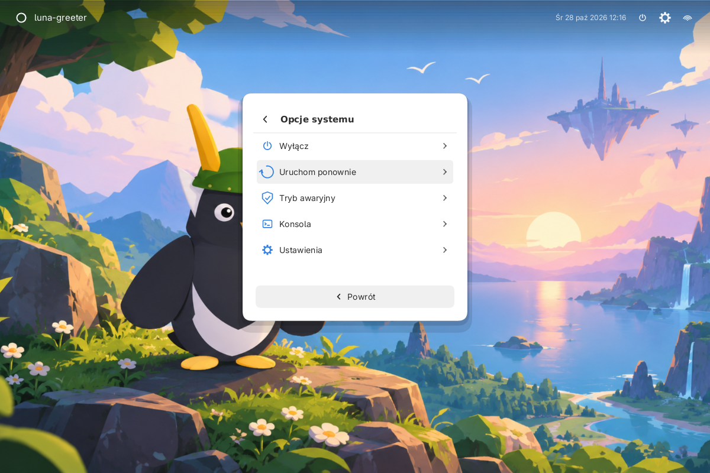

# Luna Greeter — menedżer logowania

`luna-greeter` to ekran logowania Luna zbudowany na libLunie. Nie implementuje
PAM ani nie uruchamia sesji samodzielnie — jest **frontendem greetd**. Cała
część uprzywilejowana (PAM, logind, uruchomienie sesji) zostaje w daemonie
`greetd`, a greeter działa jako zwykły użytkownik `greeter`.

> **Protokół:** greetd nie używa D-Bus. Udostępnia prosty protokół przez
gniazdo Unix (`GREETD_SOCK`, zwykle `/run/greetd-ipc`): 4-bajtowa długość
payloadu (native endian) + UTF-8 JSON. Interfejs
`org.freedesktop.DisplayManager` na D-Bus dotyczy m.in. LightDM/SDDM; Luna
wybrała greetd, bo jest mniejszy i nie wymaga uprawnień w warstwie UI.



```
greetd (root) ── Unix socket /run/greetd-ipc ── luna-greeter (greeter)
     │
     └── start_session → luna-session → selene + luna-shell
```

## Co jest w środku

| Element | Opis |
| --- | --- |
| `luna-greeter/src/greetd.rs` | protokół greetd (ramki: 4-bajtowa długość + JSON), wątek roboczy, obsługa `auth_message` |
| `luna-greeter/src/sessions.rs` | wykrywanie sesji Wayland/X11 z `wayland-sessions/` i `xsessions/` (XDG) |
| `luna-greeter/src/users.rs` | lista lokalnych kont z `/etc/passwd` (UID 1000–69999, prawdziwa powłoka) |
| `luna-greeter/src/avatars.rs` | zdjęcia profilowe z AccountsService + fallback na inicjały |
| `luna-greeter/src/state.rs` | zapamiętane ostatnie konto i sesja (bezpieczny plik stanu) |
| `luna-greeter/src/app.rs` | UI: karta logowania, wybór konta i sesji, hasło, klawiatura/mysz, zegar |
| `luna-greeter/src/bin/config.rs` | `luna-greeter-config` — bezpieczny zapis `/etc/luna/greeter.conf` (przez `pkexec`) |
| `de/session/luna-greeter-session` | uruchamia Selene (kompozytor greetera) i `luna-greeter` |
| `de/greetd/config.toml.example` | przykładowa konfiguracja greetd |

Greeter obsługuje cały standardowy dialog greetd:

- `create_session` → `auth_message` (`visible` / `secret` / `info` / `error`) →
  `post_auth_message_response` → `success` → `start_session`,
- `auth_error` czyści hasło i pozwala spróbować ponownie; greeter od razu wysyła
do greetd `cancel_session`, bo greetd trzyma nieudaną sesję w stanie
„konfigurowana” i bez anulowania odrzucałby **wszystkie** kolejne logowania
komunikatem „a session is already being configured” (aż do restartu greetd).
Nowe połączenie greetera również zaczyna od `cancel_session`, więc sesja-sierota
po restarcie samego greetera nie blokuje logowania.
- brak gniazda pokazuje stan „brak połączenia” z możliwością ponownego połączenia,
- lokalne konta są tylko podpowiedzią — można wpisać dowolną nazwę (LDAP/SSSD),
- jeśli hasło jest wpisane przed pierwszym `Enter`, greeter wysyła je automatycznie,
  gdy PAM poprosi o sekret — wystarczy **jedno** `Enter`.

## Konta i sesje — dane z systemu

Greeter **nie używa mocków** w trybie produkcyjnym:

- **Konta** pochodzą z lokalnego `/etc/passwd` (UID 1000–69999, prawdziwa powłoka,
  sensowny katalog domowy). Konto można też wpisać ręcznie — działa wtedy LDAP/SSSD.
  Nazwa i inicjały w awatarze biorą się z pola GECOS, np. `Patryk Szkudlarek`.
- **Sesje** są wykrywane z `wayland-sessions/` i `xsessions/` w systemowych katalogach
  `XDG_DATA_DIRS` (standardowo `/usr/local/share` i `/usr/share`). Celowo nie czytamy
  `XDG_DATA_HOME` użytkownika `greeter` — to zapisywalny katalog, więc mógłby zostać
  użyty do podsunięcia własnego polecenia sesji. Greeter pokazuje tylko sesje, których
  `Exec`/`TryExec` da się uruchomić, i wysyła
  do greetd wybrane polecenie + `XDG_SESSION_TYPE=wayland|x11` oraz
  `XDG_SESSION_DESKTOP`/`XDG_CURRENT_DESKTOP` z `DesktopNames`.
- Domyślnie wybierana jest sesja Luny, jeśli jest zainstalowana; obok niej widać
  GNOME, KDE, sway, labwc itd., jeśli mają swoje pliki `.desktop`.



Sesję można zmienić przed logowaniem przyciskiem „Sesja” (menu z typem Wayland/X11).
Konto wybiera się z listy „Inne konta” albo wpisuje ręcznie w polu nazwy użytkownika.

## Zapamiętywanie konta i sesji

Po udanym uwierzytelnieniu greeter zapisuje ostatnie konto i sesję do pliku stanu
(`$XDG_STATE_HOME/luna/greeter.conf`, a gdy brak — `$HOME/.local/state/luna/greeter.conf`
lub `/var/lib/greetd/luna/greeter.conf`). Plik ma prawa `0600` i jest zapisywany atomowo.

Przy starcie wartości są traktowane wyłącznie jako **podpowiedź**:
- nazwa użytkownika musi przejść walidację loginu,
- identyfikator sesji musi wskazywać jedną z sesji odkrytych w systemie,
- **polecenie sesji nigdy nie jest brane z pliku stanu** — zawsze z systemowych
  plików `.desktop`.

## Awatary z systemu

Greeter czyta zdjęcie profilowe z AccountsService:

1. `Icon=` z `/var/lib/AccountsService/users/<login>` (jeśli wskazuje istniejący plik),
2. fallback: `/var/lib/AccountsService/icons/<login>`.

Obsługiwane są PNG (maks. 8 MiB); obraz jest przycinany do okręgu. Gdy pliku nie ma,
greeter nie ma uprawnień albo dekodowanie się nie uda, zostają inicjały z GECOS.
Dzięki temu greeter nie czyta samodzielnie katalogów domowych użytkowników.

## Wygląd ekranu logowania

Ekran używa standardowych widgetów libLuny (`Avatar`, `PasswordEntry`, `Button`,
`Menu`) i tokenów motywu, dzięki czemu wygląda spójnie z Ustawieniami i powłoką.
Układ jest celowo minimalny — na tapecie pływają tylko dwa elementy:

- **górny pasek** — po lewej ikona księżyca i nazwa `luna-greeter`, po prawej
  data z zegarem oraz trzy przyciski: zasilanie, ustawienia i sieć;
- **wąska karta** — okrągły awatar, nazwa konta jako nagłówek, samo pole hasła
  (z ikoną kłódki i podglądem), pełnej szerokości przycisk **Zaloguj się**
  i stopka: `Opcje systemu` · `Sesja` · `Wyłącz`.

Domyślnie greeter pokazuje wyłącznie pole hasła — konto jest znane z ostatniego
logowania albo z pierwszego konta w systemie. Link **Inne konta** rozwija pole
nazwy użytkownika i siatkę dostępnych kont; wybór konta zwija ten tryb z powrotem.


Ten sam ekran w ciemnym motywie:



### Opcje systemu

Przycisk **Opcje systemu** (w stopce karty albo ikona zębatki w górnym pasku)
otwiera drugi ekran z akcjami systemowymi: wyłączenie, restart, tryb awaryjny,
konsola na `tty2` i Ustawienia Luny. Akcje są wywoływane przez `loginctl` /
`systemctl` z uprawnieniami konta `greeter` — jeśli logind/Polkit odmówi,
komunikat błędu pojawia się pod listą akcji, a greeter pozostaje na ekranie
logowania. `Escape` albo **Powrót** wraca do karty logowania.



Tapetę, motyw (jasny/ciemny/auto), akcent i widoczność zegara ustawia się w
**Ustawienia → Ekran logowania**. Ustawienia zapisują plik systemowy:

```ini
# /etc/luna/greeter.conf
# Wygenerowane przez Ustawienia Luny. Ścieżka tapety musi być absolutna.
theme=dark
accent=blue
show_clock=true
wallpaper=/usr/share/wallpapers/paganlinux/paganlinux-wallpaper.png
```

- Greeter działa jako konto `greeter`, więc **nie czyta** konfiguracji z katalogu
  domowego osoby logującej się. Plik systemowy ma prawa `0644`.
- Zapis wymaga roota: Ustawienia wołają `pkexec luna-greeter-config write`
  (okno autoryzacji pokazuje agent polkit, w Lunie `luna-polkit`). Pomocnik
  parsuje **wyłącznie znane klucze** i nie wykonuje żadnych poleceń.
- Tapeta musi być plikiem **PNG** (maks. 32 MiB). Jeśli plik nie jest czytelny dla
  konta `greeter` (np. leży w katalogu domowym z prawami 0700), pomocnik kopiuje
  go do `/var/lib/luna/wallpapers/` i zapisuje ścieżkę kopii.
- Bez tapety w `greeter.conf` greeter używa domyślnej grafiki Luny
  (`/usr/share/wallpapers/luna/luna-desktop.png`) instalowanej przez pakiet
  `luna-greeter`. Dopiero gdy i jej brakuje, tło stanowi gradient/poświata akcentu.
- `LUNA_GREETER_CONFIG` wskazuje inny plik (tryb `--preview` i testy); wtedy zapis
  idzie bezpośrednio, bez `pkexec`.

Zmiany działają od następnego uruchomienia greetera (przy wylogowaniu/restarcie
`greetd`). Bieżący stan można sprawdzić przez `luna-greeter --list`.

## Instalacja

1. Zainstaluj Lunę i greetd:

   ```bash
   sudo ./scripts/install.sh --prefix /usr
   sudo pacman -S greetd        # albo apt/dnf install greetd
   ```

2. Utwórz konto greetera i daj mu dostęp do urządzeń (tryb DRM Selene):

   ```bash
   sudo useradd --system --home /var/lib/greetd --create-home \
        --shell /usr/sbin/nologin greeter
   sudo usermod -aG video,render,input greeter
   ```

3. Skopiuj konfigurację greetd:

   ```bash
   sudo install -D -m 644 /usr/share/luna/greetd/config.toml.example /etc/greetd/config.toml
   ```

   (w drzewie źródeł ten sam plik to `de/greetd/config.toml.example`)

4. Upewnij się, że PAM ma usługę `greetd` (pakiet dystrybucji zwykle ją dostarcza;
   potrzebne są `pam_unix` i `pam_systemd`):

   ```bash
   cat /etc/pam.d/greetd
   ```

5. Wyłącz inny menedżer logowania i włącz greetd:

   ```bash
   sudo systemctl disable --now lightdm   # nazwa zależna od dystrybucji
   sudo systemctl enable --now greetd
   ```

6. Po restarcie zobaczysz ekran logowania Luna. Sesja „Luna” jest uruchamiana
   przez `luna-session` (Selene + `luna-shell`).

## Podgląd bez logowania

Na zwykłym pulpicie możesz obejrzeć UI bez przejmowania ekranu:

```bash
luna-greeter --preview
# albo
LUNA_GREETER_PREVIEW=1 luna-greeter
```

W trybie podglądu greeter jest zwykłym oknem `xdg-shell`, nie powierzchnią
blokującą, i nie łączy się z greetd. Konta i sesje są nadal czytane z systemu
(`/etc/passwd`, `wayland-sessions/`, `xsessions/`) — to nie są dane demo.

## Diagnostyka: co greeter widzi w systemie

Bez uruchamiania Waylanda i bez uprawnień roota można sprawdzić, jakie konta
i sesje zostaną pokazane:

```bash
luna-greeter --list
```

Przykład z systemu z Luną, Hyprlandem, labwc i Xfce:

```
Sesje:
  Luna                     Wayland /usr/local/bin/luna-session
  Hyprland                 Wayland /usr/bin/start-hyprland
  labwc                    Wayland /usr/sbin/labwc
  Sesja Xfce (Wayland)     Wayland /usr/sbin/startxfce4 --wayland
  Sesja Xfce               X11     /usr/sbin/startxfce4
Konta:
  patryks              Patryk Szkudlarek
Ekran logowania:
  konfiguracja: /etc/luna/greeter.conf
  tapeta:      /usr/share/wallpapers/paganlinux/paganlinux-wallpaper.png
  motyw:       dark (akcent: blue, zegar: tak)
```

## Zmienne środowiskowe

| Zmienna | Znaczenie |
| --- | --- |
| `GREETD_SOCK` | ścieżka gniazda greetd (greetd ustawia ją automatycznie) |
| `LUNA_GREETER_SESSION` | dodatkowa sesja „Luna (custom)” albo fallback, gdy system nie ma plików sesji |
| `LUNA_GREETER_PREVIEW=1` | tryb podglądu (zwykłe okno, bez logowania) |
| `LUNA_GREETER_CONFIG` | inny plik konfiguracji wyglądu (domyślnie `/etc/luna/greeter.conf`) |
| `LUNA_SYSTEM_DARK=1` | wymusza ciemny wariant motywu |
| `SELENE_BACKEND` / `SELENE_INPUT` | przekazywane do Selene przez skrypt greetera |

## Wymagania i ograniczenia

- **Kompozytor greetera** musi obsługiwać `wlr-layer-shell` (Selene ma go
  wbudowany). Alternatywnie można uruchomić greeter pod `sway`/`labwc`.
  Warto sprawdzić wsparcie warstw, zanim wybierze się inny kompozytor kioskowy.
- W trybie DRM użytkownik `greeter` potrzebuje grup `video`/`render` (DRM)
  i `input` (evdev). Bez tego Selene zgłosi brak dostępu.
- Akcje systemowe (wyłączenie, restart, tryb awaryjny, konsola) są wykonywane
  jako `greeter` przez `loginctl`/`systemctl`. Wymagają więc reguły logind/Polkit
  dopuszczającej te operacje z sesji greetera; bez niej UI pokaże komunikat
  o niepowodzeniu zamiast wykonać akcję.
- Lista kont pochodzi z lokalnego `/etc/passwd`. Konta LDAP/SSSD nadal działają:
  wystarczy wpisać nazwę użytkownika ręcznie.
- Hasło nigdy nie jest logowane ani zapisywane. Po wysłaniu do greetd pole jest
  czyszczone.
- Plik stanu (`greeter.conf`) zawiera tylko nazwę konta i identyfikator sesji; jest
  walidowany i nie może wskazać dowolnego polecenia do uruchomienia. Awatary są
  tylko obrazkami — brak pliku nie blokuje logowania.

## Bezpieczeństwo

- Proces greetera działa jako `greeter`, nie root; PAM i sesję uruchamia greetd.
- `Escape` nie zamyka greetera (`AppConfig::escape_to_exit(false)`) — nie da się
  przypadkowo zostawić systemu bez ekranu logowania.
- Gniazdo greetd jest przekazywane przez `GREETD_SOCK`; greeter nie szuka
  dowolnych gniazd w katalogu tymczasowym.
- Wszystkie komunikaty PAM są wyświetlane w UI, ale odpowiedzi `secret` nie są
  nigdzie zapisywane.
