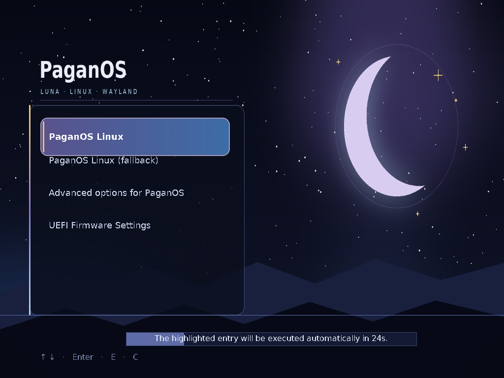

# Motyw GRUB „Luna” dla PaganOS



Motyw nawiązuje do brandingu Luny: nocne niebo, półksiężyc w kolorach
`#D8CCF0`/`#B5D5F1` z obrysem `#7B67AB`, złota gwiazda `#F3D27C` i menu
systemów na półprzezroczystym panelu. Jest instalowany razem ze środowiskiem
jako pakiet `luna-grub-theme` i wchodzi w zależności metapakietu
`luna-desktop`, więc zwykła aktualizacja systemu go nie pomija.

## Pliki

| Ścieżka | Rola |
| --- | --- |
| `assets/grub/luna/theme.txt` | układ menu, pasek odliczania, podpowiedź klawiszy |
| `assets/grub/luna/background.png` | tło 1920×1080 (GRUB skaluje do trybu ekranu) |
| `assets/grub/luna/select_*.png` | 9-slice podświetlenia wybranej pozycji |
| `assets/grub/luna/terminal_*.png` | 9-slice tła konsoli GRUB-a (`C`) |
| `assets/grub/luna/dejavu_*.pf2` | fonty DejaVu Sans/Mono dla menu i konsoli |
| `assets/grub/luna/generate.py` | generator tła, pixmap i fontów |
| `de/grub/05_luna_theme` | skrypt `/etc/grub.d/` włączający motyw |

## Jak to działa

- `scripts/install.sh` (komponent `base`) instaluje motyw do
  `<prefix>/share/grub/themes/luna/` i skrypt do `/etc/grub.d/05_luna_theme`.
- Motyw jest **kopiowany także na partycję `/boot`** (`/boot/grub/themes/luna/`)
  i skrypt preferuje tę lokalizację. Dzięki temu działa przy osobnym `/boot`
  oraz wtedy, gdy starszy GRUB nie potrafi odczytać partycji `/usr`.
- `05_luna_theme` uruchamia się po `00_header` i ustawia `theme` **tylko
  wtedy**, gdy w `/etc/default/grub` nie ma `GRUB_THEME`. Jawny wybór
  administratora zawsze ma pierwszeństwo.
- Skrypt ładuje wszystkie `*.pf2` z katalogu motywu (tak samo robi `00_header`
  dla `GRUB_THEME`) i wskazuje `theme.txt` względem urządzenia rozruchowego,
  więc działa też z `/boot` na osobnej partycji i z LVM. Najpierw szuka
  `/boot/grub/themes/luna`, potem `/usr/share/...` i `/usr/local/share/...`.
- Skrypt zdejmuje stary `GRUB_BACKGROUND` (`background_image` bez argumentu),
  żeby zamiast splash.png pokazało się tło motywu, i wypisuje
  `Found theme: …` w trakcie `grub-mkconfig`.
- Instalator i hook pakietu `luna-grub-theme` odświeżają
  `/boot/grub/grub.cfg` po instalacji (best-effort; błąd nie przerywa
  aktualizacji środowiska).

Po ręcznej zmianie plików motywu wystarczy:

```sh
sudo grub-mkconfig -o /boot/grub/grub.cfg
```

## Odtwarzanie grafiki

Cały motyw jest generowany deterministycznie:

```sh
python3 assets/grub/luna/generate.py
# albo:
make grub-theme
```

Skrypt zapisuje `background.png`, 18 kawałków 9-slice (`select_*`,
`terminal_*`) oraz fonty `*.pf2` (jeśli w systemie jest `grub-mkfont`). Fonty są
generowane z DejaVu (`/usr/share/fonts/dejavu`); grafika i konfiguracja są
objęte MPL-2.0. Zrzut `images/grub-theme.png` to prawdziwy ekran GRUB-a
z rozruchu testowego w QEMU (OVMF).

Tarball receptury odtwarza:

```sh
make grub-package
# → packaging/paganos/github/de/luna-grub-theme/luna-grub-theme-0.1.0.tar.gz
#   (skrypt wypisuje nowy sha256 do wpisania w PAGBUILD.yaml)
```

## Pakowanie (PaganOS)

Receptura `packaging/paganos/github/de/luna-grub-theme/PAGBUILD.yaml` zawiera
gotowy tarball z motywem i skryptem. Jest niezależna od wersji Luny — zawiera
wygenerowane pliki, więc do zbudowania pakietu nie trzeba Pythona ani
`grub-mkfont`. Hook `post-install` kopiuje motyw także do
`/boot/grub/themes/luna` i odświeża `grub.cfg`. Po skopiowaniu katalogu do
repo receptur:

```sh
pagbuild recipes/de/luna-grub-theme/PAGBUILD.yaml
```

Metapakiet `luna-desktop` zależy od `luna-grub-theme`, więc aktualizacja
środowiska instaluje motyw automatycznie.
