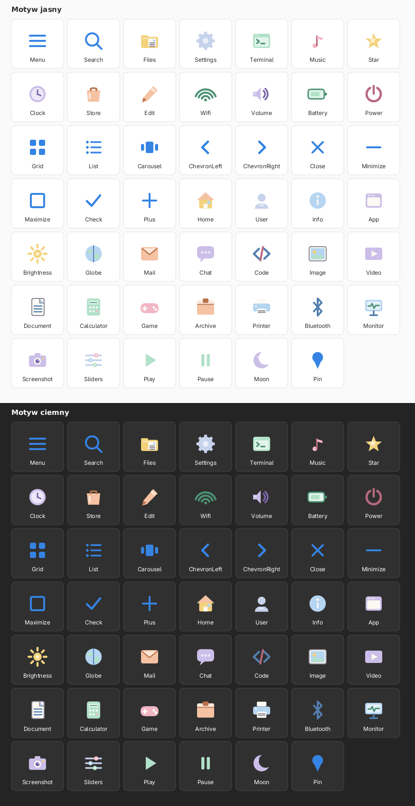

# Luna Icons — pastelowy zestaw ikon środowiska



`luna-icons` to wbudowany, wektorowy zestaw ikon libLuny. Rysuje go
`libluna-widgets::paint_icon` w siatce 24×24, więc ikony są ostre w każdym
rozmiarze i nie wymagają plików rastrowych. Domyślny styl jest **pastelowy**:
każda rodzina ma własny, stały odcień, a kształt mówi, do czego ikona służy.

## Zasady

- **Kształt przed kolorem.** Kartka ma zagięty róg i linie tekstu, terminal —
  okno z promptem, aparat — obiektyw, koperta — klapkę. Kolor tylko wzmacnia
  rozpoznawanie; ikona działa też w trybie monochromatycznym.
- **Jedna paleta na rodzinę.** Pliki i katalogi są maślane, multimedia różowe
  i liliowe, urządzenia i stan — miętowe, ustawienia — perłowe.
- **Kontrolki zostają jednokolorowe.** Menu, lupka, strzałki, „×”, „−”, „□”,
  „✓” i „+” nie zmieniają odcienia, żeby nie rozstrajać paska i przycisków.
- **Dwa style.** `Luna (pastel)` (domyślny) i `Monochrome`. Oba korzystają z tych
  samych kształtów; monochromatyczny rysuje całość kolorem tekstu i **pomija
  kolorowe zestawy zewnętrzne**, żeby interfejs był naprawdę jednokolorowy.
- **Zestawy zewnętrzne.** Jeśli w Ustawieniach wybrano zestaw freedesktop
  (Papirus, Adwaita…), jego PNG mają pierwszeństwo dla ikon aplikacji i miejsc;
  brakujące pozycje nadal rysuje Luna.

## Paleta

| Rola | Wypełnienie | Rozjaśnienie | Kontur | Przykłady |
|---|---|---|---|---|
| Maślana | `#F3D27C` | `#FBF0C8` | `#A4782C` | katalogi, dom, gwiazda |
| Brzoskwiniowa | `#F5C2A3` | `#FCE7D9` | `#B8734A` | sklep, edycja, archiwum |
| Różowa | `#F2B7C6` | `#FBE4EA` | `#B8697F` | muzyka, gry, zasilanie |
| Liliowa | `#CBBEE8` | `#EDE7F8` | `#7B67AB` | zegar, czat, wideo, księżyc |
| Błękitna | `#B5D5F1` | `#E4F0FB` | `#527FAE` | przeglądarka, dokument, kod |
| Miętowa | `#B2E1C9` | `#E2F5EC` | `#4C9274` | terminal, Wi‑Fi, bateria |
| Papierowa | `#F1EDE3` | `#FBF9F3` | `#8B8794` | kartki, drukarka, zdjęcia |
| Perłowa | `#C7D2EB` | `#E9EEF9` | `#65749C` | ustawienia, użytkownik, suwaki |

## Znaczenie ikon

| Ikona | Co przedstawia | Gdzie działa |
|---|---|---|
| `Files` | katalog z wystającą kartką | menedżer plików, launcher |
| `Terminal` | okno terminala z promptem `>_` | terminal, taskbar |
| `Settings` | koło zębate | Ustawienia, Quick Panel |
| `Home` | dom z dachem, oknem i drzwiami | katalog domowy |
| `Document` | kartka z zagiętym rogiem i liniami | dokumenty, PDF, tekst |
| `Image` | ramka zdjęcia: słońce i góry | obrazy, galeria |
| `Video` | ekran z trójkątem odtwarzania | wideo, odtwarzacz |
| `Music` | nuta | audio, odtwarzacz |
| `Archive` | pudełko z uchwytem | ZIP, TAR, 7z |
| `Code` | nawiasy `</>` i ukośnik | edytory, pliki źródłowe |
| `Calculator` | korpus z wyświetlaczem i klawiszami | kalkulator |
| `Game` | pad z krzyżakiem i przyciskami | gry, Steam |
| `Printer` | drukarka z kartką | drukowanie |
| `Globe` | kula ziemska z kontynentami | przeglądarka, sieć |
| `Mail` | koperta z klapką | poczta |
| `Chat` | dymek z trzema kropkami | komunikatory |
| `Store` | torba z uchwytem | sklep z aplikacjami |
| `Clock` | tarcza zegara | czas, historia |
| `User` | sylwetka osoby | konto, ekran blokady |
| `Wifi`, `Volume`, `Battery`, `Power`, `Bluetooth` | stan urządzeń | panel, OSD |
| `Monitor`, `Screenshot`, `Sliders`, `Brightness` | ustawienia systemowe | Ustawienia, Quick Panel |
| `Play`, `Pause`, `Moon` | sterowanie i tryb ciemny | odtwarzacz, przełącznik motywu |
| `Pin` | pinezka | launcher, przypięte aplikacje |

Kontrolki interfejsu (`Menu`, `Search`, strzałki, `Close`, `Pin`) są zawsze rysowane
symbolicznie w kolorze przekazanym przez wywołującego — także w motywie pastelowym —
żeby nie znikały na tle kart i przycisków.

Ikony typów plików w `luna-files` (`folder`, `file`, `Image`, `Music`,
`Video`, `Archive`, `Document`, `Code`, `Text`) korzystają z tej samej palety,
więc lista plików czyta się jak spójny zestaw, a nie zbiór przypadkowych
symboli.

## Podgląd i regeneracja

Galeria w obu motywach powstaje z tego samego kodu:

```bash
cargo run --manifest-path apps/luna-demo/Cargo.toml --bin icons
# → docs/images/icons.png (góra: motyw jasny, dół: ciemny)
```

Style przełącza strona **Ikony** w Ustawieniach (`~/.config/luna/icons.conf`:

```ini
theme = luna
icon_set = Luna-Icons
# icon_set = none   # świadomie tylko ikony wektorowe
# theme = monochrome
```

## Pakiet freedesktop (PNG + SVG)

Ten sam kod potrafi wyeksportować pełny pakiet dla aplikacji **GTK/Qt/KDE** —
z rozmiarami 16, 24, 32, 48, 64, 128, 256 i 512 px oraz katalogami `apps`, `places`,
`mimetypes`, `devices`, `status`, `actions`, `emblems` i `categories`:

```sh
make icons
# → assets/icons/Luna-Icons/16x16…512x512/…/*.png
# → assets/icons/Luna-Icons/scalable/…/*.svg
```

Oprócz rastrów powstaje katalog `scalable/` z tymi samymi ikonami w SVG
(siatka 24×24, `viewBox="0 0 24 24"`). SVG jest generowane z **tej samej sceny**
co PNG, więc paski aplikacji, launcher i ikony systemowe mają identyczne kształty,
grubości linii i paletę. `index.theme` deklaruje katalogi `scalable/*` jako
`Type=Scalable` (`MinSize=16`, `MaxSize=512`), dzięki czemu toolkit wybierze
wektor, gdy tylko obsługuje SVG.

Instalator kopiuje cały pakiet do `share/icons/Luna-Icons`, więc zestaw „Luna Icons”
pojawi się w Ustawieniach → **Ikony** → **Zestaw zewnętrzny** i będzie dostępny
dla innych toolkitów. Jest to **domyślny** zestaw Luny — gdy pakietu nie ma
(np. świeże źródła bez `make icons`), ten sam rysunek powstaje wektorowo.
Aliasy (np. `application-pdf` → `text-x-generic`) są dowiązaniami symbolicznymi,
zarówno dla PNG, jak i SVG, więc pakiet nie powiela tych samych plików.

### Ikony na paski i przyciski

Nazwy plików są zgodne z freedesktop, więc wystarczy wskazać nazwę ikony
(np. `folder`, `utilities-terminal`, `preferences-system`) — aplikacja dostanie
SVG z `scalable/` i sama dobierze rozmiar. W kodzie na libLunie ten sam efekt
daje `paint_icon` / `paint_named_icon`, które rysują identyczny kształt bez
ładowania pliku.

### Aplikacje spoza zestawu

Launcher i taskbar nie wymuszają ikony Luny dla nieznanej aplikacji. Jeśli
`Luna-Icons` nie ma wpisu (np. `gparted`, `darktable`, `net.lutris.Lutris`),
libLuna szuka **oryginalnej ikony** w `hicolor`, potem w pozostałych
zainstalowanych motywach, a na końcu w `pixmaps`. Obsługiwane są zowel PNG, jak
i SVG — te drugie (np. `org.gnome.Adwaita1.Demo`, `org.gtk.Demo4`, Papirus)
są rasteryzowane przez `resvg`. Dopiero gdy nic nie znajdzie, rysuje ogólną
ikonę wektorową. Motywy o wysokim kontraście są pomijane, żeby czarno-białe
warianty nie trafiały do kolorowego launchera.
