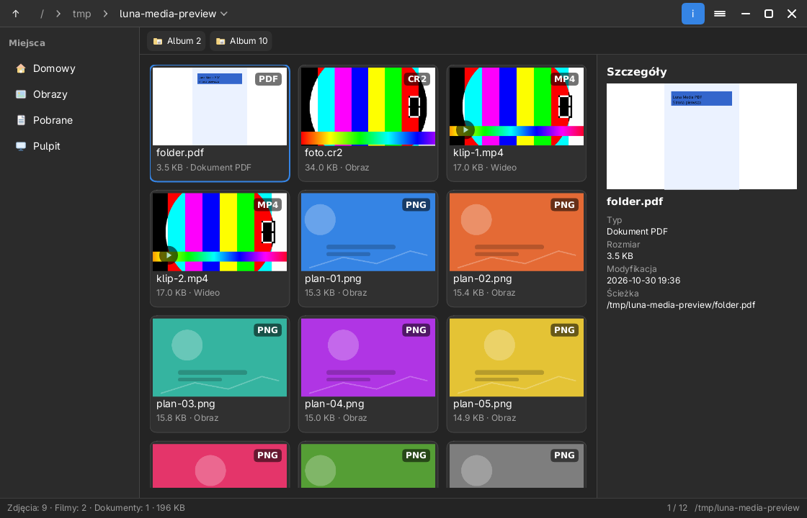
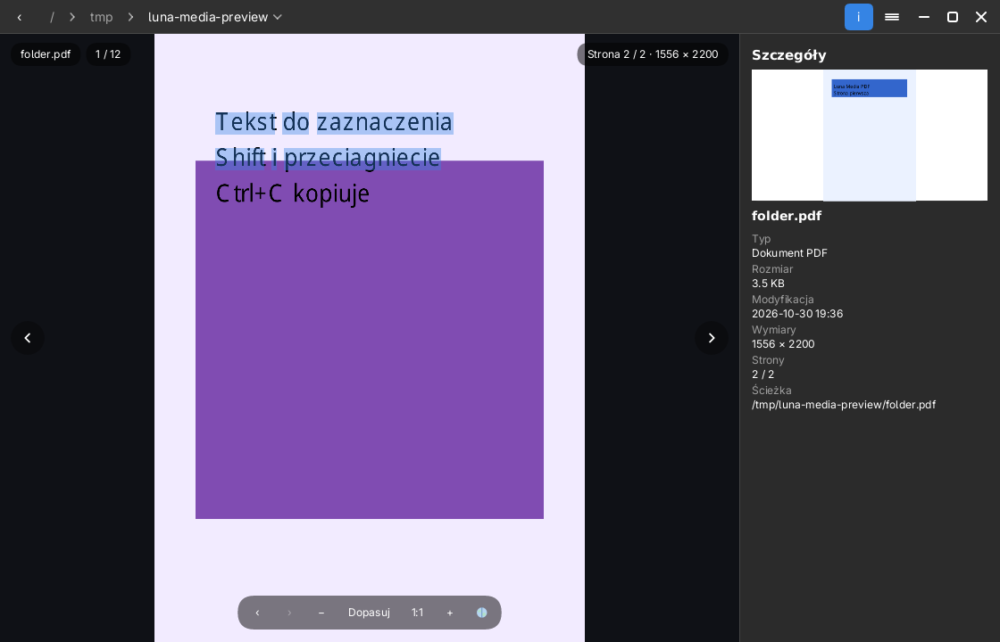

# Luna Media (`luna-media`)

Przeglądarka obrazów, plików RAW, filmów i PDF-ów środowiska Luna, zbudowana na libLunie
(`libluna-platform` + `libluna-widgets`), bez GTK. Obrazy PNG/JPEG/SVG są
dekodowane natywnie, RAW-y pokazują osadzony podgląd, a pozostałe formaty i filmy —
przez `ffmpeg`. Strony PDF renderuje poppler. Dźwięk trafia do PipeWire/PulseAudio
przez `pw-play` (albo `paplay`).



## Co już działa

**Galeria**
- skanowanie katalogu (obrazy, RAW-y, filmy i PDF-y, bez plików ukrytych), sortowanie
  naturalne (`IMG_2` przed `IMG_10`);
- siatka kafelków z **miniaturami liczącymi się w tle** (dwa wątki, pamięć
  podręczna) — filmy dostają klatkę z 0,5 s, PDF-y pierwszą stronę, a RAW-y
  osadzony podgląd; egzotyczne obrazy konwertuje ffmpeg;
- podwójne kliknięcie / `Enter` otwiera podgląd, strzałki poruszają zaznaczeniem,
  `Backspace` wraca do katalogu nadrzędnego;
- panel boczny z miejscami XDG (katalog domowy, Obrazy, Filmy, Pobrane, Pulpit),
  okruszki ścieżki i panel szczegółów (`I`);
- **pasek folderów** pod paskiem tytułu: kliknięcie podkatalogu wchodzi do niego
  (`Ctrl+↓` wchodzi do pierwszego, `Ctrl+↑` wraca);
- pasek stanu z liczbą obrazów, filmów i dokumentów, łącznym rozmiarem i pozycją
  zaznaczenia.

**Podgląd obrazów**
- dopasowanie do okna, powiększenie `+`/`-` i rolką myszy, przesuwanie przeciąganiem,
  `0` = dopasuj, `1` = rzeczywisty rozmiar, dwuklik przełącza jedno i drugie;
- poprzedni/następny plik (`←`/`→`, strzałki na krawędziach), zawijanie playlisty;
- pokaz slajdów (`S` lub `Space`) z odstępem z konfiguracji; pomija filmy;
- panel szczegółów pokazuje wymiary i ścieżkę.

**Odtwarzacz wideo**
- `ffmpeg` dekoduje klatki (RGBA, stałe 30 fps, maks. 1024×576) z opcją `-re`, więc
tempo odpowiada materiałowi; aplikacja trzyma **tylko najnowszą** klatkę i pomija
spóźnione, dzięki czemu obraz nie zostaje w tyle za dźwiękiem nawet gdy rysowanie
jest wolniejsze niż 30 fps; `ffprobe` daje wymiary, czas i kodek;
- `Space` (albo klik w obraz) — pauza/odtwarzanie, `←`/`→` — poprzedni/następny
  plik, `PgUp`/`PgDn` — ±10 s, `Home`/`End` — początek/koniec, `M` — wyciszenie;
- pasek odtwarzania (`MediaControls`): play/pauza, pozycja, czasy; klik w pasek
  przewija; po pauzie klatka jest odświeżana dla nowej pozycji;
- dźwięk jest osobnym potokiem `ffmpeg | pw-play` (fallback: `paplay`) i startuje
  razem z obrazem; przewinięcie restartuje oba potoki, więc nie rozjeżdżają się;
- film otwiera się z automatycznym odtwarzaniem, respektując zapamiętane wyciszenie.

**PDF**
- poppler (`pdfinfo` + `pdftocairo`) liczy strony i renderuje je w tle do 2200 px;
  `PgUp`/`PgDn`, `↑`/`↓`, `Space` i `Home`/`End` zmieniają stronę,
  a przyciski `‹`/`›` w dolnym pasku są nieaktywne na krańcach;
- licznik „Strona 2 / 10” jest w prawym górnym rogu; zoom i przesuwanie działają
  jak dla obrazów; miniatura kafelka to pierwsza strona;
- **warstwa tekstowa**: `Shift` + przeciągnięcie zaznacza słowa (także po zoomie),
  `Ctrl+C` kopiuje zaznaczenie, `Ctrl+A` zaznacza całą stronę, a menu ma
  „Kopiuj tekst strony” — wymaga `pdftotext` z popplera;
- `←`/`→` nadal przełączają pliki (playlistę), a nie strony.



**RAW z aparatów**
- CR2, CR3, NEF, ARW, DNG, ORF, RW2, RAF, PEF, SRW i pokrewne;
- czytamy **największy poprawny podgląd JPEG** osadzony w pliku (bez demozajki),
  a gdy jest za mały — automatycznie robimy pełną demozajkę przez `dcraw_emu`;
- menu **„Rozwiń RAW w pełnej jakości”** wymusza pełny rozwój także wtedy, gdy
  podgląd wystarcza do galerii; wynik jest w sRGB z balansem bieli aparatu.

**Integracja**
- pasek tytułu to `HeaderBar` z libLuny — w jego obszarze `content` siedzą gotowe
  widgety: `Button` (wstecz/wyżej), `PathBar` (okruszki), `ToggleButton`
  (szczegóły) i `MenuButton` (menu `☰`); aplikacja nie rysuje drugiego paska;
- uruchomienie z plikiem (`luna-media zdjęcie.jpg`) otwiera go w podglądzie,
  a playlistą staje się reszta multimediów z tego katalogu;
- uruchomienie z katalogiem otwiera galerię;
- menu `☰`: otwórz w domyślnej aplikacji, otwórz katalog w Luna Files, kopiuj
  ścieżkę, szczegóły, O aplikacji;
- `Escape` zamyka podgląd (wraca do galerii), a w galerii — okno.

## Formaty i zależności

| Rodzaj | Obsługa |
|---|---|
| PNG, JPEG, SVG | natywnie (`tiny-skia`, `jpeg-decoder`, `resvg`) |
| GIF, WebP, BMP, TIFF, AVIF, HEIC, ICO, JXL | przez `ffmpeg` (pierwsza klatka) |
| RAW aparatów (CR2, CR3, NEF, ARW, DNG, ORF, RW2, RAF, PEF, SRW…) | osadzony podgląd JPEG + pełna demozajka `dcraw_emu` (LibRaw) |
| PDF | `pdfinfo` + `pdftocairo` (render), `pdftotext` (warstwa tekstowa) |
| MP4, MKV, WebM, AVI, MOV, OGV, FLV, WMV, MPEG, TS, 3GP | `ffmpeg` + `ffprobe` |
| dźwięk | `pw-play` (PipeWire) albo `paplay` (PulseAudio) |

Poppler to zwykle pakiet `poppler` (PaganOS/Arch) albo `poppler-utils`
(Debian/Ubuntu); `dcraw_emu` (LibRaw) jest potrzebny do pełnej demozajki RAW,
ale bez niego działają osadzone podglądy JPEG.

Bez `ffmpeg`/`ffprobe` galeria nadal pokazuje miniatury PNG/JPEG/SVG, ale filmy
i egzotyczne obrazy zgłoszą czytelny błąd zamiast crasha. Bez popplera PDF-y
pokażą komunikat o brakującym `pdfinfo`/`pdftocairo`. To świadoma decyzja
jak w Luna Files (archiwa przez `bsdtar`/`7z`): nie linkujemy libav ani libpoppler.

## Architektura

| Plik | Rola |
|---|---|
| `model.rs` | wykrywanie formatów, skanowanie katalogu, sortowanie naturalne, formatowanie |
| `places.rs` | katalogi XDG i miejsca w panelu bocznym |
| `prefs.rs` | trwałe ustawienia (`muted`, `slideshow_secs`, `last_dir`) |
| `decode.rs` | dekodowanie obrazów (natywnie/ffmpeg), RAW (osadzony JPEG) i stron PDF |
| `thumb.rs` | kolejka miniatur w tle z pamięcią podręczną |
| `video.rs` | `ffprobe`, potoki `ffmpeg`, odtwarzacz, pauza/przewijanie, dźwięk |
| `app.rs` | stan, nawigacja, podgląd, pokaz slajdów, pętla klatki |
| `ui.rs` | układ, `HeaderBar` z widgetami libLuny, rysowanie, obsługa wejścia |

## Skróty

| Skrót | Galeria | Podgląd |
|---|---|---|
| `←` `→` `↑` `↓` | zaznaczenie | poprzedni/następny |
| `Enter` / `Space` | otwórz | play/pauza (film) / pokaz slajdów (obraz) |
| `Backspace` | katalog wyżej | wróć do galerii |
| `Ctrl+↑` / `Ctrl+↓` | wyżej / pierwszy podkatalog | — |
| `+` `-` `0` `1` | — | powiększ / pomniejsz / dopasuj / 1:1 |
| `S` | — | pokaz slajdów |
| `M` | — | wycisz dźwięk |
| `PgUp` `PgDn` | przewiń o stronę | ±10 s (film) / zmiana strony (PDF) |
| `↑` `↓` | zaznaczenie | plik / zmiana strony (PDF) |
| `Home` `End` | pierwszy/ostatni | początek/koniec filmu lub strona PDF |
| `Space` | otwórz | play/pauza (film) / slajdy (obraz) / następna strona (PDF) |
| `Shift` + przeciągnięcie | — | zaznaczanie tekstu PDF |
| `Ctrl+C` / `Ctrl+A` | — | kopiuj zaznaczenie / zaznacz całą stronę (PDF) |
| `I` | szczegóły | szczegóły |
| `F5` / `F9` | odśwież / panel boczny | odśwież |
| `F11` / `F` | maksymalizacja | maksymalizacja |
| `O` | otwórz zewnętrznie | otwórz zewnętrznie |

## Testy i podgląd

```sh
cd apps/luna-media
cargo test                      # bez okna: model, dekodowanie, UI, prefs
cargo test -- --ignored         # prawdziwy potok ffmpeg (generuje krótki klip)
cargo run --bin preview         # docs/images/luna-media*.png
```

Test odtwarzania (`plays_and_seeks_a_generated_clip`) jest oznaczony `#[ignore]`,
bo wymaga `ffmpeg` i `ffprobe`; nie uruchamiamy go w zwykłym `cargo test`.

## Ograniczenia / następne kroki

- GIF-y są na razie statyczne (pierwsza klatka); animacja wymaga strumienia klatek
  jak w odtwarzaczu wideo.
- Orientacja EXIF w JPEG jest ignorowana (ścieżka `ffmpeg` ją respektuje).
- RAW to domyślnie podgląd osadzony; pełna demozajka jest dostępna automatycznie
  dla małych podglądów i z menu „Rozwiń RAW w pełnej jakości”.
- PDF jest rasteryzowany (domyślnie 2200 px na dłuższy bok); tekst można zaznaczać
  i kopiować (Shift+przeciągnięcie, także po zoomie), ale nie ma jeszcze wyszukiwania.
- Brak zmiany głośności (tylko wyciszenie), napisów i wyboru ścieżki dźwiękowej.
- Dekodowanie wideo w pamięci jest ograniczone do 1024×576; przy 4K źródłach obraz
  jest skalowany (telewizory 4K dostaną później dekodowanie pod rozmiar okna).
