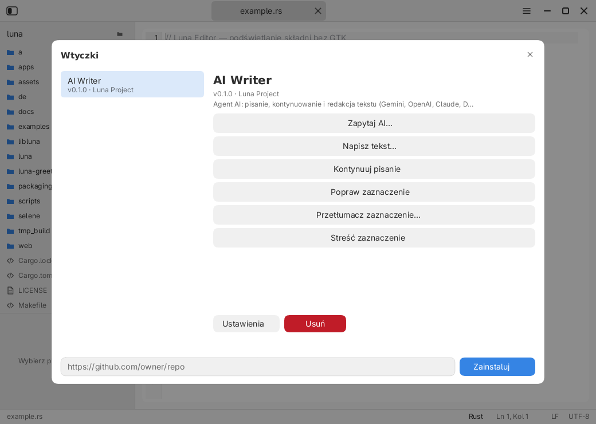

# Wtyczki Luna Editor — dokumentacja dla twórców

Edytor **nie zawiera wtyczek na stałe**. Wtyczka to osobny program instalowany
z zewnątrz (np. z GitHuba) do katalogu użytkownika. Dzięki temu można ją napisać
w dowolnym języku i rozwijać bez przebudowywania Edytora.

Pierwsza oficjalna wtyczka to **AI Writer** — agent AI do pisania, redakcji,
tłumaczenia i streszczania tekstu (Gemini, OpenAI, Claude, DeepSeek, OpenRouter,
Mistral, Groq, Ollama). Repozytorium:
<https://github.com/LunaDesktop/luna-editor-ai-writer>.



## Instalacja

W Edytorze otwórz **menu ☰ → Plugins…** i wklej adres:

```
https://github.com/<owner>/<repo>
```

Instalator:

1. pobiera archiwum `main` (a jeśli nie istnieje — `master`) przez `curl` lub
   `wget`, albo bezpośredni URL archiwum `.tar.gz`,
2. rozpakowuje je `tar`-em,
3. szuka pliku `plugin.conf` (do 3 poziomów katalogów),
4. kopiuje katalog wtyczki do
   `$XDG_DATA_HOME/luna/editor/plugins/<id>/`
   (domyślnie `~/.local/share/luna/editor/plugins/<id>/`).

Wymagane narzędzia systemowe: `curl` (lub `wget`) oraz `tar`.

Wtyczkę usuwa się przyciskiem **Remove** w menedżerze. Ustawienia (w tym klucze
API) są przechowywane osobno w
`$XDG_CONFIG_HOME/luna/editor/plugins/<id>.conf` z prawami `0600`.

Po instalacji polecenia wtyczki są dostępne także **w menu głównym Edytora**
(sekcja z nazwą wtyczki), obok menedżera `Plugins…`.

## Manifest `plugin.conf`

Plik musi leżeć w katalogu głównym repozytorium (albo w podkatalogu — instalator
znajdzie go do 3 poziomów). Format jest liniowy: `klucz = wartość`, komentarze
zaczynają się od `#`.

```ini
id = example
name = Example plugin
version = 0.1.0
author = Twoje imię
description = Krótki opis widoczny w menedżerze wtyczek.
entry = plugin.py
interpreter = python3

command = hello|Przywitaj się||selection|insert
command = write|Napisz tekst…|prompt|document|insert

setting = tone|Ton wypowiedzi|select|neutralny,formalny,swobodny|neutralny
setting = api_key|Klucz API|secret||
```

### Klucze manifestu

| Klucz | Wymagany | Opis |
|---|---|---|
| `id` | tak | Unikalny identyfikator: litery, cyfry, `.`, `_`, `-` |
| `name` | nie | Nazwa wyświetlana (domyślnie `id`) |
| `version` | nie | Wersja widoczna w menedżerze |
| `author` | nie | Autor |
| `description` | nie | Opis w menedżerze |
| `entry` | tak | Program względem katalogu wtyczki |
| `interpreter` | nie | Np. `python3`, `node`, `sh`. Bez niego plik musi być wykonywalny |
| `command` | tak (≥1) | Polecenie widoczne w UI (wymagane, chyba że wtyczka ma tylko `chat`) |
| `chat` | nie | `chat = true` — wtyczka obsługuje panel czatu (patrz niżej) |
| `setting` | nie | Pole konfiguracji |

### `command = id|tytuł|prompt|kontekst|wyjście`

| Pole | Wartości | Znaczenie |
|---|---|---|
| `id` | tekst | Trafia do `LUNA_PLUGIN_ACTION` |
| `tytuł` | tekst | Etykieta przycisku (można użyć polskich znaków) |
| `prompt` | `prompt` lub puste | `prompt` = najpierw zapytaj o instrukcję |
| `kontekst` | `document`, `selection`, `none` | Co trafi na standardowe wejście |
| `wyjście` | `insert`, `replace_selection`, `replace_document`, `append` | Co zrobić z wynikiem |

- `insert` — wstaw w miejscu kursora (zastępuje zaznaczenie),
- `replace_selection` — zamień zaznaczenie; bez zaznaczenia wstaw w kursorze,
- `replace_document` — zamień całą treść dokumentu,
- `append` — dopisz na końcu dokumentu.

### `setting = klucz|etykieta|typ|opcje|domyślna`

| Typ | Opis |
|---|---|
| `text` | Zwykłe pole tekstowe |
| `secret` | Pole maskowane (np. klucz API) |
| `select` | Lista wyboru; opcje oddzielone przecinkami |
| `models` | Lista pobierana z wtyczki po kliknięciu (np. modele LLM); pokazywana w popupie z wyszukiwaniem |

Dla typu `models` wtyczka dostaje akcję `__list_models__` i powinna wypisać
identyfikatory modeli **jeden na linię** na standardowe wyjście. Edytor pokazuje
je w popupie z filtrowaniem i przewijaniem; wybrany model trafia do zapisu
ustawień.

Wartości trafiają do procesu jako zmienne `LUNA_SETTING_<KLUCZ>` (wielkie litery,
znaki inne niż alfanumeryczne zamieniane na `_`). Przykład: `api_key` →
`LUNA_SETTING_API_KEY`.

## Protokół uruchomienia

Edytor uruchamia program w katalogu wtyczki i przekazuje:

| Zmienna | Znaczenie |
|---|---|
| `LUNA_PLUGIN_ID` | `id` wtyczki |
| `LUNA_PLUGIN_ACTION` | `id` wybranego polecenia |
| `LUNA_PLUGIN_INSTRUCTION` | Tekst wpisany w oknie polecenia (może być pusty) |
| `LUNA_PLUGIN_PATH` | Ścieżka dokumentu (może być pusta dla nowego pliku) |
| `LUNA_PLUGIN_LANGUAGE` | Język dokumentu, np. `Rust`, `Markdown`, `Plain` |
| `LUNA_SETTING_*` | Wartości ustawień z manifestu i konfiguracji |

Dodatkowo, gdy użytkownik kliknie pole typu `models`, edytor uruchamia wtyczkę
z `LUNA_PLUGIN_ACTION=__list_models__` (bez danych na stdin) i oczekuje listy
modeli — po jednym na linię. To akcja zarezerwowana przez system wtyczek.

**Standardowe wejście** zawiera kontekst wybrany w manifeście (cały dokument,
zaznaczenie albo nic). Wtyczka powinna najpierw przeczytać stdin.

**Standardowe wyjście** to wynik — czysty tekst do wstawienia. Edytor ignoruje
końcowe znaki nowej linii przy `insert`/`replace_selection`.

**Standardowe wyjście błędów** i kod wyjścia ≠ 0 oznaczają błąd; jego treść
zostanie pokazana użytkownikowi w oknie alertu.

Wtyczki działają z uprawnieniami użytkownika. Nie ma piaskownicy — instaluj
tylko zaufane repozytoria.

## Panel czatu (agent)

Wtyczka deklarująca `chat = true` dostaje w edytorze **panel czatu** (przycisk
ikonki czatu w nagłówku, skrót `Ctrl+Shift+A`). Panel pokazuje się tylko wtedy,
gdy taka wtyczka jest zainstalowana.

Rozmowa to akcja zarezerwowana `__chat__`. Edytor wywołuje wtyczkę wielokrotnie
(pętla agenta, domyślnie do 6 kroków): po każdej odpowiedzi z `tool_calls`
wykonuje narzędzia, dokłada ich wyniki do historii i wywołuje wtyczkę ponownie.

### Co dostaje wtyczka (stdin, JSON)

```json
{
  "version": 1,
  "workspace": {
    "name": "mojprojekt",
    "root": "/home/ula/mojprojekt",
    "files": [{ "path": "src/main.rs", "size": 812 }],
    "contents": [{ "path": "src/main.rs", "text": "fn main() {}\n" }]
  },
  "file": {
    "path": "src/main.rs",
    "language": "Rust",
    "content": "…",
    "selection": "…"
  },
  "messages": [
    { "role": "user", "content": "dodaj testy" },
    { "role": "assistant", "content": "Sprawdzam pliki" },
    { "role": "tool", "content": "[read_file src/main.rs]\nfn main() {}" }
  ],
  "tools": ["read_file", "list_dir", "search", "write_file", "create_file", "delete_file"]
}
```

- `workspace.files` — do 400 plików projektu (bez `target`, `node_modules`
  i katalogów ukrytych);
- `workspace.contents` — treść małych plików (do 24 kB każdy, łącznie 48 kB),
  żeby model widział projekt od razu, bez dodatkowych wywołań;
- `file` — aktywny dokument wraz z zaznaczeniem;
- `messages` — cała historia rozmowy z rolami `user`, `assistant`, `tool`.
  Wiadomości roli `note` (komunikaty edytora) nie są wysyłane.

### Co zwraca wtyczka (stdout, JSON)

```json
{
  "text": "Dopisuję testy do src/main.rs",
  "tool_calls": [
    { "tool": "read_file", "path": "src/main.rs" },
    { "tool": "write_file", "path": "src/main.rs", "content": "…pełna treść…" }
  ]
}
```

- `text` — pokazywane w panelu (może być puste przy samych narzędziach),
- `tool_calls` — opcjonalne; gdy ich nie ma, odpowiedź jest finalna.

Odpowiedź może być też czystym tekstem (bez JSON) — wtedy edytor traktuje ją
jako odpowiedź końcową. Dlatego model można poprosić o JSON, ale zwykła
odpowiedź nie psuje rozmowy.

### Narzędzia

| Narzędzie | Argumenty | Działanie |
|---|---|---|
| `read_file` | `path` | Treść pliku (do 48 kB) |
| `list_dir` | `path` (puste = katalog projektu) | Lista wpisów katalogu |
| `search` | `query`, `path` (opcjonalnie) | Do 20 trafień `ścieżka:linia: treść` |
| `write_file` | `path`, `content` | Zapis całego pliku (tworzy katalogi) |
| `create_file` | `path`, `content` | Jak wyżej, ale błąd gdy plik istnieje |
| `delete_file` | `path` | Usuwa plik |

Zasady bezpieczeństwa po stronie edytora:

- ścieżki muszą być **względne** i nie mogą wyjść poza katalog projektu
  (`..` i ścieżki absolutne są odrzucane),
- zapis do pliku otwartego w edytorze z **niezapisanymi zmianami** jest
  odrzucany (wynik narzędzia zwraca błąd, więc model może zareagować),
- po udanym zapisie edytor przeładowuje czyste bufory i odświeża drzewo plików,
- `write_file` wymaga pełnej treści pliku — nie ma operacji „wstaw fragment”.

### Przykład minimalny (Python)

```python
import json, os, sys

if os.environ.get("LUNA_PLUGIN_ACTION") == "__chat__":
    request = json.load(sys.stdin)
    last = request["messages"][-1]["content"]
    if "[read_file" in last:
        print(json.dumps({"text": "Gotowe."}))
    else:
        print(json.dumps({
            "text": "Zagladam do README.",
            "tool_calls": [{"tool": "read_file", "path": "README.md"}],
        }))
```

## Minimalny przykład (Python)

`plugin.conf`:

```ini
id = hello
name = Hello
version = 0.1.0
entry = hello.py
interpreter = python3
command = hello|Przywitaj się||document|replace_document
```

`hello.py`:

```python
import os
import sys

context = sys.stdin.read()
action = os.environ.get("LUNA_PLUGIN_ACTION", "")
print(f"Witaj! Akcja: {action}, znaków w dokumencie: {len(context)}")
```

## Minimalny przykład (Shell)

```ini
id = upper
name = Wielkie litery
version = 0.1.0
entry = upper.sh
command = upper|Zamień na wielkie litery||selection|replace_selection
```

```sh
#!/bin/sh
tr '[:lower:]' '[:upper:]'
```

Plik `upper.sh` musi być wykonywalny (`chmod +x`). Zamiast tego można ustawić
`interpreter = sh`.

## Publikacja wtyczki na GitHubie

1. Utwórz repozytorium z `plugin.conf` w katalogu głównym.
2. Dodaj program wejściowy i (opcjonalnie) README.
3. Użytkownik instaluje przez URL repozytorium. Domyślnie używane są gałęzie
   `main` i `master`; nie są potrzebne żadne wydania ani tagi.
4. Aktualizacja = ponowna instalacja z tego samego URL (katalog jest
   zastępowany).

## AI Writer — pierwsza wtyczka

Instalacja:

```
https://github.com/LunaDesktop/luna-editor-ai-writer
```

Po instalacji: **Plugins… → AI Writer → Settings** — wybierz dostawcę, model
i wpisz klucz API. Klucz jest zapisywany lokalnie (`0600`) i wysyłany tylko do
wybranego dostawcy.

Obsługiwani dostawcy: Gemini, ChatGPT (OpenAI), Claude (Anthropic), DeepSeek,
OpenRouter, Mistral, Groq oraz lokalny Ollama (bez klucza).

Po wpisaniu klucza API pole **Model** pobiera listę modeli bezpośrednio od
dostawcy i otwiera popup z wyszukiwaniem. Polecenie **Zapytaj AI…** pozwala
wpisać dowolne pytanie lub prompt i wstawić odpowiedź do dokumentu.

Polecenia: **Zapytaj AI…**, **Napisz tekst…**, **Kontynuuj pisanie**,
**Popraw zaznaczenie**, **Przetłumacz zaznaczenie…**, **Streść zaznaczenie**.

## Rozwiązywanie problemów

| Objaw | Przyczyna / rozwiązanie |
|---|---|
| „W archiwum nie znaleziono plugin.conf” | Manifest musi być w repozytorium (do 3 poziomów katalogów) |
| „Nie udało się pobrać wtyczki” | Brak `curl`/`wget`, zły URL albo prywatne repo |
| „Nie udało się uruchomić wtyczki” | Zły `interpreter`, brak `python3` lub plik niewykonywalny |
| „Brak klucza API” (AI Writer) | Uzupełnij ustawienia wtyczki |
| Wtyczka nic nie zwraca | Program musi wypisać tekst na standardowe wyjście |

Zobacz też: [dokumentacja Edytora](editor.md), [system ikon](icons.md).
