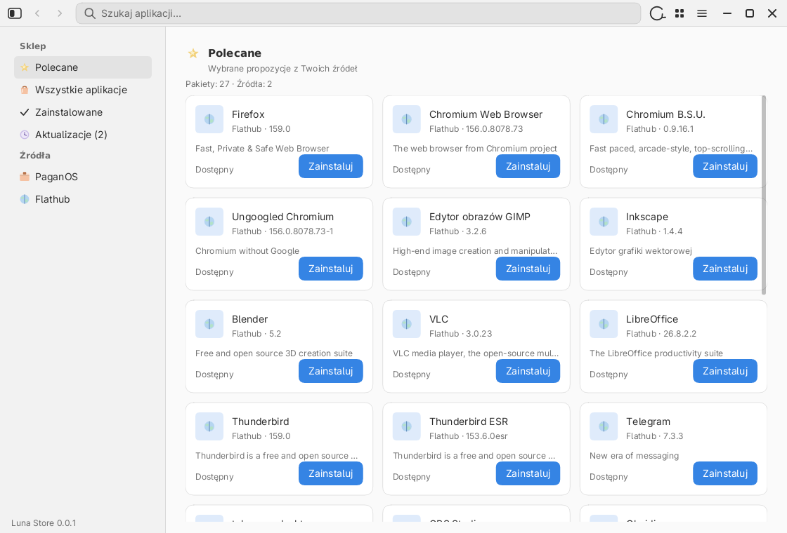
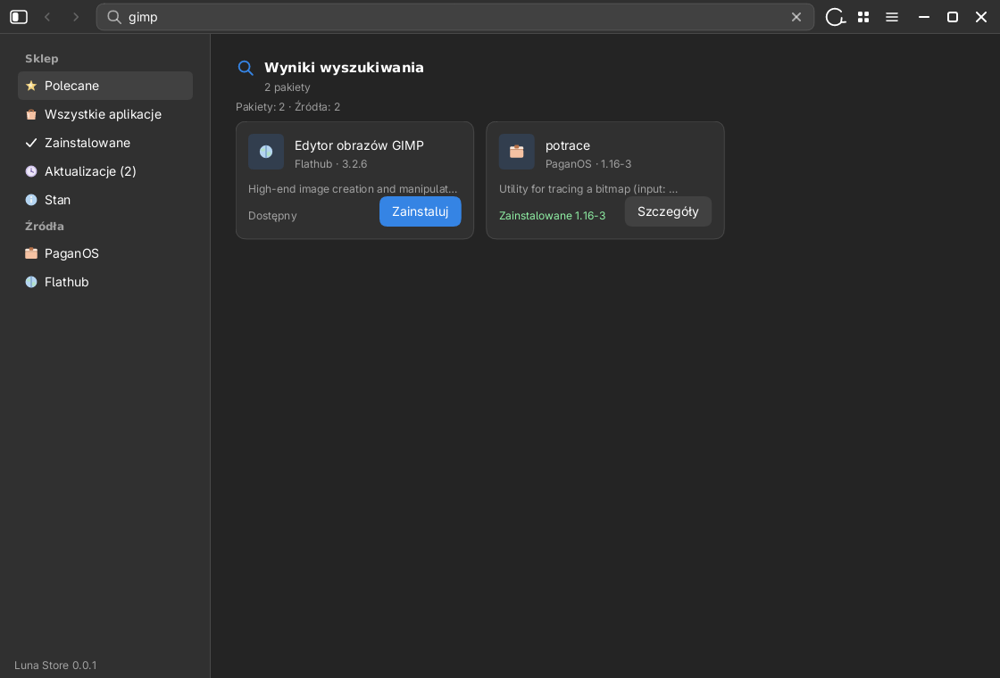
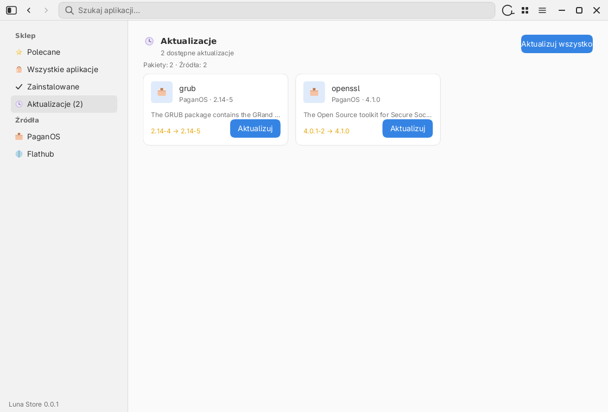
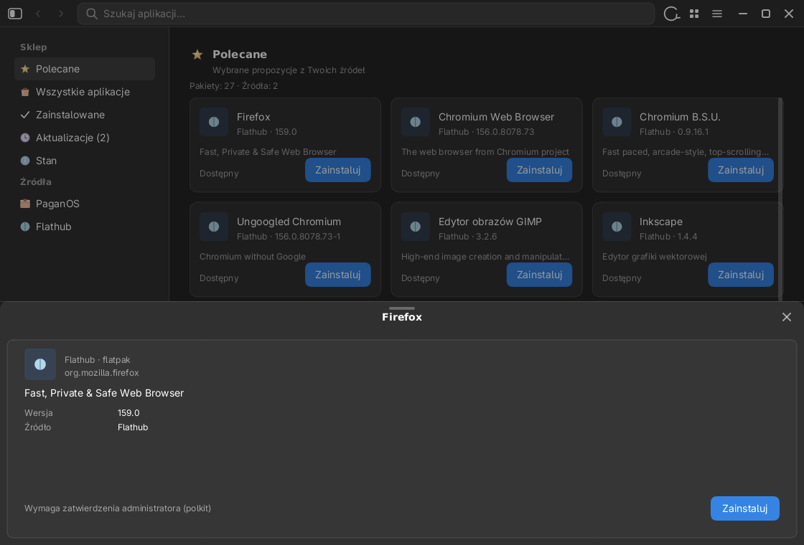
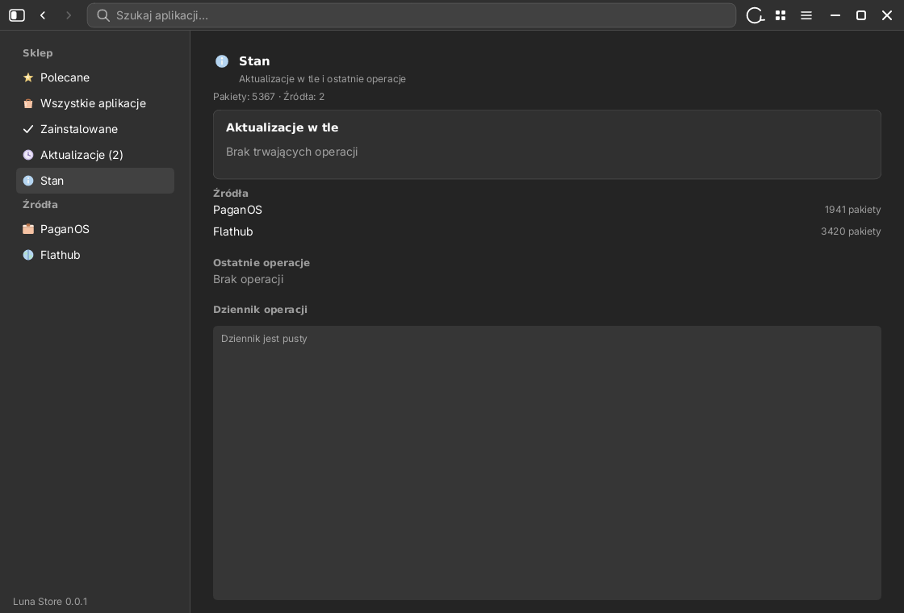
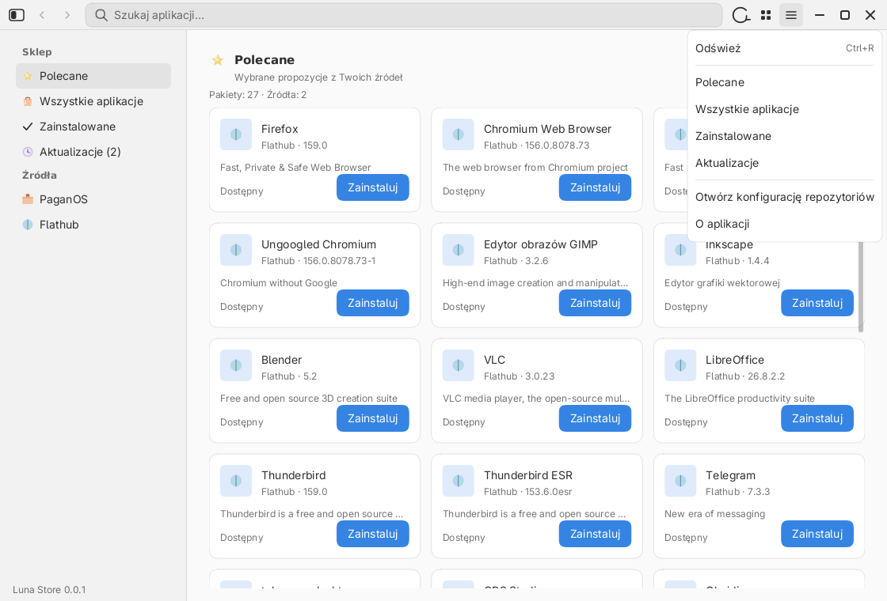
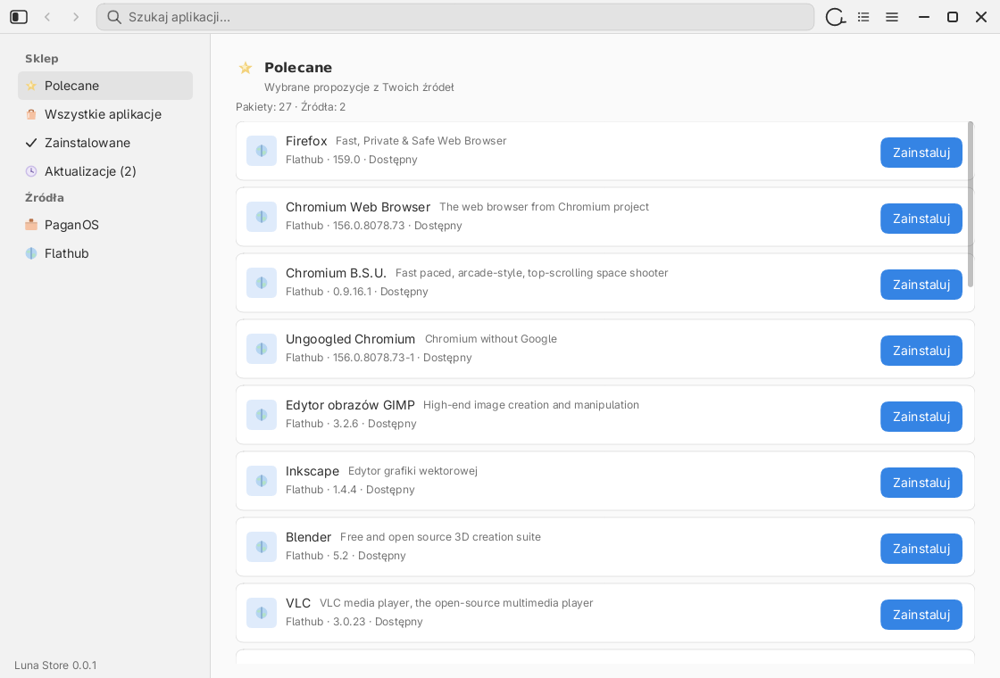

# Luna Store — sklep i aktualizacje

`luna-store` to sklep z oprogramowaniem środowiska Luna zbudowany na **libLunie**
(bez GTK/Qt). Pokazuje aplikacje z natywnych menedżerów pakietów i Flatpaka,
pozwala instalować, usuwać i aktualizować — a lista źródeł pochodzi z **pliku
konfiguracji**, nie z kodu.















Headerbar jest zbudowany jak w **Luna Files**: przełącznik paska bocznego
(`Ctrl+B`), **Wstecz/Dalej** (`Alt+←`/`Alt+→`, przyciski myszy też działają),
pole wyszukiwania na całą szerokość, przełącznik **siatka/lista**
oraz menu ☰ (nawigacja, odświeżanie `Ctrl+R`, otwarcie `repositories.conf`,
informacje o wersji).

## Uruchamianie na konkretnym pakiecie

Menu PPM launchera (**Odinstaluj**) uruchamia Sklep z argumentem pakietu:

```sh
luna-store --package org.gnome.Nautilus   # albo -p / --package=<id>
luna-store --search firefox               # albo -s / --search=<fraza>
```

Sklep czeka, aż katalogi się wczytają, dopasowuje nazwę `.desktop` do
identyfikatora pakietu (m.in. ostatni segment po kropce, np. `nautilus`),
otwiera panel szczegółów i — jeśli pakietu nie ma — pokazuje wyszukiwanie
z komunikatem „Nie znaleziono pakietu”.

## Co jest w środku

| Warstwa | Plik | Rola |
| --- | --- | --- |
| model | `apps/luna-store/src/model.rs` | pakiet, źródło, porównywanie wersji |
| konfiguracja | `config.rs` | parser `repositories.conf` + wykrywanie backendów |
| backendy | `backends.rs` | pacman, pag, apt, dnf, emerge, Flatpak, `custom` |
| cache | `cache.rs` | katalogi TSV w `$XDG_CACHE_HOME/luna/store` |
| praca w tle | `worker.rs` | wątki + kanały `mpsc`, brak blokowania UI |
| stan / UI | `app.rs`, `ui.rs` | scalanie danych, karty, wyszukiwanie, panel szczegółów |

## Plik repozytoriów

Kolejność wyszukiwania:

1. `$LUNA_STORE_CONFIG`
2. `~/.config/luna/store/repositories.conf`
3. `/etc/luna/store/repositories.conf`
4. `$XDG_DATA_HOME/luna/store/repositories.conf` (`~/.local/share/...`)
5. `/usr/share/luna/store/repositories.conf` (lub katalog z `$XDG_DATA_DIRS`)
6. konfiguracja wbudowana w binarkę

Jeśli żadnego pliku nie ma, sklep zapisuje domyślny `repositories.conf`
w `~/.config/luna/store/`, żeby można go było od razu edytować.

Format jest celowo prosty (INI/TOML-podobny):

```ini
[store]
refresh_minutes = 60
privilege = auto          # auto | pkexec | sudo | none
featured = firefox, gimp, vlc, steam

[repository.pagan]
name = PaganOS
backend = pag
enabled = auto            # auto | yes | no

[repository.flathub]
name = Flathub
backend = flatpak
remote = flathub
# installation = user     # domyślnie system dla instalacji z remote
enabled = auto
```

`enabled = auto` włącza źródło tylko wtedy, gdy program backendu jest w `PATH`
(albo istnieje `probe`). Jeden plik działa więc na Archu, PaganOS, Debianie,
Fedorze i Gentoo — bez ręcznego przełączania.

Domyślnie zdefiniowane są:

| Backend | Program | Katalog | Instalacja |
| --- | --- | --- | --- |
| `pacman` | `pacman` | `pacman -Sl` | `pkexec pacman -S` |
| `pag` | `pag` | JSON w `/var/cache/pag/repos` | `pkexec pag install` |
| `apt` | `apt-get` | `apt-cache search .` | `pkexec apt-get install` |
| `dnf` | `dnf` | `dnf list --available` | `pkexec dnf install` |
| `emerge` | `emerge` | `md5-cache` w `/var/db/repos` | `pkexec emerge` |
| `flatpak` | `flatpak` | `flatpak remote-ls` | `flatpak install` (polkit) |

Aktualizacje: `pacman -Qu`, `apt list --upgradable`, `dnf list --upgrades`,
`emerge -puDN @world`, porównanie JSON-ów `pag`, `flatpak remote-ls --updates`.

„Odśwież” ponownie czyta **lokalne** indeksy (i cache Flatpaka). Odświeżenie
metadanych repozytoriów systemowych bywa operacją roota — robi je `apt-get update`
(dodawane przed `apt-get upgrade`), `pacman -Syu`/`pag update`, `dnf upgrade`
i `flatpak update`. Dla Gentoo warto okresowo uruchomić `emerge --sync`.

## Własny menedżer (dowolna dystrybucja)

Wystarczy `backend = custom` i polecenia. Dane katalogu są w TSV:

```ini
[repository.void]
name = Void Linux
backend = custom
probe = xbps-query
enabled = auto
catalog_cmd = sh -c 'xbps-query -l | awk ...'
installed_cmd = sh -c 'xbps-query -l | awk ...'
updates_cmd = sh -c 'xbps-install -un | awk ...'
install_cmd = pkexec xbps-install -y {package}
remove_cmd = pkexec xbps-remove -y {package}
update_all_cmd = pkexec xbps-install -Su
```

Format wyjścia:

- `catalog_cmd`: `identyfikator<TAB>nazwa<TAB>wersja<TAB>opis`
- `installed_cmd`: `identyfikator<TAB>wersja`
- `updates_cmd`: `identyfikator<TAB>nowa_wersja`

Placeholdery `{package}` i `{remote}` są podstawiane bez powłoki. Jeśli polecenie
wymaga powłoki, użyj jawnie `sh -c '…'` — plik konfiguracji jest zaufany.

## Zaznaczanie i instalacja wielu pakietów

- Przycisk ✓ w headerbarze włącza **tryb zaznaczania**: kliknięcie karty
  (poza przyciskiem akcji) zaznacza ją lub odznacza, zamiast otwierać
  szczegóły. `Ctrl+A` zaznacza wszystko widoczne, `Esc` wychodzi z trybu.
- Na dole pojawia się pasek z liczbą zaznaczonych i przyciskiem
  **„Zainstaluj wszystkie (N)”** oraz „Odznacz wszystko”. Pakiety już
  zainstalowane bez aktualizacji są pomijane, a zaznaczone aktualizacje
  są aktualizowane.
- Cała seria idzie **jednym wątkiem, po kolei** (menedżery pakietów blokują
  własną bazę), z jednym hasłem w oknie autoryzacji. Po zakończeniu lista
  i przyciski są odblokowane, a tryb zaznaczania zamyka się sam.
- Nieudane hasło wraca do formularza dla całej serii; błąd pojedynczego
  pakietu nie blokuje pozostałych.

## Aktualizacje w tle i strona „Status”

- **Aktualizuj wszystko** najpierw pyta o potwierdzenie („Zaktualizowanych zostanie N pakietów…”),
  a dopiero potem uruchamia menedżer przez `pkexec` — polkit pokazuje okno hasła.
- Jeśli `pkexec` nie ma bitu setuid (zdarza się w obrazach systemu; przy
  `privilege = auto`) Sklep **nie kończy się kodem 127**, tylko prosi o hasło
  we własnym oknie i przekazuje je do `sudo -S` przez `stdin` (nigdy przez
  `argv` ani dziennik). Błędne hasło wraca do formularza z komunikatem, bez
  zamykania okna. Jawny `privilege = pkexec` nie jest podmieniany po cichu —
  błąd trafia do dziennika na stronie „Status”.
- Po instalacji/usunięciu/aktualizacji Sklep wysyła **powiadomienie systemowe**
  (`org.freedesktop.Notifications`, hint `desktop-entry = eu.luna.Store.desktop`).
  Błąd jest powiadomieniem trwałym. Gdy pojawią się nowe aktualizacje, przychodzi
  jedno powiadomienie na wzrost ich liczby (bez powtarzania przy odświeżaniu
  ani po ponownym uruchomieniu Sklepu — licznik jest zapisany w cache).
  Kliknięcie powiadomienia otwiera Sklep, a jeśli okno już jest — aktywuje je
  (bez drugiej instancji).
- Każda instalacja/aktualizacja/usunięcie jest strumieniowane do wspólnego
  dziennika `$XDG_CACHE_HOME/luna/store/operations.log`, więc widać postęp
  **na żywo**, a `pkexec`/menedżer pakietów dokańcza pracę nawet po zamknięciu
  okna sklepu (proces nie jest przywiązany do wątku UI).
- Strona **Status** (sidebar, menu ☰): bieżąca operacja z licznikiem czasu,
  stan źródeł (liczby pakietów, błędy), historia ostatnich operacji oraz ogon
  dziennika. Po ponownym uruchomieniu sklepu dziennik i historia zostają.
- Dla PaganOS „aktualizuj wszystko” używa `pag upgrade -y` (a nie `pag update`,
  które tylko odświeża indeksy).

## Szybkość i płynność

- **Cache**: katalogi są zapisywane jako TSV i wczytywane przy starcie, więc
  pierwsza klatka nie czeka na `apt-cache` ani Flatpaka.
- **Wątki**: katalog, stan instalacji i każda operacja idą do osobnego wątku;
  UI odświeża się co ~80 ms, gdy coś trwa.
- **Wirtualizacja**: rysowane są tylko widoczne karty, więc 100 000 pakietów
  nie spowalnia przewijania.
- **Filtrowanie w pamięci**: wyszukiwanie korzysta z jednego znormalizowanego
  napisu (`id + nazwa + opis`), bez ponownego odpytywania menedżerów.
- **Wyszukiwanie jest globalne**: pole w headerbarze przeszukuje **wszystkie**
  źródła, także gdy jesteś na stronie „Polecane” (wcześniej filtr działał tylko
  w obrębie bieżącej strony). Wyniki mają tytuł „Wyniki wyszukiwania”, a trafienia
  w nazwę/ID są wyżej niż te w opisie. `Enter` chowa edycję, `Esc` czyści pole,
  a kliknięcie poza polem zdejmuje fokus; zmiana strony czyści zapytanie.
  Skrót `/` (oraz `Ctrl+F`) od razu ustawia fokus w wyszukiwarce.
- **Leniwe opisy**: pacman/dnf dociągają opis wybranego pakietu dopiero po
  otwarciu szczegółów.
- **Panel szczegółów**: kliknięcie karty (poza przyciskiem) wysuwa BottomSheet
  z ikoną źródła, identyfikatorem, opisem, wersją i akcjami. Animacja panelu
  i powiadomień jest postępowana w `App::tick` (wcześniej panel był „otwarty”,
  ale niewidoczny, bo animacja stała na zerze).

## Bezpieczeństwo

- Nazwy pakietów są walidowane (bez spacji, `;`, `|`, wiodącego `-`).
- Polecenia budowane są jako `argv` (`Command::new`), nie przez powłokę.
- Operacje systemowe **zawsze wymagają autoryzacji**: `privilege = auto` używa
  `pkexec` (okno hasła rysuje agent polkit Luny, `luna-polkit`), a `pkexec`
  szukamy także w `/usr/sbin`, `/sbin` i `/usr/local/sbin` — nie tylko w `PATH`
  odziedziczonym po sesji. `pkexec` wybieramy **tylko wtedy, gdy jest setuid
  root**; inaczej (komunikat „pkexec must be setuid root”, kod 127) Sklep pyta
  o hasło i używa `sudo -S`. Gdy nie ma żadnego działającego narzędzia,
  pokazuje jasny błąd zamiast po cichu uruchamiać menedżer bez uprawnień.
  Flatpak systemowy sam wywołuje polkit; instalacja użytkownika
  (`installation = user`) nie wymaga hasła.
- Usunięcie pakietu wymaga potwierdzenia w panelu szczegółów.

## Instalacja

Bez roota (najprościej, od razu działa w sesji użytkownika):

```bash
./scripts/install.sh --user --only store
~/.local/bin/luna-store
```

Instalator kładzie `~/.local/bin/luna-store`, wpis
`~/.local/share/applications/eu.luna.Store.desktop` oraz domyślny
`~/.local/share/luna/store/repositories.conf`. Sklep pojawi się też w launcherze Luny.

Systemowo:

```bash
sudo ./scripts/install.sh --prefix /usr --only store
```

Można też przez `make`:

```bash
make install-store-user     # ~/.local
make install-store          # /usr/local (wymaga uprawnień)
```

## Uruchamianie i testy

```bash
cargo run --manifest-path apps/luna-store/Cargo.toml
cargo test --manifest-path apps/luna-store/Cargo.toml

# zrzut ekranu bez kompozytora (PNG):
cargo run --manifest-path apps/luna-store/Cargo.toml --bin store-render -- --dark /tmp/store.png
cargo run --manifest-path apps/luna-store/Cargo.toml --bin store-render -- --list /tmp/store-list.png
```
