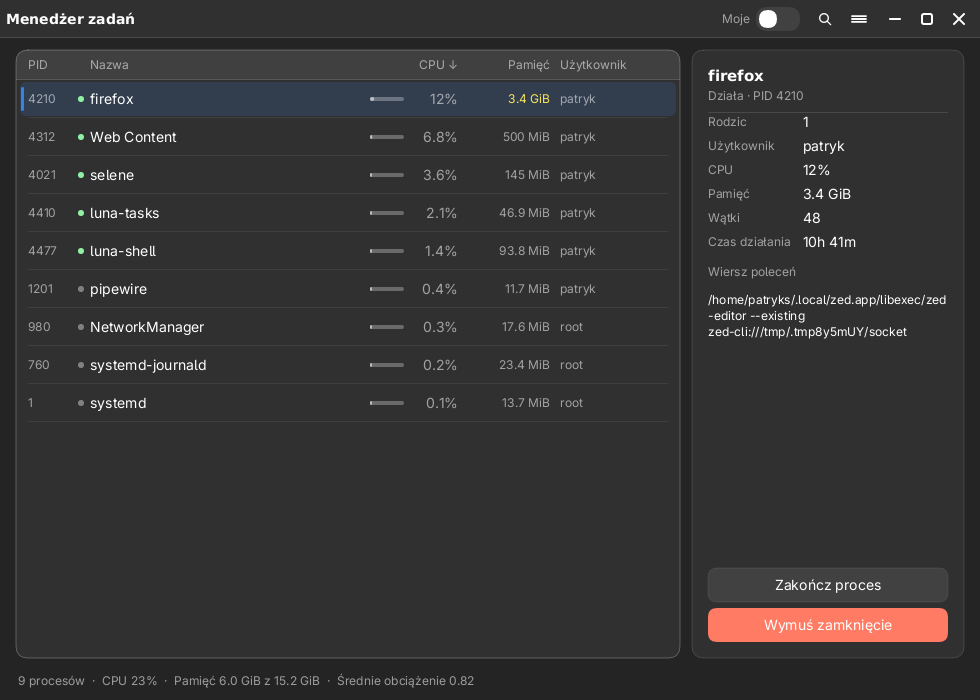
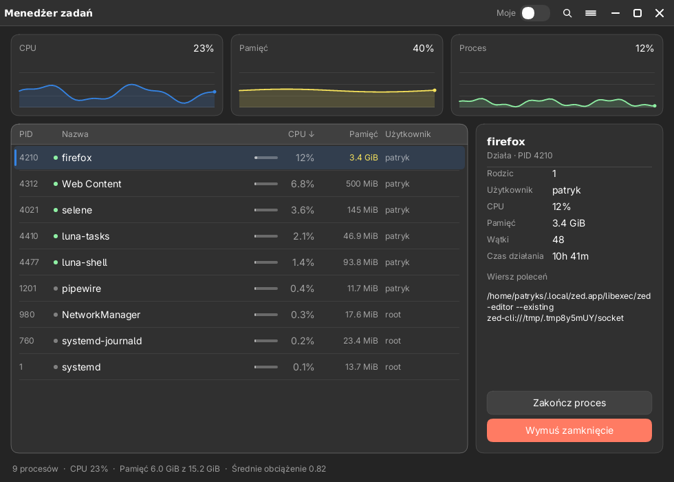
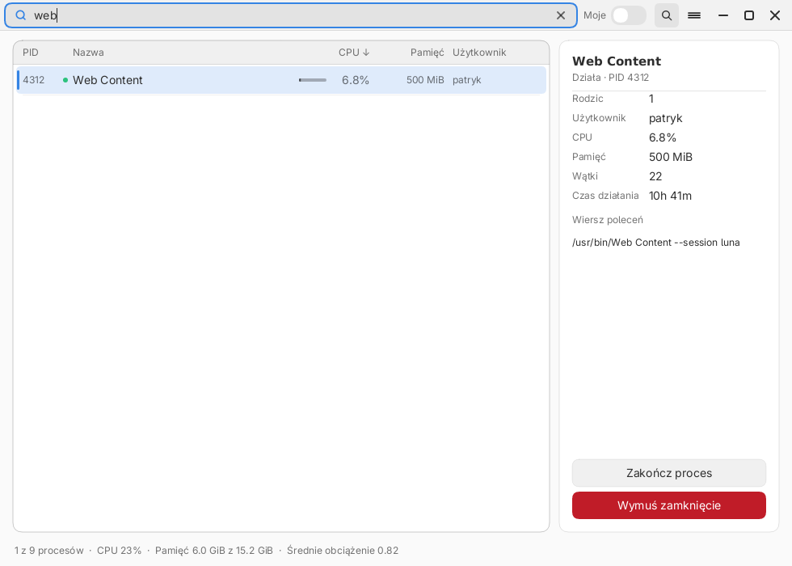
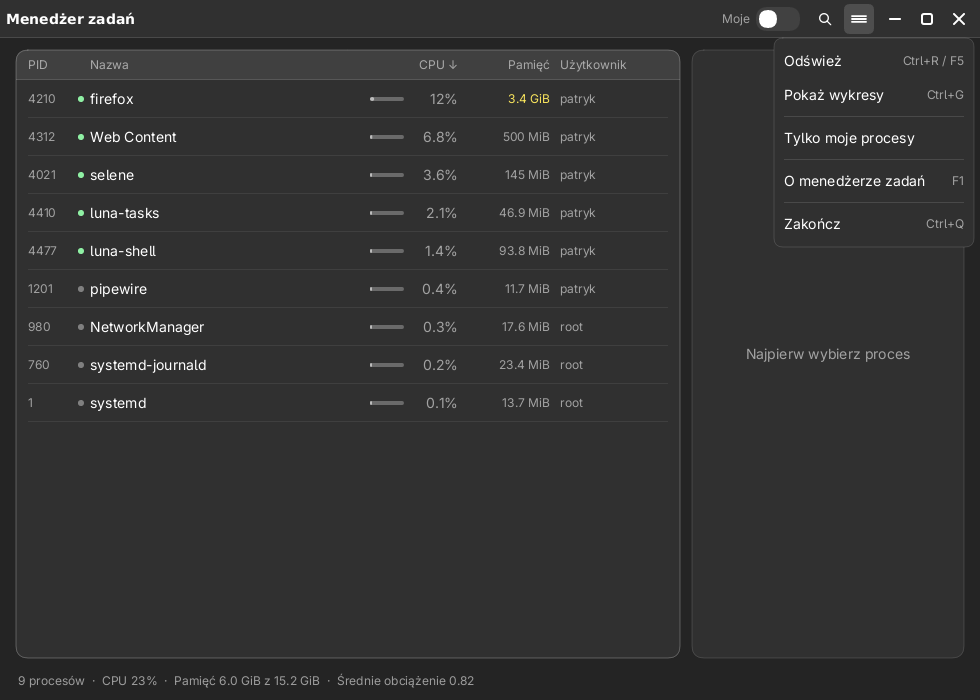
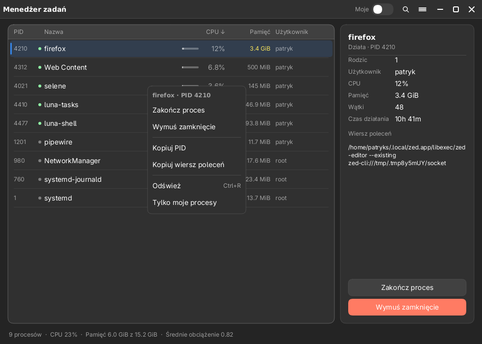
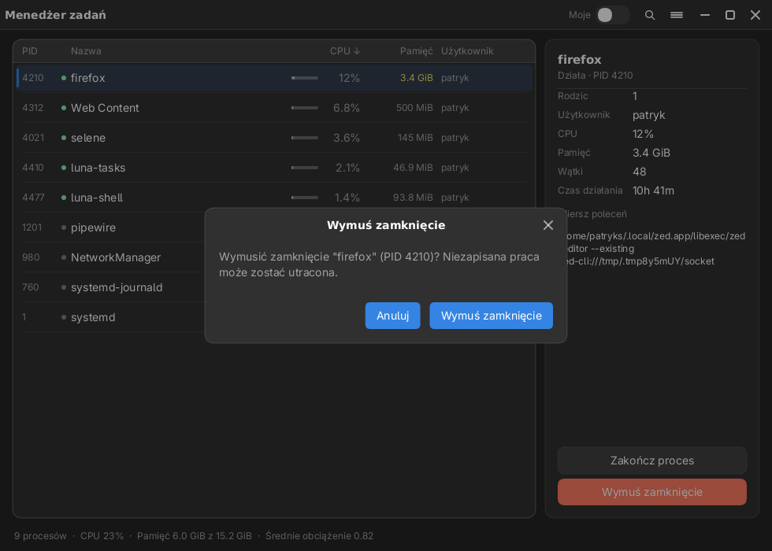
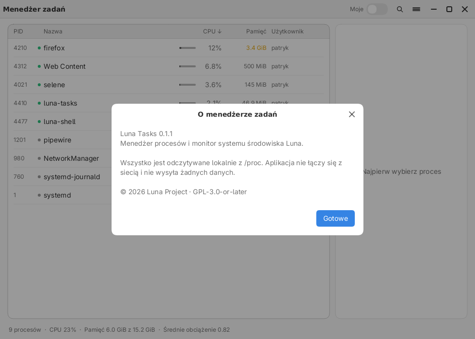

# Luna Tasks — menedżer procesów i monitor systemu















`luna-tasks` to lekki menedżer procesów środowiska Luna na libLunie. Czyta
wyłącznie `/proc` i `/etc/passwd`, nie wymaga GTK, nie uruchamia usług w tle
i nie wysyła żadnych danych.

## Co jest w środku

| Obszar | Możliwości |
|---|---|
| **Lista** | PID, nazwa, CPU, pamięć i użytkownik; sortowanie po kliknięciu nagłówka (CPU, pamięć, PID, nazwa, użytkownik) |
| **Odświeżanie** | próbka `/proc` co sekundę; procent CPU liczony z różnicy taktów między próbkami |
| **Wyszukiwanie** | lupka w pasku tytułu (obok `—`/`□`/`×`) pokazuje pole filtra po PID, nazwie, pełnej linii poleceń i użytkowniku; wpisanie tekstu od razu włącza filtr, a `Esc`/`Ctrl+F` chowa i pokazuje pole |
| **Zakres** | kompaktowy przełącznik **Moje** w pasku tytułu (obok lupki; pełna nazwa **Tylko moje procesy** w menu) ukrywa procesy innych kont |
| **Wykresy** | opcja **Pokaż wykresy** w menu (`Ctrl+G`): trzy mini-wykresy — CPU systemu, pamięć i CPU zaznaczonego procesu — z historią ostatnich 60 próbek (1 minuta) |
| **Kolorowanie** | kropka stanu procesu (działa/śpi/czeka/zombie), kolor CPU przy wysokim zużyciu i kolor pamięci przy dużym udziale w RAM; zombie i zatrzymane procesy mają wyróżnione tło |
| **Szczegóły** | panel z rodzicem, użytkownikiem, CPU, pamięcią, liczbą wątków, czasem działania i pełną linią poleceń |
| **Zakończenie** | `SIGTERM` (**Zakończ proces**) albo `SIGKILL` (**Wymuś zamknięcie**) po potwierdzeniu; PID 1 jest chroniony, a błędy `EPERM`/`ESRCH` pokazują czytelny komunikat |
| **Menu kontekstowe** | PPM na procesie: **Zakończ proces**, **Wymuś zamknięcie**, **Kopiuj PID**, **Kopiuj wiersz poleceń**, **Odśwież** i przełącznik zakresu; `Shift+F10` otwiera je z klawiatury |
| **Klawiatura** | strzałki, `PageUp`/`PageDown`, `Home`/`End`, `Enter`/`Delete` (zakończ), `Shift+Delete` (wymuś), `Shift+F10` (menu kontekstowe), `Ctrl+F` (szukaj), `Ctrl+G` (wykresy), `Ctrl+R`/`F5` (odśwież), `Ctrl+Q` (zamknij), `F1` (o aplikacji) |
| **Menu** | hamburger w pasku tytułu: **Odśwież**, zakres listy, **O menedżerze zadań**, **Zakończ** |

## Jak to działa

- Każda próbka czyta `/proc/<pid>/stat` (PID, nazwa, stan, rodzic, takty CPU),
  `/proc/<pid>/status` (`VmRSS`, `Uid`, `Threads`), `/proc/<pid>/cmdline` oraz
  `/proc/<pid>/statm` jako zapas dla pamięci.
- Procent CPU to różnica `utime + stime` między dwiema próbkami podzielona przez
  czas, liczbę taktów na sekundę (`sysconf(_SC_CLK_TCK)`) i liczbę rdzeni.
  Pierwsza próbka po starcie pokazuje `0%` — dopiero druga ma punkt odniesienia.
- `starttime` z `/proc/<pid>/stat` odróżnia procesy o tym samym PID. Dzięki temu
  zaznaczenie nie „przeskakuje” na inny proces, a potwierdzenie zakończenia nie
  wyśle sygnału do procesu, który powstał po recyklingu PID.
- Nazwa pochodzi z pola `comm` jądra (może zawierać spacje i nawiasy — parser
  dzieli linię po ostatnim `)`); pełna linia poleceń jest widoczna w szczegółach.
- Użytkownik pochodzi z `/etc/passwd`; gdy UID nie ma wpisu, pokazujemy numer.
- Zakończenie procesu to `kill(2)` z `SIGTERM` albo `SIGKILL`. Aplikacja nie
  uruchamia `killall`, `pkill` ani żadnych zewnętrznych poleceń.
- Bez fokusu okna odświeżanie jest wstrzymane — menedżer nie zużywa CPU, gdy
  stoi w tle.
- Lista i panel szczegółów dopasowują się do szerokości okna: przy węższym oknie
  kolumny pamięci/użytkownika znikają, a panel szczegółów ustępuje liście.
  Przełącznik zakresu siedzi w pasku tytułu, więc nad listą nie ma osobnego
  pustego wiersza; licznik procesów jest na dolnym pasku stanu.
- Kolory są wyłącznie wskazówką wizualną: kropka pokazuje stan procesu,
  CPU robi się żółte od 20% i czerwone od 50%, a pamięć żółta od 10% i czerwona
  od 25% całego RAM-u. Nic nie zmienia zachowania akcji.
- Menu kontekstowe (PPM) zaznacza kliknięty proces i pozwala zakończyć go,
  skopiować PID lub pełną linię poleceń bez szukania w panelu szczegółów.
  `Shift+F10` otwiera to samo menu przy zaznaczonym wierszu.
- Wykresy trzymają 60 próbek (przy odświeżaniu co 1 s = ostatnia minuta).
  Historia procesu czyści się przy zmianie zaznaczenia, a historia systemu
  rośnie niezależnie. Opcja jest zapisywana w `tasks.conf` (`charts=on|off`).
- Długa linia poleceń jest zawijana **po znakach** i przycinana do karty
  (`PaintCtx::paragraph`), więc ścieżki typu
  `/home/…/zed.app/libexec/zed-editor` zostają w panelu szczegółów.

## Prywatność

- Czytane są wyłącznie pliki `/proc` i `/etc/passwd`. Aplikacja nie otwiera
  gniazd sieciowych i nie zapisuje historii procesów.
- Jedyny trwały zapis to `~/.config/luna/tasks.conf` z ustawieniami widoku
  (`sort`, `order`, `scope`). Nie zawiera nazw procesów ani poleceń.
- Zakończenie cudzego procesu wymaga uprawnień administratora; bez nich
  aplikacja pokazuje **Brak uprawnień do tego procesu** i nie próbuje obejść
  zabezpieczeń.

## Uruchamianie i testy

```sh
cargo run --manifest-path apps/luna-tasks/Cargo.toml
cargo test --manifest-path apps/luna-tasks/Cargo.toml --lib
cargo run --manifest-path apps/luna-tasks/Cargo.toml --bin preview
```

`--bin preview` rysuje stany interfejsu bez kompozytora (do dokumentacji):
`docs/images/tasks-{list,search,menu,confirm,about}.png`. Podglądy używają
sztucznych procesów, żeby zrzuty były deterministyczne; aplikacja zawsze czyta
prawdziwy system.

Wpis sesji: `de/session/eu.luna.Tasks.desktop` (`Exec=luna-tasks`,
`Categories=System;Monitor;`). Instalacja: `scripts/install.sh --only tasks`.
