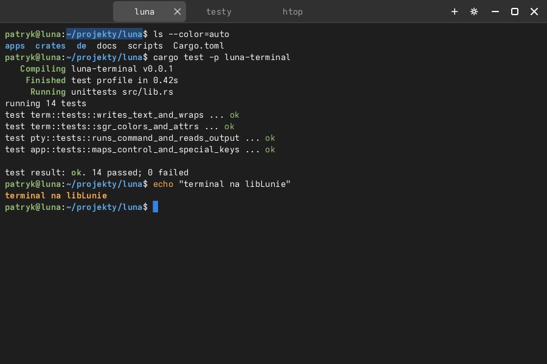
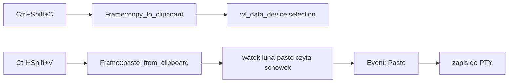
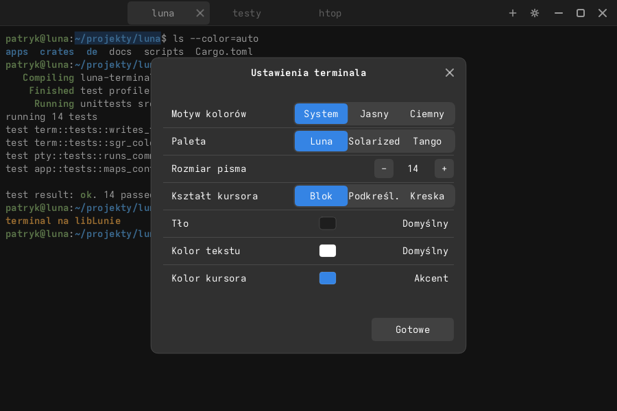

# Luna Terminal — terminal na libLunie

`luna-terminal` to emulator terminala zbudowany wyłącznie na libLunie — **bez
GTK, Qt ani VTE**. Warstwa uprzywilejowana nie istnieje: aplikacja otwiera
pseudoterminal, uruchamia powłokę użytkownika i rysuje siatkę znaków fontem
monospace.



## Jak to działa

```
luna-terminal ── fork/exec ──> $SHELL (PTY slave)
      │                              │
      │  read (wątek)  <─────────────┘
      │  write (klawisze, wklejanie, DSR/DA)
      └── parser VT → siatka znaków → libluna-render → Selene
```

| Moduł | Odpowiedzialność |
| --- | --- |
| `apps/luna-terminal/src/pty.rs` | `posix_openpt`/`grantpt`/`unlockpt`, `fork`, `setsid`, `TIOCSCTTY`, `execve`, wątek czytający, `TIOCSWINSZ` |
| `apps/luna-terminal/src/term.rs` | siatka komórek, scrollback (2000 linii), parser VT100/xterm, SGR, tryb alternatywny, DSR/DA, tekst zaznaczenia |
| `apps/luna-terminal/src/ui.rs` | pasek tytułu i zakładek, paleta ANSI, rysowanie serii tekstu, zaznaczenie, kursor, okno Ustawień |
| `apps/luna-terminal/src/prefs.rs` | ustawienia: schemat, preset palety, kolory, stopień pisma, kształt kursora (`terminal.conf`) |
| `apps/luna-terminal/src/app.rs` | pętla zdarzeń, zakładki, mapa klawiatury, schowek, tytuł okna, obsługa wyjścia procesu |

Font: `TextEngine::mono()` (`libluna-render`) — Adwaita Mono → DejaVu Sans Mono →
Noto Sans Mono. Platforma tworzy renderer z tym silnikiem po
`AppConfig::monospace(true)`.

## Zaznaczanie i schowek

- **Przeciąganie** lewym przyciskiem zaznacza tekst; zaznaczenie rysuje się pod
  tekstem półprzezroczystym tłem akcentu.
- **Podwójny klik** zaznacza słowo (ciąg znaków bez spacji — wygodne dla ścieżek
  i adresów URL), **potrójny** — cały wiersz, `Shift+klik` rozszerza zaznaczenie.
- **`Ctrl+Shift+C`** kopiuje zaznaczenie do systemowego schowka
  (`wl_data_device`), **`Ctrl+Shift+V`** wkleja. Wklejanie respektuje
  `bracketed paste` (`?2004`), więc powłoka i edytory nie wykonują wklejonego
  tekstu od razu.
- **Środkowy przycisk myszy** wkleja schowek (jak w terminalach X11).
- Wiersze są łączone znakiem `\n`, a końcowe spacje obcinane.



Odczyt schowka idzie w tle — klatka się nie blokuje, a tekst wraca jako
`Event::Paste` w jednej z kolejnych klatek.

## Zakładki

- **`Ctrl+Shift+T`** — nowa zakładka (nowy PTY, ten sam rozmiar siatki),
  **`Ctrl+Shift+W`** — zamknięcie aktywnej; ostatnia zakładka zamyka okno.
- **`Ctrl+Tab` / `Ctrl+Shift+Tab`**, **`Ctrl+PageUp` / `Ctrl+PageDown`** oraz
  **`Alt+1…9`** przełączają zakładki.
- **`Ctrl+Shift+N`** otwiera nowe okno terminala.
- Pasek zakładek pojawia się przy więcej niż jednej zakładce; kliknięcie wybiera
  zakładkę, `×` ją zamyka, kółko myszy przewija przepełniony pasek. Przycisk `+`
  obok paska tworzy nową zakładkę.
- Tytuł okna i etykieta zakładki pochodzą z OSC 0/2 aktywnego programu.

## Ustawienia i kolorystyka

**`Ctrl+,`** albo ikona koła zębatego na pasku tytułu otwiera okno Ustawień:

| Ustawienie | Wartości |
| --- | --- |
| Motyw kolorów | `System`, `Light`, `Dark` — niezależnie od motywu środowiska |
| Paleta | `Luna`, `Solarized`, `Tango` (16 kolorów ANSI + tło/tekst/kursor) |
| Rozmiar pisma | 8–32 (przyciski `−`/`+`, też `Ctrl++`, `Ctrl+-`, `Ctrl+0`) |
| Kształt kursora | `Block`, `Underline`, `Bar` |
| Tło / kolor tekstu / kursor | cykliczny wybór gotowych kolorów („Default” = z palety) |

Ustawienia są zapisywane od razu w `$XDG_CONFIG_HOME/luna/terminal.conf`
(albo `~/.config/luna/terminal.conf`). Plik można edytować ręcznie:



```ini
# luna-terminal
scheme=system        # system | light | dark
preset=luna          # luna | solarized | tango
font_size=14
background=0         # indeks koloru tła (0 = z palety)
foreground=0
cursor=0
cursor_shape=block   # block | underline | bar
```

## Obsługiwane sekwencje

- **Kursor:** CUP/HVP, CUU/CUD/CUF/CUB, CNL/CPL, CHA, VPA, zapis/odtworzenie (`ESC 7/8`, CSI `s/u`).
- **Kasowanie:** ED (`J` 0/1/2/3), EL (`K` 0/1/2), ECH (`X`).
- **Edycja:** ICH (`@`), DCH (`P`), IL (`L`), DL (`M`), SU/SD (`S`/`T`).
- **SGR:** 0, 1, 2, 3, 4, 7, 8, 22–24, 27, 28, 30–37, 39, 40–47, 49, 90–97, 100–107,
  `38;5;n`, `48;5;n`, `38;2;r;g;b`, `48;2;r;g;b`.
- **Tryby prywatne:** `?1` (kursory aplikacji), `?7` (autowrap), `?25` (kursor),
  `?47`/`?1047`/`?1049` (ekran alternatywny), `?2004` (bracketed paste).
- **OSC:** 0/2 — tytuł okna (BEL albo `ESC \`).
- **Odpowiedzi:** DSR `CSI 5n`/`6n`, DA `CSI c`.
- **Obszar przewijania:** DECSTBM (`CSI r`), indeks/reverse index (`ESC D`/`ESC M`).
- **UTF-8:** dekodowanie przyrostowe; szerokie znaki (CJK/emoji) zajmują 2 kolumny,
  znaki łączące są doklejane do poprzedniej komórki.

## Klawiatura

| Klawisz | Działanie |
| --- | --- |
| litery/cyfry/znaki | wysyłane jako UTF-8 (`KeyEvent.text`) |
| `Ctrl+A`…`Ctrl+Z`, `Ctrl+[ \ ] ^ _`, `Ctrl+Space` | kody sterujące 0x01–0x1f |
| `Alt+klawisz` | `ESC` + znak |
| strzałki, Home/End, Insert/Delete, PageUp/PageDown, F1–F12 | sekwencje xterm (SS3 w trybie aplikacji) |
| `Ctrl+Shift+C` / `Ctrl+Shift+V` | kopiuj / wklej |
| `Ctrl+Shift+T` / `Ctrl+Shift+W` / `Ctrl+Shift+N` | nowa zakładka / zamknij zakładkę / nowe okno |
| `Ctrl+Tab`, `Ctrl+Shift+Tab`, `Ctrl+PageUp/Down`, `Alt+1…9` | przełączanie zakładek |
| `Ctrl+,` | Ustawienia |
| `Ctrl++` / `Ctrl+-` / `Ctrl+0` | stopień pisma |
| `Shift+PageUp` / `Shift+PageDown` | historia (3/4 ekranu) |
| `Shift+Home` / `Shift+End` | początek / koniec historii |
| kółko myszy | historia (3 linie na „ząbek”); nad paskiem zakładek przewija pasek |
| dowolny klawisz podczas przeglądania historii | powrót na dół |

`Escape` **nie zamyka okna** (`escape_to_exit(false)`) — trafia do programu
(np. wyjście z trybu wstawiania w `vim`). Okno zamyka się kontrolką `✕` na pasku
tytułu albo po zakończeniu procesu (domyślnie po 450 ms). Zakładki z zakończonym
procesem zamykają się same, chyba że ustawiono `LUNA_TERMINAL_HOLD=1`.

## Uruchamianie

```bash
luna-terminal                 # $SHELL (domyślnie /bin/sh)
luna-terminal -e htop         # dowolne polecenie
luna-terminal --              # to samo co -e
```

| Zmienna | Znaczenie |
| --- | --- |
| `LUNA_TERMINAL_FONT_SIZE` | stopień pisma 8–32 (domyślnie 14, nadpisuje zapisane ustawienie) |
| `LUNA_TERMINAL_CMD` | polecenie zamiast powłoki, uruchamiane przez `sh -c` |
| `LUNA_TERMINAL_HOLD=1` | nie zamykaj okna po zakończeniu procesu |
| `LUNA_FONT_MONO`, `LUNA_FONT_MONO_BOLD` | własne pliki fontu monospace |

Dziecko dostaje `TERM=xterm-256color`, `COLORTERM=truecolor`, `LUNA_TERMINAL=1`
oraz dziedziczone środowisko; katalog roboczy to `$HOME`.

## Instalacja

```bash
sudo ./scripts/install.sh --prefix /usr
```

Instalator kładzie `luna-terminal` i wpis `eu.luna.Terminal.desktop`
(kategoria `System;TerminalEmulator;`, ikona `utilities-terminal`).

Podgląd bez kompozytora i bez PTY:

```bash
cargo run --manifest-path apps/luna-terminal/Cargo.toml --bin preview   # → docs/images/luna-terminal.png
```

## Ograniczenia

- Brak reflow przy zmianie rozmiaru — zawinięte linie nie są przeliczane (jak w
  wielu klasycznych terminalach); zawartość jest przycinana/dopisywana.
- Brak raportowania myszy (`?1000`/`?1006`) i drag & drop — zaznaczanie i schowek
  działają, ale aplikacje pełnoekranowe nie dostają zdarzeń myszy.
- Brak hiperłączy OSC 8 i obrazów kitty/sixel.
- Kursywa jest parsowana (SGR 3), ale silnik tekstu ma tylko wariant regular/bold.
- Scrollback: 2000 linii; komórka trzyma `String`, więc pamięć jest większa niż
  w terminalach z komórkami 64-bitowymi.
- Kolor tła/tekstu/kursora wybiera się z gotowych zestawów (bez dowolnego
  próbnika kolorów); własne wartości wymagałyby rozszerzenia formatu konfiguracji.
